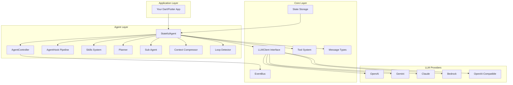
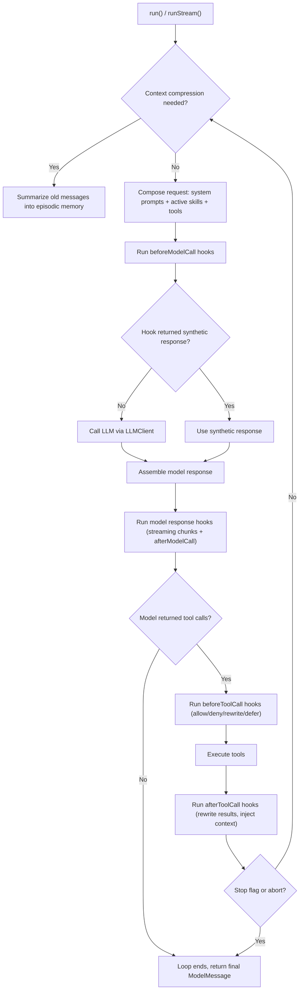
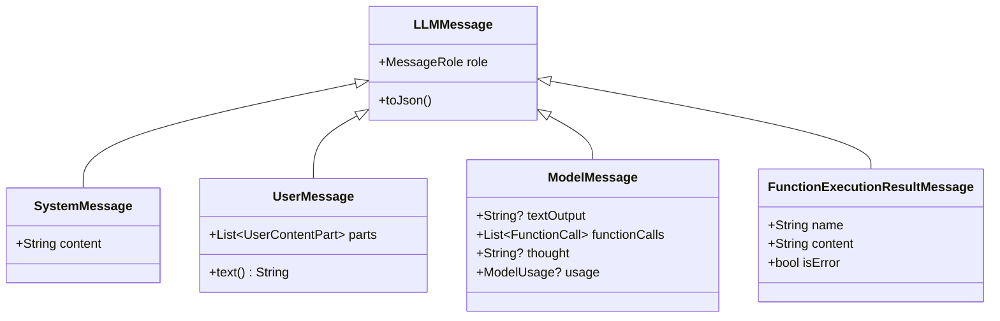

`dart_agent_core` is a mobile-first, local-first Dart library for building stateful, tool-using AI agents with multi-provider LLM support. It provides a complete agentic framework — from connecting to OpenAI, Gemini, and Claude, to managing conversation state, executing tools, and evaluating agent performance — all in pure Dart with cross-platform compatibility.

## What Is `dart_agent_core`?

At its core, `dart_agent_core` implements the **think-act-observe** agentic loop pattern: an AI model receives a user request, reasons about it, optionally calls external tools, observes the results, and continues until the task is complete. The library handles all the plumbing — LLM API calls, JSON schema tool definitions, conversation state persistence, streaming events, and even evaluation frameworks for measuring agent quality.

The library is designed for **mobile-first** use cases where local execution matters. Unlike cloud-hosted agent platforms, `dart_agent_core` runs entirely on the client device, keeping data private and reducing latency. It supports all six Dart/Flutter platforms: Android, iOS, Web, Windows, macOS, and Linux, including WebAssembly (WASM) compatibility.

Sources: [README.md](README.md#L1-L50), [pubspec.yaml](pubspec.yaml#L1-L10)

## Core Capabilities at a Glance

The following table summarizes the major feature categories and what each provides:

| Category | Capability | Key Classes |
|----------|-----------|-------------|
| **LLM Providers** | Unified interface for OpenAI, Gemini, Claude, Bedrock, and OpenAI-compatible APIs | `LLMClient`, `OpenAIClient`, `GeminiClient`, `ClaudeClient`, `BedrockClaudeClient`, `ResponsesClient` |
| **Tool System** | Wrap any Dart function as a tool with JSON Schema parameters; function mode or object mode | `Tool`, `ToolParameterMode`, `AgentToolResult` |
| **Message Types** | Text, images, audio, video, and document content parts for multimodal input/output | `UserMessage`, `ModelMessage`, `TextPart`, `ImagePart` |
| **State Management** | Conversation history, token usage, metadata, and disk persistence as JSON | `AgentState`, `FileStateStorage`, `StateStorage` |
| **Skills** | Modular capabilities with own system prompts and tools, toggleable at runtime | `Skill`, `DirectorySkill`, `activate_skills`, `deactivate_skills` |
| **Planning** | Step-by-step task list injection via `write_todos` tool | `PlanMode`, `Planner`, `PlanState`, `PlanStep` |
| **Sub-Agents** | Delegate tasks to worker agents with isolated context | `SubAgent`, `delegate_task` |
| **Context Compression** | Summarize old messages into episodic memory when token limits approach | `LLMBasedContextCompressor`, `ContextCompressor` |
| **Loop Detection** | Catch repeated identical tool calls and diagnose subtler loops via LLM | `DefaultLoopDetector`, `LoopDetector` |
| **Streaming** | Real-time token chunks, tool call events, and retry notifications for Flutter UIs | `StreamingEvent`, `StreamingEventType` |
| **Agent Hooks** | Rewrite inputs, transform outputs, deny/defer tool calls, inject context, abort runs | `AgentHook`, `BeforeRunHookContext`, `ModelCallHookContext` |
| **Observability** | Lifecycle events for tracing, metrics, and diagnostics | `AgentController`, `EventBus`, event classes |
| **Evaluation** | Tasks, suites, trials, graders, transcripts, pass@k metrics, and reports | Eval subsystem (`lib/src/eval/`) |

Sources: [lib/dart_agent_core.dart](lib/dart_agent_core.dart#L1-L32), [README.md](README.md#L28-L65)

## High-Level Architecture

The library is organized into three architectural layers. The **Core Layer** provides foundational abstractions (messages, tools, LLM client interface). The **Agent Layer** implements the autonomous loop with state, skills, planning, hooks, and streaming. The **Eval Layer** offers a complete evaluation framework for measuring agent performance.



Sources: [lib/src/agent/stateful_agent.dart](lib/src/agent/stateful_agent.dart#L1-L32), [lib/src/core/llm_client.dart](lib/src/core/llm_client.dart#L1-L30)

## The Agent Loop Lifecycle

The central mechanism is the agentic loop inside `StatefulAgent`. Every call to `run()` or `runStream()` enters a **think-act-observe** cycle that repeats until a stop condition is met. Understanding this loop is essential to using the library effectively.



The loop exits when any of these conditions occur: the model returns no tool calls, a tool sets `stopFlag = true`, a hook returns stop/abort, a loop is detected, or an exception occurs. This design gives you fine-grained control over agent behavior at every stage.

Sources: [doc/architecture.md](doc/architecture.md#L1-L40)

## Project Structure

The repository follows a clean separation between core abstractions, agent logic, LLM provider implementations, and evaluation tools:

```
dart_agent_core/
├── lib/
│   ├── dart_agent_core.dart          # Public API exports
│   ├── eval.dart                     # Eval subsystem exports
│   └── src/
│       ├── core/                     # Foundational abstractions
│       │   ├── message.dart          # LLMMessage, UserMessage, ModelMessage
│       │   ├── tool.dart             # Tool, ToolParameterMode
│       │   ├── llm_client.dart       # LLMClient abstract class, ModelConfig
│       │   └── event_bus.dart        # EventBus, Event base class
│       ├── agent/                    # Agent loop and features
│       │   ├── stateful_agent.dart   # Main agent loop implementation
│       │   ├── agent_hook.dart       # AgentHook pipeline (part of stateful_agent)
│       │   ├── skill.dart            # Skill abstraction + directory skills
│       │   ├── planner.dart          # PlanMode, Planner, PlanState
│       │   ├── sub_agent.dart        # SubAgent delegation
│       │   ├── context_compressor.dart # LLM-based context compression
│       │   ├── loop_detector.dart    # DefaultLoopDetector
│       │   ├── controller.dart       # AgentController
│       │   ├── events.dart           # Lifecycle event classes
│       │   └── state_storage.dart    # StateStorage interface
│       ├── llm/                      # LLM provider clients
│       │   ├── openai_client.dart    # OpenAI Chat Completions
│       │   ├── responses_client.dart # OpenAI Responses API
│       │   ├── gemini_client.dart    # Google Gemini
│       │   ├── claude_client.dart    # Anthropic Claude (direct)
│       │   └── bedrock_claude_client.dart # AWS Bedrock (Claude)
│       └── eval/                     # Evaluation framework
│           ├── core/                 # Tasks, suites, trials, transcripts
│           ├── graders/              # Code, model, and human graders
│           ├── llm/                  # Recording, replay, rate limiting
│           └── metrics/              # pass@k, pass^k calculations
├── example/                          # Usage examples for every feature
├── test/                             # Unit and integration tests
└── doc/                              # Architecture and feature documentation
```

Sources: [lib/dart_agent_core.dart](lib/dart_agent_core.dart#L1-L32), [get_dir_structure output](lib/src)

## Message Flow and Data Types

All communication with LLMs uses a unified message hierarchy. The `LLMMessage` abstract class has four roles: `system`, `user`, `assistant` (model), and `tool`. Messages support multimodal content through typed parts — text, images, audio, video, and documents.



When the model requests a tool call, the agent executes the corresponding function, wraps the result in a `FunctionExecutionResultMessage`, appends it to the conversation history, and sends the updated history back to the model. This cycle continues until the model produces a final text response with no tool calls.

Sources: [lib/src/core/message.dart](lib/src/core/message.dart#L1-L80)

## Tool System

Tools are the bridge between the AI model and your Dart code. Each `Tool` wraps a Dart function (sync or async) with a JSON Schema description that tells the model when and how to call it. The library supports two parameter modes:

| Mode | How It Works | Use When |
|------|-------------|----------|
| **Function Mode** (default) | Uses `Function.apply` to map JSON arguments to positional and named Dart parameters | You want type-safe parameter binding |
| **Object Mode** | Passes the entire arguments map as a single `Map<String, dynamic>` | You prefer dynamic parameter handling or have complex nested structures |

Tools can return plain strings or `AgentToolResult` objects that include a `stopFlag` to signal the agent loop should terminate, and `stateUpdates` to modify agent state after execution. This gives tools direct control over the agent's behavior.

Sources: [lib/src/core/tool.dart](lib/src/core/tool.dart#L1-L43), [example/simple_agent_example.dart](example/simple_agent_example.dart#L1-L56)

## Cross-Platform Design

`dart_agent_core` is built to run on all Dart/Flutter platforms with zero platform-specific code in the public API. Platform-specific implementations (file I/O, HTTP adapters, JavaScript runtimes) are isolated behind conditional exports:

| Platform | File Storage | HTTP Client | JavaScript Runtime |
|----------|-------------|-------------|-------------------|
| **Android, iOS, macOS, Linux, Windows** | `FileStateStorage` (dart:io) | `Dio` with native adapters | Node.js or dart:io process |
| **Web** | In-memory or localStorage-backed | `Dio` with browser adapters | `dart:js_interop` or stub |

On web platforms, `dart:io` is unavailable, so `Platform.environment` cannot be used to read API keys. Instead, use `package:web` to access `localStorage` or inject configuration at build time.

Sources: [README.md](README.md#L100-L130), [lib/src/agent/file_state_storage_io.dart](lib/src/agent/file_state_storage_io.dart), [lib/src/agent/file_state_storage_web.dart](lib/src/agent/file_state_storage_web.dart)

## Provider Abstraction

All LLM providers implement the same `LLMClient` abstract class, which exposes two methods: `generate()` for synchronous responses and `stream()` for streaming. This means you can swap providers without changing any agent code — just instantiate a different client.

| Provider | Class | Authentication | Notes |
|----------|-------|---------------|-------|
| **OpenAI Chat Completions** | `OpenAIClient` | API key | Standard chat API with function calling |
| **OpenAI Responses API** | `ResponsesClient` | API key | Stateful API with `previous_response_id` chaining |
| **Google Gemini** | `GeminiClient` | API key | Native multimodal support |
| **Anthropic Claude** | `ClaudeClient` | API key | Direct Anthropic Messages API |
| **AWS Bedrock (Claude)** | `BedrockClaudeClient` | AWS SigV4 credentials | Claude via AWS infrastructure |
| **OpenAI-Compatible** | Any of the above with custom `baseUrl` | Varies | Works with Kimi, Qwen, GLM, Ollama, OpenRouter |

All clients support configurable retry logic, timeouts, and HTTP proxies via the `proxyUrl` parameter.

Sources: [lib/src/core/llm_client.dart](lib/src/core/llm_client.dart#L1-L136), [lib/src/llm/openai_client.dart](lib/src/llm/openai_client.dart#L1-L50)

## Evaluation Framework

Beyond building agents, `dart_agent_core` includes a complete evaluation subsystem for measuring agent quality. The eval framework supports task definitions, grading (code, model, or human), transcript recording, replay for deterministic testing, and statistical metrics like pass@k and pass^k.

This is particularly valuable for teams iterating on agent behavior — you can run evaluation suites, compare results across runs, identify regressions, and track improvement over time. The framework also integrates with observability tools like Langfuse for trace export.

Sources: [lib/eval.dart](lib/eval.dart), [lib/src/eval/](lib/src/eval/)

## Reading Progression

To get started with `dart_agent_core`, follow this recommended reading order:

1. **[Overview](1-overview)** — You are here. Understand what the library provides and how it's organized.
2. **[Quick Start](2-quick-start)** — Build your first agent in under 50 lines of code.
3. **[Installation and Platform Support](3-installation-and-platform-support)** — Set up the dependency and understand platform-specific considerations.
4. **[Running the Examples](4-running-the-examples)** — Explore the extensive example directory with working code for every feature.
5. **[Common Development Commands](5-common-development-commands)** — Learn the build, test, and analysis commands used in the project.

Once you have the basics down, dive into the **Deep Dive** section to understand the [Architecture and Agent Loop Lifecycle](6-architecture-and-the-agent-loop-lifecycle) in detail, then explore LLM providers, the tool system, agent features, and the evaluation subsystem.