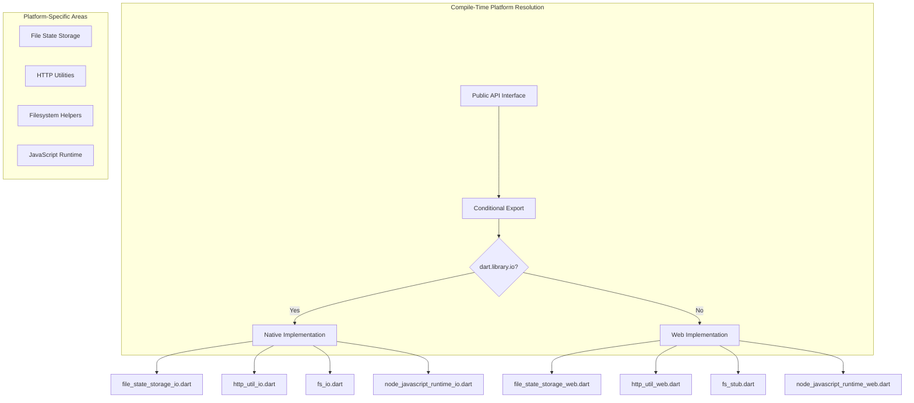

This page guides you through adding `dart_agent_core` to your Dart or Flutter project and understanding which platforms are supported. Whether you're building for mobile, desktop, or web, this library works across all six Dart/Flutter platforms with automatic platform detection at compile time.

## Installation

Adding `dart_agent_core` to your project is straightforward. The library is published on [pub.dev](https://pub.dev/packages/dart_agent_core) and can be added as a dependency in your `pubspec.yaml` file.

### Step 1: Add the Dependency

Open your project's `pubspec.yaml` file and add the following under the `dependencies` section:

```yaml
dependencies:
  dart_agent_core: ^2.0.4
```

### Step 2: Get Dependencies

Run the following command in your terminal to fetch the package:

```bash
dart pub get
# or if you're using Flutter:
flutter pub get
```

### Step 3: Import the Library

In your Dart file, import the library:

```dart
import 'package:dart_agent_core/dart_agent_core.dart';
```

This single import gives you access to all core functionality: `StatefulAgent`, `OpenAIClient`, `GeminiClient`, `ClaudeClient`, `BedrockClaudeClient`, `Tool`, `AgentState`, and more.

Sources: [pubspec.yaml](pubspec.yaml#L1-L33), [simple_agent_example.dart](example/simple_agent_example.dart#L1-L56)

## Platform Support Overview

`dart_agent_core` is designed as a **mobile-first, local-first** library that runs natively on all six Dart/Flutter platforms. The library uses Dart's conditional export mechanism to automatically select platform-appropriate implementations at compile time.

### Supported Platforms Matrix

| Platform | Dart/Flutter | State Storage | HTTP Proxy | JavaScript Runtime | WASM Compatible |
|----------|--------------|---------------|------------|-------------------|-----------------|
| **Android** | ✅ | ✅ Filesystem | ✅ Full support | ✅ Node.js | ✅ |
| **iOS** | ✅ | ✅ Filesystem | ✅ Full support | ✅ Node.js | ✅ |
| **macOS** | ✅ | ✅ Filesystem | ✅ Full support | ✅ Node.js | ✅ |
| **Windows** | ✅ | ✅ Filesystem | ✅ Full support | ✅ Node.js | ✅ |
| **Linux** | ✅ | ✅ Filesystem | ✅ Full support | ✅ Node.js | ✅ |
| **Web** | ✅ | ⚠️ In-memory | ❌ Browser-controlled | ❌ Custom needed | ✅ |

**Key Takeaway**: On native platforms (Android, iOS, macOS, Windows, Linux), you get full functionality including filesystem-based state persistence, HTTP proxy support, and JavaScript runtime. On web, you need to handle API keys differently and provide custom state storage for persistence.

Sources: [README.md](README.md#L104-L120), [CHANGELOG.md](CHANGELOG.md#L83-L95)

## Platform-Specific Setup

The library handles platform differences automatically through conditional exports. Here's what you need to know for each platform type.

### Native Platforms (Android, iOS, macOS, Windows, Linux)

For native platforms, setup is minimal. The library automatically uses filesystem-based state storage and supports all features.

#### API Key Configuration

Use `dart:io` to access environment variables:

```dart
import 'dart:io';

void main() async {
  final apiKey = Platform.environment['OPENAI_API_KEY'] ?? '';
  final client = OpenAIClient(apiKey: apiKey);
  // ... rest of your agent setup
}
```

#### State Storage

On native platforms, `FileStateStorage` automatically persists state to JSON files on disk:

```dart
final agent = StatefulAgent(
  name: 'my_agent',
  client: client,
  modelConfig: modelConfig,
  state: AgentState.empty(),
  stateStorage: FileStateStorage('/path/to/state/directory'),
  // ... other configuration
);
```

The state directory should be writable by your application. On mobile platforms, consider using the app's documents directory.

Sources: [simple_agent_example.dart](example/simple_agent_example.dart#L1-L56), [file_state_storage_io.dart](lib/src/agent/file_state_storage_io.dart#L14-L84)

### Web Platform Setup

Web platform requires special considerations due to the absence of `dart:io` and filesystem access.

#### Step 1: Add Web Package

Add the `web` package for WASM-safe browser APIs:

```yaml
dependencies:
  dart_agent_core: ^2.0.4
  web: ^1.0.0
```

**Important**: Avoid the legacy `dart:html` package, which is not WASM-compatible.

#### Step 2: Configure API Keys

Use `package:web` for WASM-safe browser API access:

```dart
import 'package:web/web.dart' as web;
import 'package:dart_agent_core/dart_agent_core.dart';

void main() async {
  // Persist the key once from your app (e.g., a settings screen):
  // web.window.localStorage.setItem('OPENAI_API_KEY', '<key>');
  
  final apiKey = web.window.localStorage.getItem('OPENAI_API_KEY') ?? '';
  final client = OpenAIClient(apiKey: apiKey);
  // ... same StatefulAgent setup as Quick Start
}
```

#### Step 3: State Storage for Web

On web, `FileStateStorage` operates as an in-memory store. For durable persistence, implement your own `StateStorage` using `localStorage` or `IndexedDB`:

```dart
// In-memory storage (default web behavior)
final agent = StatefulAgent(
  stateStorage: FileStateStorage('session_data'),
  // ... other configuration
);

// For durable web storage, implement StateStorage interface
```

#### Step 4: JavaScript Runtime for Web

The default `NodeJavaScriptRuntime` doesn't work on web. If you need JavaScript execution, use a custom implementation like `flutter_js`:

```yaml
dependencies:
  flutter_js: ^0.8.7
```

Sources: [README.md](README.md#L113-L125), [file_state_storage_web.dart](lib/src/agent/file_state_storage_web.dart#L14-L66)

## How Cross-Platform Support Works

The library uses Dart's conditional export mechanism to resolve platform-specific implementations at compile time. This means the same `dart_agent_core` package automatically selects the correct implementation based on your target platform.



### Platform-Specific Files Overview

| Area | Native File | Web File | Purpose |
|------|------------|----------|---------|
| **State Storage** | `file_state_storage_io.dart` | `file_state_storage_web.dart` | Persist agent session state |
| **HTTP** | `http_util_io.dart` | `http_util_web.dart` | Configure HTTP proxies |
| **Filesystem** | `fs_io.dart` | `fs_stub.dart` | File/directory operations |
| **JavaScript** | `node_javascript_runtime_io.dart` | `node_javascript_runtime_web.dart` | Execute JavaScript scripts |

Sources: [file_state_storage.dart](lib/src/agent/file_state_storage.dart#L1-L11), [http_util.dart](lib/src/core/http_util.dart#L1-L8), [fs.dart](lib/src/core/fs.dart#L1-L13)

## SDK Requirements

The library requires Dart SDK version 3.9.2 or higher. This ensures compatibility with modern Dart features and Flutter 3.35+.

### Checking Your Dart Version

```bash
dart --version
```

If you need to upgrade Dart or Flutter:

```bash
# For Flutter users
flutter upgrade

# For Dart-only users
dart pub upgrade
```

Sources: [pubspec.yaml](pubspec.yaml#L17-L18)

## Common Installation Issues

| Issue | Solution |
|-------|----------|
| **Dependency resolution fails** | Run `dart pub cache repair` then `dart pub get` again |
| **Platform not supported error** | Ensure you're using Dart 3.9.2+ and have the correct platform SDK installed |
| **Web build fails with dart:io error** | Import only `package:dart_agent_core/dart_agent_core.dart` (not internal files) |
| **State not persisting on web** | Implement custom `StateStorage` using `localStorage` or `IndexedDB` |
| **JavaScript runtime not working on web** | Use `flutter_js` or similar WASM-compatible runtime |
| **HTTP proxy not working on web** | Proxies are browser-controlled on web; configure at browser/OS level |

## Next Steps

Now that you have `dart_agent_core` installed, you can:

1. **Run the examples** to see the library in action: [Running the Examples](4-running-the-examples)
2. **Learn common development commands** for working with the library: [Common Development Commands](5-common-development-commands)
3. **Explore the architecture** to understand how the agent loop works: [Architecture and the Agent Loop Lifecycle](6-architecture-and-the-agent-loop-lifecycle)

If you're building a Flutter app, check out the [Streaming Events for Flutter UIs](20-streaming-events-for-flutter-uis) page for real-time UI integration patterns.