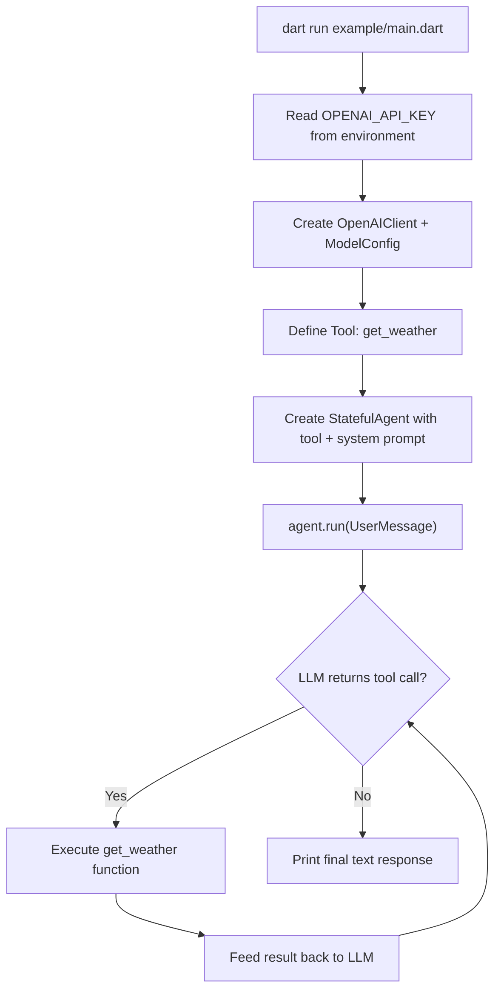
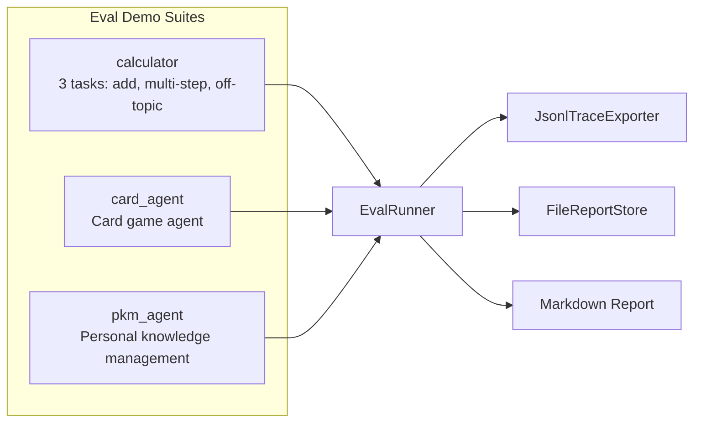

This guide walks you through running the pre-built examples included in `dart_agent_core`. Each example demonstrates a specific capability — from basic tool use to advanced evaluation suites — so you can learn the framework incrementally by running working code.

## Prerequisites

Before running any example, ensure you have:

1. **Dart SDK 3.9.2 or later** installed (`dart --version`)
2. **Dependencies resolved** via `dart pub get` in the project root
3. **An API key** for at least one LLM provider, exported as an environment variable

The examples read API keys from environment variables using `Platform.environment`. If no key is set, the example prints `YOUR_API_KEY` and the LLM call will fail with an authentication error.

| Provider | Environment Variable | Example File |
|---|---|---|
| OpenAI | `OPENAI_API_KEY` | `example/simple_agent_with_openai_example.dart` |
| Claude (Anthropic) | `ANTHROPIC_API_KEY` | `example/simple_agent_with_claude_example.dart` |
| Gemini (Google) | `GEMINI_API_KEY` | `example/simple_agent_with_gemini_example.dart` |
| AWS Bedrock | `AWS_ACCESS_KEY_ID` + `AWS_SECRET_ACCESS_KEY` | `example/simple_agent_with_bedrock_claude_example.dart` |
| Kimi (Moonshot) | `MOONSHOT_API_KEY` | `example/simple_agent_with_kimi_example.dart` |
| Qwen (DashScope) | `DASHSCOPE_API_KEY` | `example/simple_agent_with_qwen_example.dart` |
| GLM (Zhipu) | `GLM_API_KEY` | `example/simple_agent_with_glm_example.dart` |
| MiniMax | `MINIMAX_API_KEY` | `example/simple_agent_with_minimax_example.dart` |
| OpenRouter | `OPENROUTER_API_KEY` | `example/simple_agent_with_openrouter_example.dart` |
| Ollama (local) | *(none required)* | `example/simple_agent_with_ollama_example.dart` |

Sources: [simple_agent_example.dart](example/simple_agent_example.dart#L10-L11), [simple_agent_with_claude_example.dart](example/simple_agent_with_claude_example.dart#L12-L13), [simple_agent_with_gemini_example.dart](example/simple_agent_with_gemini_example.dart#L10-L11)

## Running a Basic Example

The simplest example is the default weather agent. It defines a `get_weather` tool, creates a `StatefulAgent` backed by OpenAI, and sends a single user message.

```bash
export OPENAI_API_KEY='sk-...'
dart run example/main.dart
```

The expected output is the agent's text response after calling the weather tool for both Seattle and Tokyo.

Sources: [example/main.dart](example/main.dart#L1-L56)

### What Happens Under the Hood



Sources: [example/main.dart](example/main.dart#L14-L55)

## Provider-Specific Examples

Each LLM provider has a dedicated example file. The pattern is identical across all providers — only the client class and API key variable change.

### Quick Reference Table

| Provider | Client Class | Base URL Override | Model Example |
|---|---|---|---|
| OpenAI | `OpenAIClient` | *(default)* | `gpt-4o-mini` |
| OpenAI (Responses API) | `ResponsesClient` | *(default)* | *(any OpenAI model)* |
| Claude | `ClaudeClient` | *(default)* | `claude-sonnet-4-20250514` |
| Gemini | `GeminiClient` | *(default)* | `gemini-2.5-pro` |
| AWS Bedrock | `BedrockClaudeClient` | *(uses region)* | `us.anthropic.claude-opus-4-6-v1` |
| Kimi | `OpenAIClient` | `https://api.moonshot.cn/v1` | `kimi-k2.5` |
| Qwen | `OpenAIClient` | `https://dashscope.aliyuncs.com/compatible-mode/v1` | `qwen3.5-plus` |
| GLM | `OpenAIClient` | `https://open.bigmodel.cn/api/coding/paas/v4` | `GLM-4.7` |
| MiniMax | `ClaudeClient` | `https://api.minimaxi.com/anthropic` | `MiniMax-M2.5` |
| OpenRouter | `OpenAIClient` | `https://openrouter.ai/api/v1` | `anthropic/claude-opus-4.6` |
| Ollama | `OpenAIClient` | `http://localhost:11434/v1` | `qwen2.5:7b` |
| Volcengine Seed | `ResponsesClient` | `https://ark.cn-beijing.volces.com/api/v3` | `doubao-seed-1-8-251228` |

Sources: [simple_agent_with_openai_example.dart](example/simple_agent_with_openai_example.dart#L14-L15), [simple_agent_with_claude_example.dart](example/simple_agent_with_claude_example.dart#L12-L14), [simple_agent_with_gemini_example.dart](example/simple_agent_with_gemini_example.dart#L12-L14), [simple_agent_with_kimi_example.dart](example/simple_agent_with_kimi_example.dart#L14-L17), [simple_agent_with_ollama_example.dart](example/simple_agent_with_ollama_example.dart#L14-L18), [simple_agent_with_bedrock_claude_example.dart](example/simple_agent_with_bedrock_claude_example.dart#L14-L20)

### Running Provider Examples

```bash
# OpenAI
export OPENAI_API_KEY='sk-...'
dart run example/simple_agent_with_openai_example.dart

# Claude (Anthropic direct)
export ANTHROPIC_API_KEY='sk-ant-...'
dart run example/simple_agent_with_claude_example.dart

# Gemini
export GEMINI_API_KEY='...'
dart run example/simple_agent_with_gemini_example.dart

# AWS Bedrock (Claude via AWS)
export AWS_ACCESS_KEY_ID='AKIA...'
export AWS_SECRET_ACCESS_KEY='...'
dart run example/simple_agent_with_bedrock_claude_example.dart

# Kimi (Moonshot AI)
export MOONSHOT_API_KEY='...'
dart run example/simple_agent_with_kimi_example.dart

# Qwen (Alibaba DashScope)
export DASHSCOPE_API_KEY='...'
dart run example/simple_agent_with_qwen_example.dart

# GLM (Zhipu AI)
export GLM_API_KEY='...'
dart run example/simple_agent_with_glm_example.dart

# MiniMax
export MINIMAX_API_KEY='...'
dart run example/simple_agent_with_minimax_example.dart

# OpenRouter (access any model)
export OPENROUTER_API_KEY='...'
dart run example/simple_agent_with_openrouter_example.dart

# Volcengine Doubao Seed
export ARK_API_KEY='...'
dart run example/simple_agent_with_seed_example.dart
```

For **Ollama**, no API key is needed. Start Ollama locally first, pull a model, then run:

```bash
ollama pull qwen2.5:7b
dart run example/simple_agent_with_ollama_example.dart
```

Sources: [simple_agent_with_ollama_example.dart](example/simple_agent_with_ollama_example.dart#L14-L18), [simple_agent_with_seed_example.dart](example/simple_agent_with_seed_example.dart#L14-L17)

## Feature Examples

Beyond provider demos, the `example/` directory includes files that showcase individual framework capabilities. Each can be run independently.

### Feature Examples at a Glance

| Feature | Example File | What It Demonstrates |
|---|---|---|
| Streaming | `simple_agent_stream_example.dart` | Real-time token-by-token output via `runStream()` |
| Agent Hooks | `simple_agent_with_hooks_example.dart` | Intercepting, rewriting, and blocking tool calls |
| Agent Controller | `simple_agent_with_controller_example.dart` | Observing lifecycle events (start, tool call, completion) |
| State Persistence | `simple_agent_with_state_example.dart` | `FileStateStorage` for durable sessions across runs |
| Skills (Pure Dart) | `simple_agent_with_skills_example.dart` | Dynamic skill activation/deactivation by the agent |
| Skills (File-system) | `simple_agent_with_directory_skills_example.dart` | `SKILL.md` files + JavaScript execution + bridge channels |
| Planning | `simple_agent_with_plan_example.dart` | `PlanMode.must` for step-by-step task decomposition |
| Sub-Agents | `simple_agent_with_sub_agent_example.dart` | Delegating research tasks to a specialized worker agent |
| Extended Thinking | `simple_agent_with_thinking_example.dart` | `thought` field in model output via Bedrock Claude |
| Eval (Minimal) | `min_eval/main.dart` | Smallest working eval: one task, one grader, one suite |
| Eval (Full Demo) | `eval_demo/main.dart` | Multi-suite eval with calculator, card, and PKM agents |

Sources: [simple_agent_stream_example.dart](example/simple_agent_stream_example.dart#L1-L59), [simple_agent_with_hooks_example.dart](example/simple_agent_with_hooks_example.dart#L1-L213), [simple_agent_with_controller_example.dart](example/simple_agent_with_controller_example.dart#L1-L106), [simple_agent_with_state_example.dart](example/simple_agent_with_state_example.dart#L1-L86), [simple_agent_with_skills_example.dart](example/simple_agent_with_skills_example.dart#L1-L128), [simple_agent_with_directory_skills_example.dart](example/simple_agent_with_directory_skills_example.dart#L1-L172), [simple_agent_with_plan_example.dart](example/simple_agent_with_plan_example.dart#L1-L49), [simple_agent_with_sub_agent_example.dart](example/simple_agent_with_sub_agent_example.dart#L1-L99)

### Running Feature Examples

```bash
# Streaming (uses Gemini by default)
export GEMINI_API_KEY='...'
dart run example/simple_agent_stream_example.dart

# Hooks (uses a scripted client — no API key needed)
dart run example/simple_agent_with_hooks_example.dart

# Controller (uses OpenAI)
export OPENAI_API_KEY='sk-...'
dart run example/simple_agent_with_controller_example.dart

# State persistence (uses OpenAI + FileStateStorage)
export OPENAI_API_KEY='sk-...'
dart run example/simple_agent_with_state_example.dart

# Skills (uses OpenAI)
export OPENAI_API_KEY='sk-...'
dart run example/simple_agent_with_skills_example.dart

# Planning (uses OpenAI)
export OPENAI_API_KEY='sk-...'
dart run example/simple_agent_with_plan_example.dart

# Sub-agents (uses OpenAI)
export OPENAI_API_KEY='sk-...'
dart run example/simple_agent_with_sub_agent_example.dart

# Extended thinking (uses AWS Bedrock)
export AWS_ACCESS_KEY_ID='AKIA...'
export AWS_SECRET_ACCESS_KEY='...'
dart run example/simple_agent_with_thinking_example.dart
```

Note that the **hooks example** uses a `_ScriptedClient` that returns pre-defined LLM responses, so it runs without any real API key. This makes it ideal for testing agent logic in isolation.

Sources: [simple_agent_with_hooks_example.dart](example/simple_agent_with_hooks_example.dart#L137-L170)

## Evaluation Examples

The evaluation subsystem has two examples of increasing complexity. Both demonstrate how to write automated tests for agent behavior using tasks, graders, and suites.

### Minimal Eval

The smallest working eval defines a single "echo" task: the agent must echo the user's text back through a tool, and a `CodeGrader` verifies the output matches.

```bash
export OPENAI_API_KEY='sk-...'
dart run example/min_eval/main.dart
```

Sources: [min_eval/main.dart](example/min_eval/main.dart#L1-L194)

### Full Eval Demo

The full eval demo includes three agent scenarios with distinct task suites:



Run a specific suite or all suites at once:

```bash
export OPENAI_BASE_URL='https://...'
export OPENAI_API_KEY='sk-...'

# Calculator suite only
dart run example/eval_demo/main.dart --suite calculator

# Card agent suite
dart run example/eval_demo/main.dart --suite card_agent

# PKM agent suite
dart run example/eval_demo/main.dart --suite pkm_agent

# All suites
dart run example/eval_demo/main.dart --suite all

# With concurrency and model override
dart run example/eval_demo/main.dart \
  --suite all \
  --concurrency 4 \
  --mode live
```

Sources: [eval_demo/main.dart](example/eval_demo/main.dart#L1-L200), [eval_demo/README.md](example/eval_demo/README.md#L1-L78)

### Eval Demo Output

After running, the demo produces:

| Output | Location | Description |
|---|---|---|
| Markdown summary | `.eval_reports/<run_name>.md` | Human-readable task pass rates and scores |
| Full JSON report | `.eval_reports/reports/<run_name>.json` | Machine-readable trial data with all graders |
| Run index | `.eval_reports/index.jsonl` | Append-only log of all runs |
| JSONL traces | `.eval_traces/<run_name>.jsonl` | One event per line for debugging |

The exit code reflects the task pass rate: **0** if all tasks passed, **1** otherwise.

Sources: [eval_demo/README.md](example/eval_demo/README.md#L46-L65)

### Eval Modes

The eval runner supports three modes for recording and replaying LLM interactions:

| Mode | Flag | Behavior |
|---|---|---|
| Live | `--mode live` | Calls the real LLM, no recording |
| Record | `--mode record` | Calls the real LLM and saves recordings to `--recording-dir` |
| Replay | `--mode replay` | Reads recordings only, raises an error on a cache miss |

Replay mode is useful for deterministic testing without spending API credits. Use `record` once to capture interactions, then `replay` for fast iteration.

Sources: [eval_demo/README.md](example/eval_demo/README.md#L67-L72), [eval_demo/main.dart](example/eval_demo/main.dart#L62-L73)

## Troubleshooting

| Problem | Likely Cause | Fix |
|---|---|---|
| `YOUR_API_KEY` printed in output | Environment variable not set | `export OPENAI_API_KEY='sk-...'` before running |
| `SocketException` or connection timeout | Network issue or wrong base URL | Check `baseUrl` and your network/firewall |
| `401 Unauthorized` | Invalid or expired API key | Regenerate the key in your provider's dashboard |
| `429 Too Many Requests` | Rate limit hit | Add `--rpm 60` flag for eval runs, or wait and retry |
| `404 Not Found` for model name | Model not available in your region/account | Verify the model string matches your provider's catalog |
| Ollama: `Connection refused` | Ollama not running locally | Start Ollama with `ollama serve` and pull a model first |
| Web platform: `Platform.environment` error | `dart:io` not available on web | Use `package:web` to read keys from `localStorage` instead |
| Eval exit code is 1 | At least one task failed | Check `.eval_reports/<run_name>.md` for details |

Sources: [example/main.dart](example/main.dart#L10-L11), [eval_demo/README.md](example/eval_demo/README.md#L74-L78)

## Suggested Learning Path

Start with the basics and progressively explore advanced features:

1. **[Overview](1-overview)** — Understand what `dart_agent_core` provides
2. **[Quick Start](2-quick-start)** — Build your first agent from scratch
3. **Run `example/main.dart`** — See a working agent with tool use
4. **Run a provider-specific example** — Try the provider you plan to use
5. **Run `simple_agent_with_hooks_example.dart`** — Explore the hook pipeline (no API key needed)
6. **Run `simple_agent_with_state_example.dart`** — Learn state persistence
7. **Run `simple_agent_stream_example.dart`** — See real-time streaming output
8. **Run `min_eval/main.dart`** — Write your first automated eval
9. **Run `eval_demo/main.dart`** — Explore multi-suite evaluation
10. **[Architecture and the Agent Loop Lifecycle](6-architecture-and-the-agent-loop-lifecycle)** — Deep dive into how the loop works internally