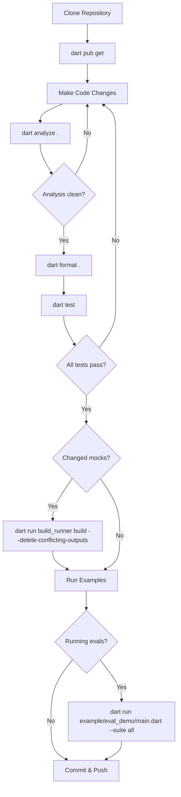

This page catalogs the essential CLI commands for working with the `dart_agent_core` codebase. Whether you are installing dependencies, running tests, executing example agents, or inspecting evaluation transcripts, the commands below cover the full development lifecycle. Each section groups related operations and links to the source files that define or exercise them.

## Prerequisites and Environment Setup

Before running any command, ensure you have a recent Dart SDK (≥3.9.2) installed. The project targets Dart 3.9.2+ as specified in [pubspec.yaml](pubspec.yaml#L10). No Python, Node.js, or other runtimes are required—everything is pure Dart.

```bash
# Verify your Dart SDK version
dart --version
```

All subsequent commands assume your terminal working directory is the repository root (`dart_agent_core/`).

Sources: [pubspec.yaml](pubspec.yaml#L10-L11)

## Installing Dependencies

The very first step after cloning the repository is to fetch all declared dependencies.

```bash
dart pub get
```

This reads [pubspec.yaml](pubspec.yaml) and downloads packages into `.dart_tool/`. The lock file (`pubspec.lock`) is git-ignored because this is a library package, not an application—consumers will resolve their own compatible versions.

If you modify mocked classes (in `test/`), you must also regenerate the mockito generated files:

```bash
dart run build_runner build --delete-conflicting-outputs
```

This regenerates any `*.mocks.dart` files that mockito produces. The `--delete-conflicting-outputs` flag prevents stale generated files from causing build errors.

Sources: [AGENTS.md](AGENTS.md#L22-L33), [pubspec.yaml](pubspec.yaml#L1-L33)

## Static Analysis and Formatting

The project uses `package:lints/recommended.yaml` for static analysis, with a few disabled rules for readability (e.g. `constant_identifier_names`, `annotate_overrides`). The configuration lives in [analysis_options.yaml](analysis_options.yaml).

```bash
# Run static analysis across the entire package
dart analyze .

# Auto-format all Dart files to match the project style
dart format .
```

**Important**: `pana` (the pub.dev scoring tool) will reject unformatted code. Always run `dart format .` before committing. You can check the full pub score locally with:

```bash
pana --no-warning .
```

This reports the same metrics that pub.dev displays, including platform-tag correctness and lint compliance.

Sources: [analysis_options.yaml](analysis_options.yaml#L1-L27), [AGENTS.md](AGENTS.md#L29)

## Running Tests

The project uses the standard `dart test` runner. Tests are organized under `test/` with subdirectories mirroring the library structure.

### All Tests

```bash
dart test
```

This discovers and runs every `*_test.dart` file in the `test/` directory.

### Single Test File

```bash
dart test test/planner_test.dart
```

Run only the planner tests, or substitute any other test file path.

### Pattern-Matched Tests

```bash
dart test -n "loop"
```

The `-n` flag filters tests by name substring. This runs all tests whose name contains "loop", matching tests in `test/loop_detector_test.dart` and any others with "loop" in their description.

### Test Directory Structure

The test suite covers the major subsystems:

| Test File | Area Covered |
|---|---|
| `agent_hooks_test.dart` | Agent hook pipeline phases |
| `claude_client_test.dart` | Anthropic Claude client |
| `gemini_client_test.dart` | Google Gemini client |
| `loop_detector_test.dart` | Loop detection logic |
| `planner_test.dart` | PlanMode / write_todos |
| `core/event_bus_test.dart` | EventBus pub/sub |
| `eval/*.dart` (13 files) | Full eval subsystem |

Sources: [AGENTS.md](AGENTS.md#L24-L28), [test/](test/)

## Running Examples

The `example/` directory contains runnable Dart programs that demonstrate individual features. Each example is a standalone `main()` that imports the library directly.

### Basic Agent Example

```bash
# Set your API key first
export OPENAI_API_KEY=sk-...

# Run the simplest agent example
dart run example/simple_agent_example.dart
```

The base example ([example/main.dart](example/main.dart)) creates a weather agent with a single `get_weather` tool, sends a message, and prints the response. It requires an `OPENAI_API_KEY` environment variable.

### Provider-Specific Examples

Each file demonstrates a different LLM client configuration:

```bash
export OPENAI_API_KEY=sk-...
dart run example/simple_agent_with_openai_example.dart

export GEMINI_API_KEY=...
dart run example/simple_agent_with_gemini_example.dart

export ANTHROPIC_API_KEY=...
dart run example/simple_agent_with_claude_example.dart

# Bedrock uses AWS credentials
export AWS_ACCESS_KEY_ID=...
export AWS_SECRET_ACCESS_KEY=...
dart run example/simple_agent_with_bedrock_claude_example.dart
```

### Feature-Specific Examples

| Example File | Feature Demonstrated |
|---|---|
| `simple_agent_example.dart` | Basic tool-use agent |
| `simple_agent_stream_example.dart` | Streaming events for UIs |
| `simple_agent_with_skills_example.dart` | Pure Dart skill system |
| `simple_agent_with_directory_skills_example.dart` | File-system SKILL.md skills |
| `simple_agent_with_plan_example.dart` | PlanMode step-by-step planning |
| `simple_agent_with_sub_agent_example.dart` | Sub-agent delegation |
| `simple_agent_with_state_example.dart` | StatefulAgent with FileStateStorage |
| `simple_agent_with_controller_example.dart` | AgentController event observation |
| `simple_agent_with_hooks_example.dart` | AgentHook pipeline |
| `simple_agent_with_thinking_example.dart` | Extended thinking mode |
| `simple_agent_with_seed_example.dart` | Seed for reproducible outputs |
| `simple_agent_with_ollama_example.dart` | Local Ollama provider |
| `simple_agent_with_openrouter_example.dart` | OpenRouter provider |
| `simple_agent_with_kimi_example.dart` | Kimi provider |
| `simple_agent_with_qwen_example.dart` | Qwen provider |
| `simple_agent_with_glm_example.dart` | GLM provider |
| `simple_agent_with_minimax_example.dart` | Minimax provider |

Sources: [example/](example/), [example/main.dart](example/main.dart#L1-L56)

## Evaluation System Commands

The eval subsystem is a separate public entry point ([lib/eval.dart](lib/eval.dart)) with its own runner, graders, and reporting pipeline. The eval demo under `example/eval_demo/` provides a complete working example.

### Running the Eval Demo

```bash
# Required: set a provider endpoint and key
export OPENAI_BASE_URL=https://api.openai.com/v1
export OPENAI_API_KEY=sk-...

# Run all three suites (calculator, card_agent, pkm_agent)
dart run example/eval_demo/main.dart --suite all --concurrency 4 --mode live

# Run just the calculator suite
dart run example/eval_demo/main.dart --suite calculator --mode live
```

### Eval Modes

| Mode | Behavior | Use Case |
|---|---|---|
| `live` | Calls the real LLM endpoint | Normal evaluation runs |
| `record` | Calls the LLM and saves recordings | Create a recording for later replay |
| `replay` | Reads saved recordings only | Offline testing without API calls |

### Running the Minimal Eval Example

The `min_eval` example demonstrates the smallest possible eval harness—a single "echo" agent with one task and one grader:

```bash
export OPENAI_API_KEY=sk-...
dart run example/min_eval/main.dart
```

This example ([example/min_eval/main.dart](example/min_eval/main.dart#L1-L194)) defines an `EvalTask`, a `CodeGrader`, and wires them together with `EvalRunner`.

### Common Eval Flags

| Flag | Description | Default |
|---|---|---|
| `--suite` | Which suite(s) to run: `calculator`, `card_agent`, `pkm_agent`, `all` | `all` |
| `--mode` | `live`, `record`, or `replay` | `live` |
| `--concurrency` | Number of parallel trial runs | `1` |
| `--run-name` | Label for this eval run | auto-generated |
| `--recording-dir` | Where to store recordings | `.eval_recordings` |

### Eval Output Files

The eval runner produces several output artifacts (all git-ignored):

| Output Path | Content |
|---|---|
| `.eval_reports/<run_name>.md` | Markdown summary of the run |
| `.eval_reports/reports/<run_name>.json` | Full JSON report with trial scores |
| `.eval_reports/index.jsonl` | Append-only index of all runs |
| `.eval_traces/<run_name>.jsonl` | JSONL trace with one event per line |

Sources: [example/eval_demo/README.md](example/eval_demo/README.md#L1-L78), [example/min_eval/main.dart](example/min_eval/main.dart#L1-L194), [lib/eval.dart](lib/eval.dart)

## Transcript Viewer CLI

The `bin/transcripts.dart` script provides a command-line interface for inspecting eval transcripts. It supports listing, showing, diffing, and exporting transcripts.

### List All Transcripts

```bash
dart run bin/transcripts.dart list --store .eval_reports
```

### Show a Specific Trial Transcript

```bash
dart run bin/transcripts.dart show --store .eval_reports \
  --trial demo_run_1/task_multi_step#0
```

### Diff Two Runs

```bash
dart run bin/transcripts.dart diff --store .eval_reports \
  --task task_multi_step --runs demo_run_1,demo_run_2
```

### Export as Markdown

```bash
dart run bin/transcripts.dart export --store .eval_reports \
  --run demo_run_1 --format markdown
```

Sources: [bin/transcripts.dart](bin/transcripts.dart#L1-L9), [example/eval_demo/README.md](example/eval_demo/README.md#L66-L78)

## Wiki and Documentation

The project maintains a generated wiki under `.zread/wiki/`. This wiki is produced by the `zread` tool and contains comprehensive page-level documentation derived from the codebase.

### Check if a Wiki Exists

```bash
cat .zread/wiki/current
# Outputs the current version path, e.g.: versions/2026-08-19-024720
```

### Read Wiki Pages

```bash
# List available wiki pages
ls .zread/wiki/versions/$(cat .zread/wiki/current)/

# Read a specific page
cat .zread/wiki/versions/$(cat .zread/wiki/current)/1-overview.md
```

### Regenerate the Wiki

```bash
zread generate --stdio
```

Regenerate when the source code has changed significantly and the wiki pages may be stale.

Sources: [AGENTS.md](AGENTS.md#L57-L77), [.zread/wiki/current](.zread/wiki/current)

## Development Workflow Summary

The following diagram shows the typical day-to-day development cycle:



## Quick Reference Table

| Task | Command |
|---|---|
| Install dependencies | `dart pub get` |
| Static analysis | `dart analyze .` |
| Format code | `dart format .` |
| Run all tests | `dart test` |
| Run specific test file | `dart test test/<file>_test.dart` |
| Run tests matching pattern | `dart test -n "substring"` |
| Regenerate mocks | `dart run build_runner build --delete-conflicting-outputs` |
| Check pub score | `pana --no-warning .` |
| Run basic example | `dart run example/simple_agent_example.dart` |
| Run eval demo (all suites) | `dart run example/eval_demo/main.dart --suite all --mode live` |
| List transcripts | `dart run bin/transcripts.dart list --store .eval_reports` |
| Show transcript | `dart run bin/transcripts.dart show --store .eval_reports --trial <id>` |
| Diff transcripts | `dart run bin/transcripts.dart diff --store .eval_reports --task <name> --runs <r1>,<r2>` |
| Export transcript | `dart run bin/transcripts.dart export --store .eval_reports --run <name> --format markdown` |
| Regenerate wiki | `zread generate --stdio` |

Sources: [AGENTS.md](AGENTS.md#L22-L33), [example/eval_demo/README.md](example/eval_demo/README.md#L1-L78)

## Git-Ignored Paths

Several directories are generated at runtime and excluded from version control via [.gitignore](.gitignore):

| Path | Purpose |
|---|---|
| `.dart_tool/` | Dart package cache and build artifacts |
| `build/` | Compiled output |
| `.state_dir/` | Local agent state storage |
| `.eval_reports/` | Eval run reports and summaries |
| `.eval_traces/` | JSONL evaluation traces |
| `.eval_recordings/` | LLM call recordings for replay |
| `.sharkbay/` | Local agent logs |
| `reports/` | Ad-hoc report output |

These paths are safe to delete if you need a clean workspace. Simply re-running the relevant commands will regenerate them.

Sources: [.gitignore](.gitignore#L1-L23)

## Next Steps

Now that you know the development commands, explore the project in more depth:

- Understand the overall design by reading [Architecture and the Agent Loop Lifecycle](6-architecture-and-the-agent-loop-lifecycle)
- Learn how to connect different providers in [Unified LLMClient Abstraction and ModelConfig](7-unified-llmclient-abstraction-and-modelconfig)
- Explore the eval methodology in [Eval Concepts: Tasks, Suites, Trials, and Gradability](21-eval-concepts-tasks-suites-trials-and-gradability)