The `dart_agent_core` library implements a modular, event-driven architecture for building stateful, tool-using AI agents. At its heart lies the **Agent Loop Lifecycle** — an autonomous "think-act-observe" cycle that enables agents to reason, execute tools, and adapt their behavior through extensible hook pipelines. This page provides a deep dive into the architectural foundations and the complete lifecycle of an agent run.

## Architectural Overview

The architecture follows a layered design with clear separation of concerns:

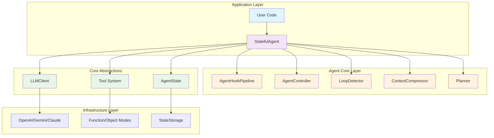

Sources: [stateful_agent.dart](lib/src/agent/stateful_agent.dart#L380-L490)

## Core Components

### StatefulAgent: The Central Orchestrator

The `StatefulAgent` class is the primary entry point for all agent operations. It manages the complete lifecycle of an agent run, including state management, tool execution, and lifecycle hooks.

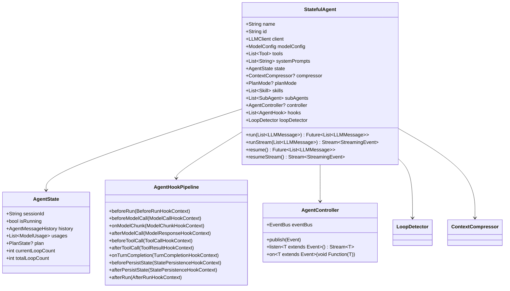

Sources: [stateful_agent.dart](lib/src/agent/stateful_agent.dart#L380-L490), [controller.dart](lib/src/agent/controller.dart#L1-L42)

### AgentState: Persistent Runtime Context

The `AgentState` class maintains all runtime information for an agent, including session identity, message history, token usage metrics, planning state, and loop counters. This state is fully serializable for persistence and resume scenarios.

| Field | Type | Purpose |
|-------|------|---------|
| `sessionId` | `String` | Unique session identifier for tracking |
| `isRunning` | `bool` | Whether agent is currently in active loop |
| `history` | `AgentMessageHistory` | Complete message history with episodic memories |
| `usages` | `List<ModelUsage>` | Cumulative token usage across all turns |
| `currentLoopUsages` | `List<ModelUsage>` | Token usage for current run only |
| `plan` | `PlanState?` | Active task decomposition from Planner |
| `totalLoopCount` | `int` | Lifetime turn counter |
| `currentLoopCount` | `int` | Turns in current run |
| `systemPromptHistory` | `List<SystemPromptHistoryItem>` | Versioned system prompt changes |
| `toolsHistory` | `List<ToolsHistoryItem>` | Versioned tool configuration changes |

Sources: [stateful_agent.dart](lib/src/agent/stateful_agent.dart#L216-L290)

## The Agent Loop Lifecycle

The agent loop follows a structured "think-act-observe" cycle. Each iteration of the loop represents one complete turn: the agent receives context, calls the LLM, processes the response, and either terminates or executes tools before continuing.

### High-Level Loop Flow

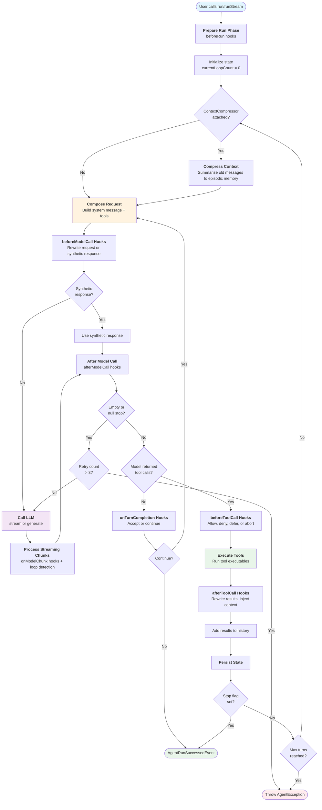

Sources: [stateful_agent.dart](lib/src/agent/stateful_agent.dart#L850-L1200)

### Phase 1: Prepare Run Phase

The run phase initializes the agent's execution context and invokes the `beforeRun` hook pipeline. This phase allows hooks to modify the initial input messages, inject context, or abort the entire run before any LLM calls occur.

```dart
Future<List<LLMMessage>> _prepareRunPhase(
  List<LLMMessage> input, {
  required bool useStream,
  required CancelToken? cancelToken,
}) async {
  final beforeRun = await _hookPipeline.beforeRun(
    BeforeRunHookContext(
      this,
      input: input,
      stream: useStream,
      cancelToken: cancelToken,
    ),
  );
  if (beforeRun.action == BeforeRunHookAction.abort) {
    throw _hookAbortException('beforeRun', beforeRun.error, beforeRun.reason);
  }
  return List<LLMMessage>.from(beforeRun.input ?? input);
}
```

Sources: [stateful_agent.dart](lib/src/agent/stateful_agent.dart#L1225-L1245)

### Phase 2: Compose Request

The request composition phase dynamically assembles the system message and available tools from multiple sources. This modular composition allows the agent to adapt its capabilities based on active skills, planning state, and available sub-agents.

**System Message Composition Order:**

| Priority | Source | Description |
|----------|--------|-------------|
| 1 | `systemPrompts` | User-defined system prompts |
| 2 | Sub-Agent Instructions | Auto-generated delegation protocol |
| 3 | Skills | Active skill instructions (in-memory or directory) |
| 4 | General Principles | Default behavioral guidelines |

**Tool Composition Order:**

| Priority | Source | Description |
|----------|--------|-------------|
| 1 | Base tools | User-provided tool definitions |
| 2 | Planner tools | `write_todos` for task decomposition |
| 3 | Skill tools | Tools from active skills |
| 4 | JavaScript runtime | `RunJavaScript` for directory skills |
| 5 | Sub-agent tools | `delegate_task` for delegation |
| 6 | Memory tools | `retrieve_memory` for episodic recall |

Sources: [stateful_agent.dart](lib/src/agent/stateful_agent.dart#L500-L650)

### Phase 3: Before Model Call Hooks

The `beforeModelCall` hook phase provides comprehensive control over the LLM request before it's sent. Hooks can modify the system message, request messages, tools, model configuration, or provide a synthetic response that bypasses the LLM entirely.

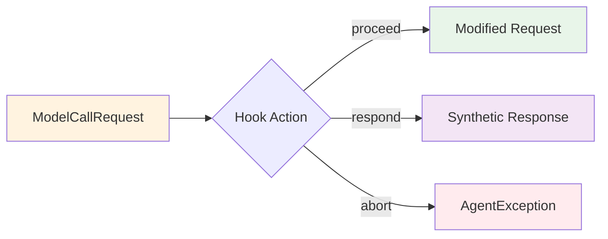

The hook can return three possible outcomes:

| Action | Effect | Use Case |
|--------|--------|----------|
| `proceed` | Continue with (potentially modified) request | Inject context, modify config |
| `respond` | Return synthetic response, skip LLM call | Cached responses, policy enforcement |
| `abort` | Throw exception, terminate run | Security blocks, fatal errors |

Sources: [agent_hook.dart](lib/src/agent/agent_hook.dart#L80-L130)

### Phase 4: LLM Call and Streaming

The LLM call phase supports both streaming and non-streaming modes. For streaming responses, chunks pass through the `onModelChunk` hook pipeline for real-time processing and loop detection.

```mermaid
sequenceDiagram
    participant Agent as StatefulAgent
    participant Hooks as HookPipeline
    participant LLM as LLMClient
    participant Loop as LoopDetector
    
    Agent->>Hooks: onModelChunk(chunk)
    Hooks-->>Agent: processed chunk
    
    alt Streaming Mode
        Agent->>LLM: stream(messages, tools)
        loop For each chunk
            LLM-->>Agent: StreamingMessage
            Agent->>Loop: detect(chunk)
            alt Loop detected
                Loop-->>Agent: LoopDetectorResult(isLoop: true)
                Agent-->>Agent: Throw AgentException
            else No loop
                Loop-->>Agent: LoopDetectorResult(isLoop: false)
            end
        end
    else Non-Streaming Mode
        Agent->>LLM: generate(messages, tools)
        LLM-->>Agent: ModelMessage
    end
```

Sources: [stateful_agent.dart](lib/src/agent/stateful_agent.dart#L920-L1080)

### Phase 5: Tool Execution

Tool execution follows a structured pipeline that allows hooks to intercept, modify, or deny individual tool calls before and after execution. The system supports two parameter modes for maximum flexibility.

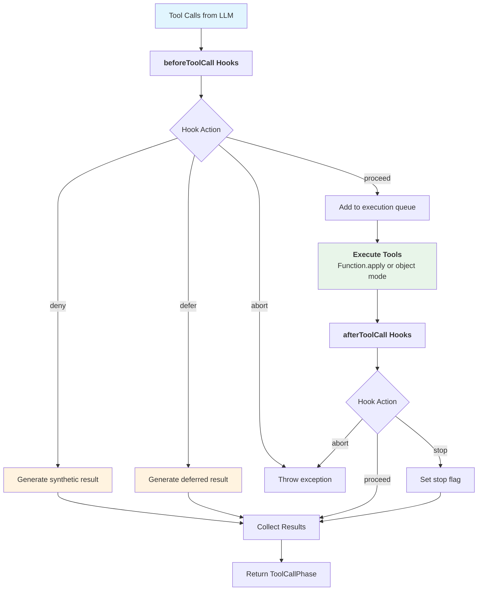

**Tool Parameter Modes:**

| Mode | Description | Signature |
|------|-------------|-----------|
| `function` | Arguments unpacked via `Function.apply` | `executable(positionalArgs, namedArgs)` |
| `object` | Raw `Map<String, dynamic>` passed directly | `executable(Map<String, dynamic>)` |

Sources: [stateful_agent.dart](lib/src/agent/stateful_agent.dart#L1440-L1730), [tool.dart](lib/src/core/tool.dart#L1-L43)

### Phase 6: Turn Completion

After the model returns a response without tool calls, the `onTurnCompletion` hook phase determines whether the run should terminate or continue with additional context. This mechanism enables hooks to inject follow-up instructions or trigger multi-turn workflows.

```dart
TurnCompletionHookResult onTurnCompletion(TurnCompletionHookContext context) {
  // Accept: agent has finished, no more turns needed
  return const TurnCompletionHookResult.accept();
  
  // Continue: inject messages and loop again
  return TurnCompletionHookResult.continueWith([
    UserMessage.text('Additional context for next turn'),
  ]);
}
```

The continuation budget is controlled by `maxTurnContinuations` (default: 3) to prevent infinite hook-driven loops.

Sources: [stateful_agent.dart](lib/src/agent/stateful_agent.dart#L1380-L1420)

## Hook Pipeline Architecture

The `AgentHookPipeline` orchestrates multiple `AgentHook` instances through a chain-of-responsibility pattern. Each hook phase has specific semantics for how results propagate through the pipeline.

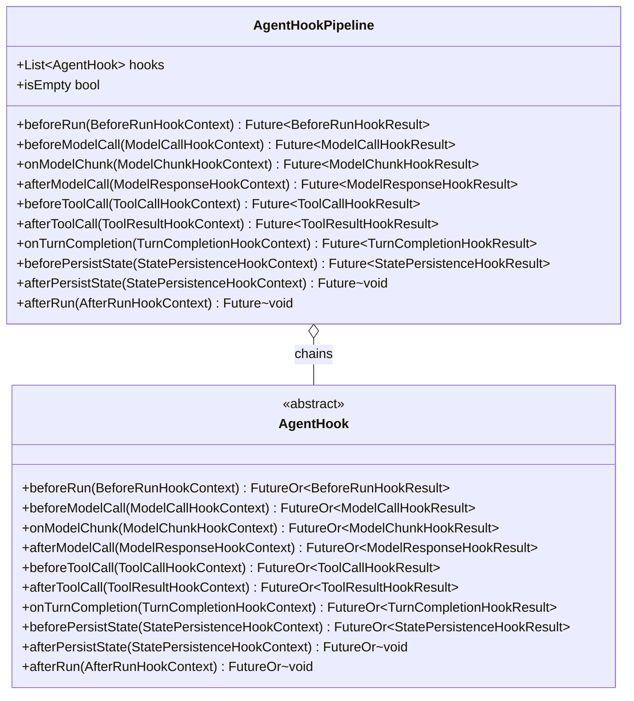

### Complete Hook Phase Reference

| Phase | Context Type | Result Type | Possible Actions |
|-------|-------------|-------------|------------------|
| `beforeRun` | `BeforeRunHookContext` | `BeforeRunHookResult` | `proceed`, `abort` |
| `beforeModelCall` | `ModelCallHookContext` | `ModelCallHookResult` | `proceed`, `respond`, `abort` |
| `onModelChunk` | `ModelChunkHookContext` | `ModelChunkHookResult` | `proceed`, `drop`, `abort` |
| `afterModelCall` | `ModelResponseHookContext` | `ModelResponseHookResult` | `proceed`, `retry`, `abort` |
| `beforeToolCall` | `ToolCallHookContext` | `ToolCallHookResult` | `proceed`, `deny`, `defer`, `abort` |
| `afterToolCall` | `ToolResultHookContext` | `ToolResultHookResult` | `proceed`, `stop`, `abort` |
| `onTurnCompletion` | `TurnCompletionHookContext` | `TurnCompletionHookResult` | `accept`, `continueRun`, `abort` |
| `beforePersistState` | `StatePersistenceHookContext` | `StatePersistenceHookResult` | `proceed`, `skip`, `abort` |
| `afterPersistState` | `StatePersistenceHookContext` | `void` | (observation only) |
| `afterRun` | `AfterRunHookContext` | `void` | (observation only) |

Sources: [agent_hook.dart](lib/src/agent/agent_hook.dart#L420-L530)

## Event System and Observability

The `AgentController` provides a publish-subscribe event system for observing agent lifecycle events without controlling the loop. This separation allows clean instrumentation for UI updates, tracing, and metrics.

### Event Flow Diagram

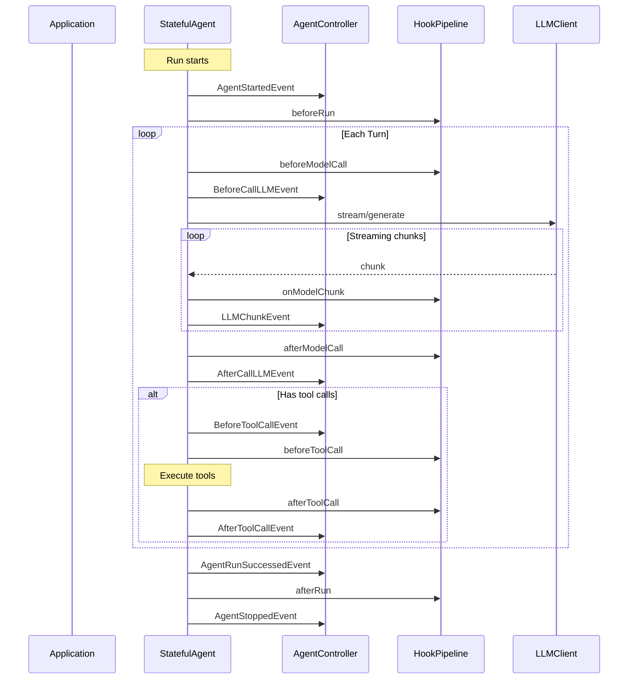

### Available Events

| Event | Trigger | Data |
|-------|---------|------|
| `AgentStartedEvent` | Run begins | Agent, input messages |
| `AgentResumedEvent` | Resume called | Agent |
| `BeforeCallLLMEvent` | Before LLM call | Agent, CallLLMParams |
| `LLMChunkEvent` | Streaming chunk received | Agent, params, chunk |
| `LLMRetryingEvent` | LLM retry triggered | Agent, reason |
| `AfterCallLLMEvent` | After LLM response | Agent, params, response, stopReason |
| `BeforeToolCallEvent` | Before tool execution | Agent, FunctionCall |
| `AfterToolCallEvent` | After tool execution | Agent, ExecutionToolResult |
| `PlanChangedEvent` | Plan state updated | Agent, PlanState |
| `AgentRunSuccessedEvent` | Run completed successfully | Agent, input, messages, stopReason |
| `AgentStoppedEvent` | Run ended (success or error) | Agent, input, messages, error |
| `OnAgentExceptionEvent` | Exception occurred | Agent, Exception |
| `OnAgentErrorEvent` | Error occurred | Agent, error message |
| `OnAgentCancelEvent` | Cancelled by user | Agent, exception, reason |

Sources: [events.dart](lib/src/agent/events.dart#L1-L100)

## Loop Detection Mechanism

The `LoopDetector` provides automatic detection of infinite loops through two complementary strategies:

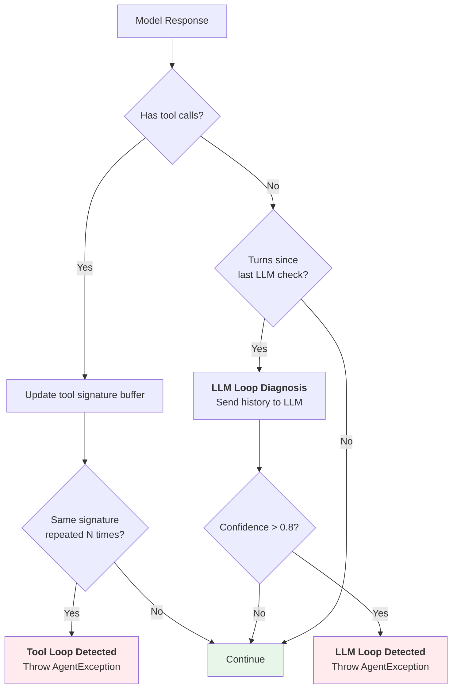

**Strategy 1: Tool Signature Tracking**
- Maintains a sliding window of recent tool call signatures (`tool:name:arguments`)
- If the same signature appears `toolLoopThreshold` (default: 5) consecutive times, a loop is declared

**Strategy 2: Periodic LLM Diagnosis**
- After `llmCheckAfterTurns` turns (default: 30), sends recent history to LLM
- LLM analyzes for cognitive stagnation or repetitive patterns
- Loop declared if confidence exceeds 0.8

Sources: [loop_detector.dart](lib/src/agent/loop_detector.dart#L1-L227)

## Context Compression and Memory

The `ContextCompressor` enables agents to handle long conversations by summarizing older messages into episodic memory. This mechanism preserves critical context while reducing token usage.

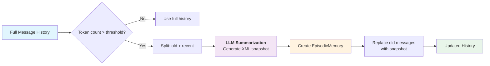

**Episodic Memory Structure:**

```dart
class EpisodicMemory {
  final String id;           // Unique episode identifier
  final String summary;      // XML snapshot of compressed context
  List<LLMMessage> messages; // Original messages for recall
}
```

Agents can retrieve compressed context on-demand using the `retrieve_memory` tool, which returns original messages from episodic memory with pagination support.

Sources: [context_compressor.dart](lib/src/agent/context_compressor.dart#L1-L219), [memory.dart](lib/src/agent/memory.dart#L1-L144)

## State Persistence Lifecycle

State persistence occurs at multiple points during the agent loop, controlled by the `beforePersistState` and `afterPersistState` hooks.

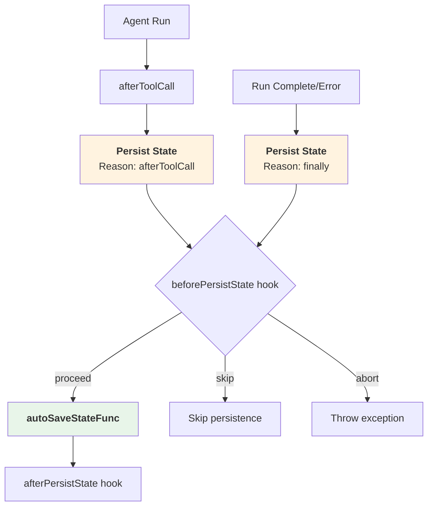

Sources: [stateful_agent.dart](lib/src/agent/stateful_agent.dart#L1200-L1230)

## Streaming Events for Flutter UIs

The `runStream()` method yields `StreamingEvent` objects designed for real-time UI updates in Flutter applications. Each event type corresponds to a specific phase of the agent loop.

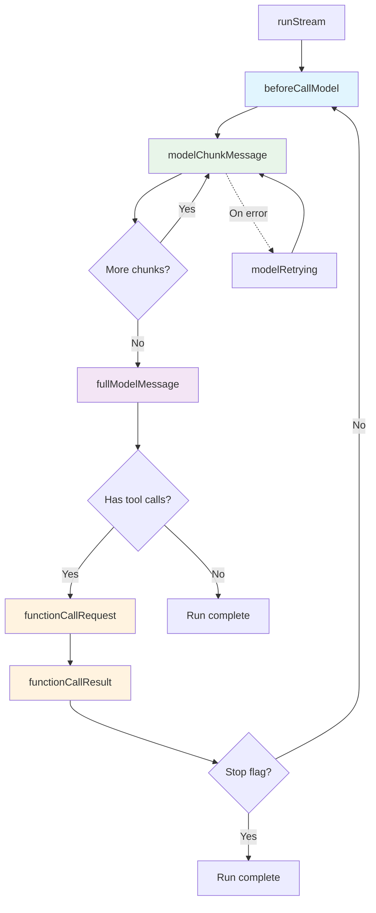

| EventType | Data Type | Description |
|-----------|-----------|-------------|
| `beforeCallModel` | `CallLLMParams` | LLM is about to be called |
| `modelChunkMessage` | `ModelMessage` | Streaming token chunk received |
| `modelRetrying` | `Map<String, dynamic>` | Retry triggered (empty response, hook request) |
| `fullModelMessage` | `ModelMessage` | Complete response for this turn |
| `functionCallRequest` | `List<FunctionCall>` | Model requested tool calls |
| `functionCallResult` | `FunctionExecutionResultMessage` | Tool execution completed |

Sources: [message.dart](lib/src/core/message.dart#L363-L390)

## Next Steps

Now that you understand the architecture and agent loop lifecycle, explore these related topics:

- [Unified LLMClient Abstraction and ModelConfig](7-unified-llmclient-abstraction-and-modelconfig) — Learn about the LLM client interface and model configuration
- [AgentHook Pipeline: Intercepting and Controlling the Loop](12-agenthook-pipeline-intercepting-and-controlling-the-loop) — Deep dive into hook implementation patterns
- [AgentController Events and Observability](13-agentcontroller-events-and-observability) — Detailed event system documentation
- [State Management and FileStateStorage Persistence](14-state-management-and-filestatestorage-persistence) — Persistence strategies and state storage