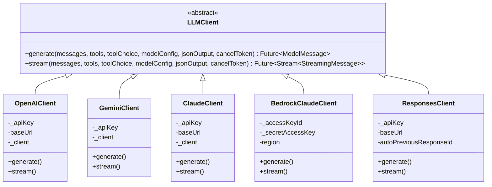
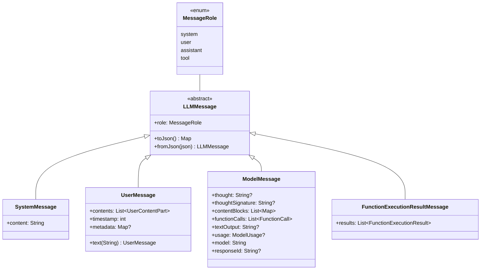
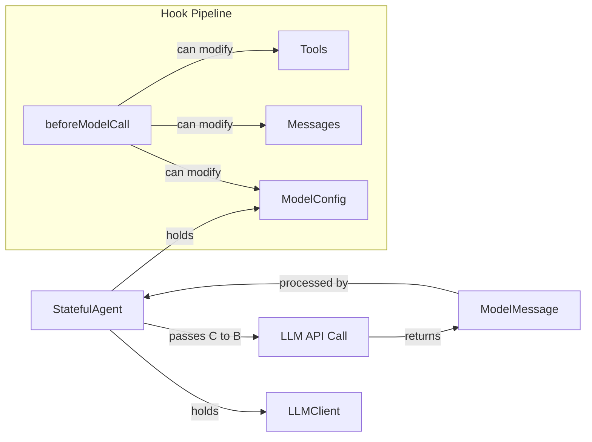

The `dart_agent_core` library provides a **provider-agnostic abstraction layer** for interacting with multiple LLM providers through a single, consistent interface. This architectural pattern enables seamless switching between OpenAI, Gemini, Claude, and AWS Bedrock without changing agent logic. The unified abstraction consists of three core components: the `LLMClient` interface, the `ModelConfig` configuration class, and a rich message type system that normalizes cross-provider differences.

## The LLMClient Interface: A Contract for Provider Abstraction

At the heart of the abstraction lies the `LLMClient` abstract class, which defines a contract that all provider implementations must fulfill. The interface exposes exactly two methods—one for synchronous generation and one for streaming responses—ensuring behavioral consistency across all providers.



The `generate` method accepts a list of `LLMMessage` objects, optional tool definitions, tool choice configuration, a `ModelConfig` instance, and an optional cancellation token. It returns a `Future<ModelMessage>` representing the complete model response. The `stream` method mirrors this signature but returns a `Stream<StreamingMessage>` that yields incremental chunks, enabling real-time UI updates.

Sources: [lib/src/core/llm_client.dart](lib/src/core/llm_client.dart#L8-L19)

## ModelConfig: Provider-Neutral Configuration

`ModelConfig` serves as the universal configuration container for LLM parameters. It encapsulates standard parameters that map directly to provider API fields, while the `extra` map provides an escape hatch for provider-specific features that don't have dedicated fields.

| Parameter | Type | Description | Provider Support |
|-----------|------|-------------|------------------|
| `model` | `String` (required) | Model identifier | All providers |
| `temperature` | `double?` | Sampling temperature (0.0–2.0) | OpenAI, Claude |
| `maxTokens` | `int?` | Maximum output tokens | All providers |
| `topP` | `double?` | Nucleus sampling threshold | OpenAI |
| `topK` | `double?` | Top-k sampling parameter | Gemini |
| `generationConfig` | `Map<String, dynamic>?` | Gemini-specific generation config | Gemini |
| `extra` | `Map<String, dynamic>?` | Provider-specific parameters | All providers |

The `extra` map is the critical extensibility mechanism. When a provider offers capabilities beyond the standard parameters—such as Claude's extended thinking, OpenAI's reasoning effort controls, or OpenAI Responses API's `previous_response_id`—developers pass these through `extra`. The client implementation selectively merges relevant keys into the request body.

```dart
// OpenAI reasoning model with effort control
final openaiConfig = ModelConfig(
  model: 'o3-mini',
  extra: {'reasoning_effort': 'high'},
);

// Claude extended thinking
final claudeConfig = ModelConfig(
  model: 'us.anthropic.claude-3-7-sonnet-20250219-v1:0',
  maxTokens: 16000,
  extra: {
    'thinking': {'type': 'enabled', 'budget_tokens': 10000},
  },
);

// Gemini with topK
final geminiConfig = ModelConfig(
  model: 'gemini-2.5-pro',
  topK: 40,
);
```

Sources: [lib/src/core/llm_client.dart](lib/src/core/llm_client.dart#L87-L121)

## The Message Type System: Normalizing Cross-Provider Differences

The `dart_agent_core` message hierarchy normalizes the fundamentally different message formats across providers into a consistent, serializable structure. This layer sits between the agent logic and the provider-specific request formatting.



Each client implementation translates these normalized types into provider-specific request formats. For example, `OpenAIClient._createRequestBody` converts `UserMessage` contents into OpenAI's `image_url` format with base64 encoding, while `GeminiClient` maps them to Gemini's `inlineData` structure. The `ModelMessage.contentBlocks` field preserves provider-native assistant content blocks (particularly important for Anthropic's interleaved `thinking`/`tool_use` blocks) while the flattened fields (`thought`, `functionCalls`, `textOutput`) provide a provider-neutral view.

Sources: [lib/src/core/message.dart](lib/src/core/message.dart#L1-L50)

## Streaming Architecture: Unified Chunk Normalization

The streaming interface introduces a `StreamingMessage` wrapper that normalizes the different streaming protocols across providers. Each provider yields chunks in its own format—OpenAI uses Server-Sent Events with delta objects, Gemini uses JSON streaming, Claude uses SSE with content block deltas—and the client implementations translate these into a uniform `StreamingMessage` containing either a `ModelMessage` chunk or a `StreamingControlMessage`.

| Control Flag | Purpose | When Emitted |
|--------------|---------|--------------|
| `retry` | Provider returned a transient error, stream will restart | 429/5xx responses during streaming |

The `StreamingMessage` structure separates data messages from control messages, allowing the agent loop to handle retry logic uniformly regardless of provider. When a provider returns a retryable error during streaming, the client emits a control message with the `retry` flag, and the agent loop can transparently restart the stream.

Sources: [lib/src/core/llm_client.dart](lib/src/core/llm_client.dart#L21-L62)

## Provider Implementation Patterns

Each concrete client follows a consistent internal pattern despite the different authentication and API formats:

| Aspect | OpenAI | Gemini | Claude | Bedrock Claude | Responses API |
|--------|--------|--------|--------|----------------|---------------|
| **Authentication** | Bearer token | API key header | `x-api-key` header | AWS SigV4 | Bearer token |
| **Endpoint** | `/chat/completions` | `/v1beta/models/{model}:generateContent` | `/v1/messages` | `/model/{modelId}/invoke` | `/responses` |
| **Streaming Protocol** | SSE with `data:` lines | JSON streaming | SSE with `event:` types | SSE | SSE |
| **Tool Format** | `functions` array | `functionDeclarations` array | `tools` array | Claude tool format | `tools` array |
| **Extra Param Merging** | Selective key extraction | Separate `generationConfig` | Direct merge | Direct merge | Configurable allowlist |

All implementations share a common retry mechanism with exponential backoff, configurable via constructor parameters (`maxRetries`, `initialRetryDelayMs`, `maxRetryDelayMs`). The `OpenAIClient` demonstrates this pattern with retry logic that doubles the delay on each attempt, capping at `maxRetryDelayMs`.

Sources: [lib/src/llm/openai_client.dart](lib/src/llm/openai_client.dart#L45-L60), [lib/src/llm/gemini_client.dart](lib/src/llm/gemini_client.dart#L20-L40), [lib/src/llm/claude_client.dart](lib/src/llm/claude_client.dart#L20-L50)

## Integration with the Agent Loop

The `StatefulAgent` class holds a reference to both an `LLMClient` instance and a `ModelConfig` instance, passing the config to the client on every LLM call. This design allows runtime configuration changes—such as adjusting temperature or switching models—without recreating the client.



The `AgentHook` pipeline provides interception points where hooks can modify the `ModelConfig` before the LLM call. A hook can read the current config, adjust parameters (e.g., increase temperature for creative tasks), or even swap the model entirely based on context. The `CallLLMParams` class bundles messages, tools, tool choice, and config into a single parameter object that flows through the hook pipeline.

Sources: [lib/src/agent/stateful_agent.dart](lib/src/agent/stateful_agent.dart#L386-L410), [lib/src/agent/stateful_agent.dart](lib/src/agent/stateful_agent.dart#L480-L520)

## OpenAI-Compatible Provider Pattern

A significant architectural benefit of the unified abstraction is the ability to connect to any OpenAI-compatible provider by simply changing the `baseUrl`. The `OpenAIClient` serves as a universal adapter for providers that expose the Chat Completions API format.

| Provider | Base URL | Model Example | Authentication |
|----------|----------|---------------|----------------|
| OpenAI | `https://api.openai.com` | `gpt-4o` | Bearer token |
| Kimi (Moonshot) | `https://api.moonshot.cn/v1` | `kimi-k2` | Bearer token |
| Qwen (DashScope) | `https://dashscope.aliyuncs.com/compatible-mode/v1` | `qwen3.5-plus` | Bearer token |
| Zhipu GLM | `https://open.bigmodel.cn/api/coding/paas/v4` | `GLM-4.7` | Bearer token |
| Ollama (Local) | `http://localhost:11434/v1` | `qwen2.5:7b` | No key required |
| OpenRouter | `https://openrouter.ai/api/v1` | `anthropic/claude-opus-4.6` | Bearer token |
| Azure OpenAI | `https://YOUR_RESOURCE.openai.azure.com/openai/v1` | `gpt-4o` | Bearer token |

Similarly, the `ResponsesClient` adapts to OpenAI Responses API-compatible providers like Volcengine Doubao-Seed, with configurable `extraAllowedKeys` controlling which `ModelConfig.extra` fields are forwarded to the API.

Sources: [doc/providers.md](doc/providers.md#L100-L180), [lib/src/llm/responses_client.dart](lib/src/llm/responses_client.dart#L30-L50)

## Serialization and State Persistence

All core types—`ModelConfig`, `LLMMessage` subclasses, `FunctionCall`, `ModelUsage`, `ToolChoice`, and `StreamingMessage`—implement `toJson()` and `fromJson()` methods. This serialization capability enables several critical features: persisting conversation history to disk via `FileStateStorage`, recording transcripts for the evaluation subsystem, and replaying recorded API responses during testing. The `ModelMessage.responseId` field, populated by the Responses API client, enables automatic conversation continuity by linking sequential responses.

Sources: [lib/src/core/llm_client.dart](lib/src/core/llm_client.dart#L87-L121), [lib/src/core/message.dart](lib/src/core/message.dart#L399-L460)

## Next Steps

- Dive deeper into specific client implementations at [OpenAI Client (Chat Completions and Responses API)](8-openai-client-chat-completions-and-responses-api)
- Explore provider-specific configuration at [Gemini, Claude, and Bedrock Client Configuration](9-gemini-claude-and-bedrock-client-configuration)
- See how the agent loop invokes the LLM at [Architecture and the Agent Loop Lifecycle](6-architecture-and-the-agent-loop-lifecycle)
- Understand the hook pipeline that can modify LLM parameters at [AgentHook Pipeline: Intercepting and Controlling the Loop](12-agenthook-pipeline-intercepting-and-controlling-the-loop)