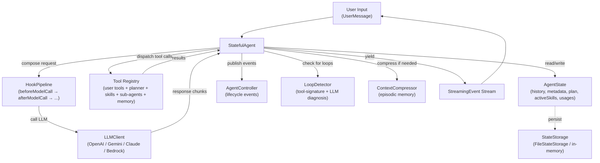

**dart_agent_core** is a mobile-first, local-first Dart library for building and evaluating stateful, tool-using AI agents. It implements a complete agentic loop with multi-provider LLM support, tool dispatch, state persistence, skill systems, context compression, and an evaluation framework — all written in pure Dart with no native dependencies. The library targets all six Dart/Flutter platforms (Android, iOS, Web, Windows, macOS, Linux) and is WebAssembly compatible.

Sources: [README.md](README.md#L1-L16) · [pubspec.yaml](pubspec.yaml#L1-L8)

## What Is dart_agent Core?

At its core, **dart_agent_core** solves a specific problem: how do you build an autonomous AI agent that can reason, use tools, maintain state across sessions, and scale from a simple prototype to a production Flutter application — all without platform-specific dependencies?

The library provides three foundational layers:

1. **LLM Client Abstraction** — A unified `LLMClient` interface that normalizes communication with OpenAI, Google Gemini, Anthropic Claude (direct and via AWS Bedrock), and any OpenAI-compatible API behind a single `generate()` / `stream()` contract.
2. **The Agentic Loop** — `StatefulAgent` implements a think-act-observe loop that automatically composes requests, dispatches tool calls, handles retries, and manages context — stopping only when the model produces a final answer or a termination condition is met.
3. **Evaluation Framework** — A separate `eval.dart` entry point exports a complete agent evaluation pipeline: tasks, suites, graders, transcripts, pass@k metrics, record/replay, and Langfuse observability integration.

Sources: [lib/dart_agent_core.dart](lib/dart_agent_core.dart#L1-L32) · [lib/eval.dart](lib/eval.dart#L1-L75)

## Architecture at a Glance

The following diagram illustrates how the major components interact during a single agent run. The `StatefulAgent` is the orchestration hub — it composes the system prompt, assembles the tool list, manages the hook pipeline, calls the LLM client, dispatches tool executions, and yields streaming events.



Sources: [doc/architecture.md](doc/architecture.md#L1-L50) · [lib/src/agent/stateful_agent.dart](lib/src/agent/stateful_agent.dart#L400-L500)

## The Agentic Loop Lifecycle

Every call to `run()` or `runStream()` enters the same core loop. Understanding this lifecycle is the single most important concept in the library.

1. **Context Compression** — If a `ContextCompressor` is attached and the token threshold is exceeded, old messages are summarized into episodic memory before the LLM is called.
2. **Request Composition** — The system message is assembled from user-provided prompts, sub-agent instructions, skill system prompts, general principles, and planner directives. The tool list is assembled from user tools, planner tools, skill tools, sub-agent tools, and memory tools.
3. **Hook Pipeline Execution** — `beforeModelCall` hooks can rewrite the system message, request messages, tools, tool choice, model config, or return a synthetic response entirely bypassing the LLM.
4. **LLM Call** — The formatted message history is sent to the chosen `LLMClient`, either via `generate()` (blocking) or `stream()` (chunk-by-chunk).
5. **Response Hooks** — Streaming chunks pass through `onModelChunk`; the assembled response passes through `afterModelCall`, which can rewrite, retry, or abort.
6. **Tool Dispatch** — If the model returns `FunctionCall`s, `beforeToolCall` hooks can allow, rewrite, deny, defer, or abort each call. Executed results are appended to history; `afterToolCall` hooks can rewrite results or inject follow-up context.
7. **Loop Continuation or Termination** — The loop returns to step 1 unless a stop condition is met: no tool calls, a tool returning `stopFlag = true`, a hook returning stop/abort, a detected loop, cancellation, or an unhandled exception.

Sources: [doc/architecture.md](doc/architecture.md#L10-L50) · [lib/src/agent/stateful_agent.dart](lib/src/agent/stateful_agent.dart#L800-L950)

## Core Concepts

The following table summarizes the key abstractions you will encounter throughout the documentation.

| Concept | Type | Purpose |
|---|---|---|
| `StatefulAgent` | Class | Central orchestrator — owns the agentic loop, state, tools, hooks, and skills |
| `AgentState` | Class | Mutable session state: conversation history, token usage, plan, active skills, metadata |
| `LLMClient` | Abstract class | Unified interface for calling LLMs (`generate` and `stream`) |
| `Tool` | Class | Wraps a Dart function with a name, description, and JSON Schema parameters |
| `ModelConfig` | Class | Model name, temperature, max tokens, top-p, top-k, and provider-specific extras |
| `UserMessage` | Class | Input from the user — supports text, image, video, audio, and document content parts |
| `ModelMessage` | Class | LLM response — text output, function calls, image/video/audio outputs, usage stats, thinking |
| `Skill` | Abstract class | Modular capability unit: system prompt + optional tools, activatable at runtime |
| `AgentHook` | Abstract class | Lifecycle interceptor — 10 hook phases for rewriting requests, denying tools, injecting context |
| `AgentController` | Class | Fire-and-forget event publisher for UI updates, tracing, and diagnostics |
| `LoopDetector` | Abstract class | Detects infinite tool loops via signature tracking and optional LLM-based diagnosis |
| `ContextCompressor` | Abstract class | Summarizes old messages into episodic memory when token limits are approached |
| `SubAgent` | Class | Named worker agent factory for task delegation with isolated context |
| `Planner` | Class | Injects `write_todos` tool for step-by-step task tracking |
| `StreamingEvent` | Class | Typed event yielded during `runStream()` — model chunks, tool calls, retries |

Sources: [lib/src/core/message.dart](lib/src/core/message.dart#L1-L50) · [lib/src/core/tool.dart](lib/src/core/tool.dart#L1-L43) · [lib/src/core/llm_client.dart](lib/src/core/llm_client.dart#L1-L136) · [lib/src/agent/stateful_agent.dart](lib/src/agent/stateful_agent.dart#L220-L390)

## Library Structure

The library is organized into three top-level namespaces under `lib/src/`, each with a distinct responsibility:

```
lib/
├── dart_agent_core.dart          # Public API surface (core + agent + llm)
├── eval.dart                     # Eval subsystem (separate entry point)
└── src/
    ├── core/                     # Foundational types (no agent logic)
    │   ├── message.dart          #   LLMMessage, UserMessage, ModelMessage, content parts
    │   ├── tool.dart             #   Tool, ToolParameterMode
    │   ├── llm_client.dart       #   LLMClient, ModelConfig, StreamingMessage, ToolChoice
    │   ├── event_bus.dart        #   Generic EventBus (pub/sub + request/response)
    │   ├── fs.dart               #   Filesystem abstraction (io/web stubs)
    │   └── http_util.dart        #   HTTP helpers (io/web stubs)
    ├── agent/                    # Agent orchestration layer
    │   ├── stateful_agent.dart   #   StatefulAgent — the agentic loop engine
    │   ├── agent_hook.dart       #   AgentHook abstract class + pipeline
    │   ├── controller.dart       #   AgentController (lifecycle events)
    │   ├── events.dart           #   Typed event classes (BeforeToolCallEvent, etc.)
    │   ├── skill.dart            #   Skill, DirectorySkill, activate/deactivate tools
    │   ├── planner.dart          #   Planner, PlanState, write_todos tool
    │   ├── sub_agent.dart        #   SubAgent, delegate_task tool
    │   ├── loop_detector.dart    #   LoopDetector, DefaultLoopDetector
    │   ├── context_compressor.dart # ContextCompressor, LLMBasedContextCompressor
    │   ├── memory.dart           #   Episodic memory tools (retrieve_memory)
    │   ├── state_storage.dart    #   StateStorage abstract class
    │   ├── file_state_storage.dart # FileStateStorage (io/web implementations)
    │   ├── javascript_runtime.dart # JavaScriptRuntime abstraction
    │   └── exception.dart        #   AgentException, AgentExceptionCode
    ├── llm/                      # LLM provider implementations
    │   ├── openai_client.dart    #   OpenAI Chat Completions
    │   ├── responses_client.dart #   OpenAI Responses API
    │   ├── gemini_client.dart    #   Google Gemini
    │   ├── bedrock_claude_client.dart # Anthropic Claude via AWS Bedrock
    │   └── claude_client.dart    #   Anthropic Claude (direct API)
    └── eval/                     # Evaluation framework
        ├── core/                 #   EvalTask, EvalSuite, EvalRunner, Trial, Outcome, Transcript
        ├── graders/              #   CodeGrader, ModelGrader, HumanGrader
        ├── llm/                  #   RecordingLLMClient, ReplayLLMClient, RateLimitGate
        ├── metrics/              #   pass@k, pass^k, classification metrics
        ├── observability/        #   JSONL exporter, Langfuse integration
        ├── reporting/            #   ReportStore, ReportGenerator, DiffReporter
        ├── suite_health/         #   SuiteHealthAnalyzer, SaturationStatus
        ├── calibration/          #   JudgeCalibrator
        └── loaders/              #   JSON-driven suite loading
```

Sources: [lib/dart_agent_core.dart](lib/dart_agent_core.dart#L1-L32) · [lib/eval.dart](lib/eval.dart#L1-L75)

## Supported LLM Providers

The library ships with five built-in `LLMClient` implementations, covering the major cloud providers and a direct Anthropic path:

| Provider | Client Class | Authentication | Notes |
|---|---|---|---|
| OpenAI (Chat Completions) | `OpenAIClient` | API key | Default base URL: `api.openai.com`; supports Azure override via `baseUrl` |
| OpenAI (Responses API) | `ResponsesClient` | API key | Stateful API; auto-passes `previous_response_id` for incremental context |
| Google Gemini | `GeminiClient` | API key | Direct Gemini API |
| AWS Bedrock (Claude) | `BedrockClaudeClient` | AWS SigV4 | Uses `aws_signature_v4` for request signing |
| Anthropic Claude (Direct) | `ClaudeClient` | API key | Direct Messages API; no AWS dependency |

Any OpenAI-compatible endpoint can also be used by overriding `baseUrl` on `OpenAIClient`. All clients support HTTP proxies via `proxyUrl` and configurable retry/timeout parameters.

Sources: [README.md](README.md#L115-L160) · [doc/providers.md](doc/providers.md#L1-L50) · [lib/src/llm/openai_client.dart](lib/src/llm/openai_client.dart#L1-L50) · [lib/src/llm/gemini_client.dart](lib/src/llm/gemini_client.dart#L1-L50) · [lib/src/llm/bedrock_claude_client.dart](lib/src/llm/bedrock_claude_client.dart#L1-L50) · [lib/src/llm/claude_client.dart](lib/src/llm/claude_client.dart#L1-L50)

## Extension Points at a Glance

Beyond basic tool-using agents, the library provides a rich set of extension points that let you progressively add sophistication. Each row below corresponds to a dedicated Deep Dive page.

| Extension Point | What It Does | Deep Dive |
|---|---|---|
| **Skills** | Modular capability units (system prompt + tools) the agent activates/deactivates at runtime to save context | [Skills: Dynamic Capability System](9-skills-dynamic-capability-system) |
| **File-System Skills** | Load skills from `SKILL.md` files; optionally execute JavaScript via `RunJavaScript` | [File-System Skills with SKILL.md](10-file-system-skills-with-skill-md) |
| **PlanMode** | Injects `write_todos` tool for step-by-step task tracking with `pending` → `in_progress` → `completed` lifecycle | [Planning with PlanMode](11-planning-with-planmode) |
| **Sub-Agent Delegation** | Named worker agents or `clone` for parallelized/isolated task execution via `delegate_task` | [Sub-Agent Delegation](12-sub-agent-delegation) |
| **Context Compression** | LLM-based summarization of old messages into episodic memory; `retrieve_memory` tool for recall | [Context Compression and Episodic Memory](13-context-compression-and-episodic-memory) |
| **AgentHook Pipeline** | 10 lifecycle phases for rewriting requests, denying tools, injecting context, controlling persistence | [AgentHook Pipeline](14-agenthook-pipeline) |
| **Loop Detection** | Tool-signature tracking + periodic LLM diagnosis to break infinite tool loops | [Loop Detection and Recovery](15-loop-detection-and-recovery) |
| **AgentController** | Fire-and-forget lifecycle events for UI updates, tracing, and diagnostics | [Streaming and Controller Events](8-streaming-and-controller-events) |

Sources: [README.md](README.md#L160-L400)

## Evaluation Framework

The library includes a complete, Anthropic-methodology-aligned evaluation framework exposed via a separate `eval.dart` entry point. This keeps the eval import cost out of production applications.

The framework supports:

- **Tasks and Suites** — Define evaluation scenarios as `EvalTask` instances, grouped into `EvalSuite` collections
- **Graders** — `CodeGrader` (deterministic), `ModelGrader` (LLM-as-judge), and `HumanGrader` (manual review)
- **Trials and Outcomes** — Execute agent runs against tasks, capture transcripts, compute pass/fail outcomes
- **pass@k and pass^k Metrics** — Statistical metrics for measuring agent reliability across multiple trials
- **Record/Replay** — Capture LLM requests for deterministic replay without API costs
- **Observability** — JSONL trace export and Langfuse integration for distributed tracing
- **Suite Health** — Saturation analysis and graduation criteria for evaluating eval suite maturity

Sources: [lib/eval.dart](lib/eval.dart#L1-L75) · [doc/eval-guide.md](doc/eval-guide.md#L1-L50)

## Platform Support

`dart_agent_core` runs on all six Dart/Flutter platforms and is **WebAssembly (WASM) compatible**. Platform-specific concerns (file-system I/O, HTTP adapters, JavaScript runtimes) are isolated behind `dart:io` / web stub implementations selected at compile time.

| Platform | State Storage | HTTP Client | JavaScript Runtime |
|---|---|---|---|
| Android | `FileStateStorage` | `Dio` (dart:io) | `NodeJavaScriptRuntime` (subprocess) |
| iOS | `FileStateStorage` | `Dio` (dart:io) | `NodeJavaScriptRuntime` (subprocess) |
| macOS | `FileStateStorage` | `Dio` (dart:io) | `NodeJavaScriptRuntime` (subprocess) |
| Linux | `FileStateStorage` | `Dio` (dart:io) | `NodeJavaScriptRuntime` (subprocess) |
| Windows | `FileStateStorage` | `Dio` (dart:io) | `NodeJavaScriptRuntime` (subprocess) |
| Web (WASM) | In-memory / `localStorage` | `Dio` (dart:html) | Requires custom `JavaScriptRuntime` (e.g., `flutter_js`) |

On web, use an in-memory or `localStorage`-backed `StateStorage` rather than `FileStateStorage`. Read API keys from `localStorage` via `package:web` (WASM-safe) instead of `Platform.environment`.

Sources: [README.md](README.md#L72-L105) · [lib/src/agent/file_state_storage.dart](lib/src/agent/file_state_storage.dart#L1-L50) · [lib/src/agent/file_state_storage_io.dart](lib/src/agent/file_state_storage_io.dart#L1-L30) · [lib/src/agent/file_state_storage_web.dart](lib/src/agent/file_state_storage_web.dart#L1-L30)

## Dependencies

The library maintains a deliberately minimal dependency footprint. The runtime dependencies are limited to HTTP, cryptography, logging, and UUID generation — there is no dependency on any AI-specific SDK or native code.

| Dependency | Purpose |
|---|---|
| `dio` | HTTP client with proxy support, cancellation tokens, and retry interceptors |
| `http` | Alternative HTTP transport |
| `aws_common` + `aws_signature_v4` | AWS Signature V4 authentication for Bedrock |
| `crypto` | Cryptographic hashing (used in eval request hashing) |
| `logging` | Structured logging throughout the library |
| `uuid` | Unique ID generation for sessions, events, and tool calls |

Sources: [pubspec.yaml](pubspec.yaml#L15-L30)

## Suggested Reading Path

This documentation is organized following the Diátaxis framework — tutorials for getting started, how-to guides for specific tasks, explanation pages for understanding architecture, and reference documentation for API details.

**For your first agent**, start here and proceed in order:

1. **[Overview](1-overview)** — You are here. Understand what the library provides and how it is structured.
2. **[Quick Start](2-quick-start)** — Build a working agent in under 20 lines of Dart.
3. **[Platform Support and Setup](3-platform-support-and-setup)** — Configure state storage, HTTP clients, and platform-specific concerns.
4. **[Supported LLM Providers](4-supported-llm-providers)** — Connect to OpenAI, Gemini, Claude, or any compatible API.

**To understand the engine**, explore the Agent Core deep dives:

5. **[StatefulAgent and the Agentic Loop](5-statefulagent-and-the-agentic-loop)** — The think-act-observe loop in detail.
6. **[Tool System and Parameter Modes](6-tool-system-and-parameter-modes)** — Wrapping Dart functions as tools, parameter modes, and `AgentToolResult`.
7. **[State Management and File Persistence](7-state-management-and-file-persistence)** — `AgentState`, `FileStateStorage`, and session persistence.
8. **[Streaming and Controller Events](8-streaming-and-controller-events)** — `runStream()`, `StreamingEvent`, and `AgentController`.

**To extend the agent**, explore the Extension Points section, and to **evaluate your agent**, explore the Evaluation Framework section.