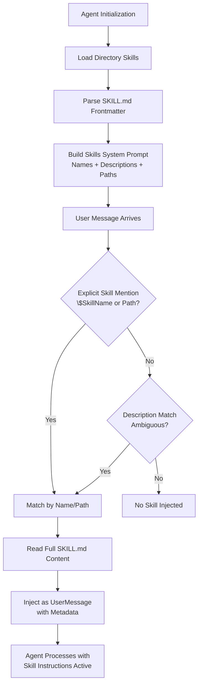

The **File-System Skills** system enables agents to dynamically load and apply domain-specific instructions stored as `SKILL.md` files within a directory tree. This approach decouples skill definitions from application code, allowing skills to be created, versioned, and managed as independent Markdown documents. The agent discovers skills at runtime, detects when a user's request matches a skill's description, and progressively loads the full instructions only when needed—optimizing context window usage while maintaining rich, modular capabilities.

## Architecture Overview

The file-system skills pipeline operates through three primary stages: discovery, trigger detection, and progressive injection. Each stage is designed to minimize context consumption while maximizing relevance.



The system is mutually exclusive with the programmatic `skills` parameter—you must choose one mode per agent instance. This design prevents conflicting activation protocols and keeps the skill management surface area coherent.

Sources: [skill.dart](lib/src/agent/skill.dart#L300-L341), [stateful_agent.dart](lib/src/agent/stateful_agent.dart#L500-L506)

## Directory Structure and SKILL.md Format

Each skill resides in its own subdirectory under a root path specified by `skillDirectoryPath`. The system recursively searches up to `maxDepth` levels (default 6) for files named exactly `SKILL.md`.

### Required SKILL.md Structure

Every `SKILL.md` file must begin with YAML frontmatter delimited by `---`. The parser extracts `name` and `description` fields; both are **mandatory** for successful loading. If `name` is omitted, the parent directory name is used as a fallback.

```markdown
---
name: code_review
description: Perform thorough code reviews with security and performance analysis.
---

# Code Review Skill

When asked to review code:

1. Read the target file using the Read tool.
2. Analyze for: security vulnerabilities, performance issues, maintainability.
3. Provide structured feedback with severity ratings.

## References
- [Security Checklist](references/security.md)
- [Performance Patterns](references/perf.md)
```

### Directory Layout

A typical skill directory might contain:

```
skills/
├── code_review/
│   ├── SKILL.md
│   ├── references/
│   │   ├── security.md
│   │   └── perf.md
│   └── templates/
│       └── review_report.md
├── data_analysis/
│   ├── SKILL.md
│   └── scripts/
│       └── analyze.js
└── translation/
    ├── SKILL.md
    └── glossaries/
        └── technical.json
```

The agent resolves relative paths referenced in `SKILL.md` (e.g., `references/security.md`) relative to the skill's own directory, not the workspace root.

Sources: [skill.dart](lib/src/agent/skill.dart#L500-L524), [skill.dart](lib/src/agent/skill.dart#L526-L539), [simple_agent_with_directory_skills_example.dart](example/simple_agent_with_directory_skills_example.dart#L95-L118)

## Skill Discovery and Trigger Detection

Discovery happens during `_prepareDirectorySkills()`, which runs before each LLM call. The system performs two distinct operations: metadata loading and mention detection.

### Metadata Loading

The `loadDirectorySkillsFromRoot()` function recursively finds all `SKILL.md` files, parses their frontmatter, and returns a `DirectorySkillLoadResult` containing successful metadata and any parse errors. Errors are logged as warnings but do not halt agent operation.

### Mention Detection

`collectExplicitDirectorySkillMentions()` scans the incoming message history for three trigger patterns:

| Pattern | Example | Matching Logic |
|---------|---------|----------------|
| **Bracket syntax** | `[$code_review](path)` | Regex extracts name and path; both are valid triggers |
| **Dollar prefix** | `$code_review` | Matches skill name exactly (case-sensitive) |
| **Plain text** | "use the code review skill" | Fallback: matches unambiguous skill name references |

The plain-text fallback only activates when a skill name is unique across all loaded skills. This prevents false positives in multi-skill environments.

Sources: [skill.dart](lib/src/agent/skill.dart#L387-L460), [skill.dart](lib/src/agent/skill.dart#L401-L415)

## Progressive Disclosure Strategy

The system employs a two-phase loading model to conserve context window space:

**Phase 1: Catalog Injection** — At agent initialization, the system prompt includes only skill names, descriptions, and file paths. This lightweight catalog enables the agent to decide which skills are relevant without loading full instruction bodies.

**Phase 2: Content Injection** — When the agent (or the detection system) identifies a needed skill, `buildDirectorySkillInjections()` reads the full `SKILL.md` content and wraps it in a structured XML envelope:

```xml
<skill>
<name>code_review</name>
<path>/path/to/skills/code_review/SKILL.md</path>
# Code Review Skill

When asked to review code: ...
</skill>
```

This content is injected as a `UserMessage` with metadata tags (`type: skill_instructions`, `skill_name`, `skill_path`) enabling downstream hooks and controllers to identify skill-injected messages.

Sources: [skill.dart](lib/src/agent/skill.dart#L462-L498), [skill.dart](lib/src/agent/skill.dart#L343-L385)

## JavaScript Execution Integration

When `NodeJavaScriptRuntime` is configured alongside `skillDirectoryPath`, the agent gains access to a `RunJavaScript` tool. This integration enables skills to include executable scripts with deterministic behavior.

### Security Boundaries

The `_runJavaScriptScript()` method enforces strict path containment: script paths must be absolute and resolve to a location under `skillDirectoryPath`. This prevents directory traversal attacks and ensures scripts operate within the intended skill workspace.

### Bridge Channels

Dart code can register bridge channels that JavaScript scripts call via `ctx.bridge.call()`. This enables bidirectional communication between skill scripts and the host application:

```dart
agent.registerJavaScriptBridgeChannel('local.greeting', (payload, context) {
  final name = (payload['name'] ?? 'friend').toString();
  return {'message': 'Hello, $name!', 'agent': context.agentName};
});
```

Sources: [stateful_agent.dart](lib/src/agent/stateful_agent.dart#L616-L646), [stateful_agent.dart](lib/src/agent/stateful_agent.dart#L677-L740), [simple_agent_with_directory_skills_example.dart](example/simple_agent_with_directory_skills_example.dart#L68-L75)

## Comparison: Directory Skills vs. Programmatic Skills

| Aspect | Directory Skills (`SKILL.md`) | Programmatic Skills (`Skill` class) |
|--------|------------------------------|-------------------------------------|
| **Definition format** | Markdown + YAML frontmatter | Dart class extending `Skill` |
| **Tool inclusion** | No built-in tools; agent uses existing tools | Can bundle `Tool` instances |
| **Activation model** | Implicit via mention detection | Explicit via `activate_skills` tool |
| **Context injection** | UserMessage with XML envelope | SystemPromptPart with markdown |
| **Dynamic updates** | Hot-reloadable from filesystem | Requires code change and rebuild |
| **JavaScript support** | Integrated via `RunJavaScript` | Not available |
| **Use case** | Non-technical authors, rapid iteration | Typed tool integration, compile-time safety |

The two systems cannot coexist on the same agent instance. Use directory skills when skills are authored by domain experts or need runtime flexibility; use programmatic skills when tight tool integration or type safety is required.

Sources: [stateful_agent.dart](lib/src/agent/stateful_agent.dart#L500-L506), [skill.dart](lib/src/agent/skill.dart#L9-L23), [skill.dart](lib/src/agent/skill.dart#L25-L35)

## System Prompt Structure

The `buildDirectorySkillsSystemPrompt()` function generates a structured instruction block wrapped in `<skills_instructions>` tags. It contains two key sections:

**Available Skills** — A bulleted list of skill name, description, and file path. This serves as the agent's skill catalog.

**How to Use Skills** — A comprehensive protocol covering:
- Discovery: recognizes the catalog as the authoritative skill list
- Trigger rules: uses `$SkillName` or description matching
- Progressive disclosure: open `SKILL.md` only after deciding to use a skill
- Context hygiene: summarizes long sections, avoids deep reference-chasing
- Coordination: announces which skills are being used and why
- Fallback: states issues and continues with best alternative

When JavaScript execution is enabled, an additional rule instructs the agent to use `RunJavaScript` for `.js` references.

Sources: [skill.dart](lib/src/agent/skill.dart#L343-L385), [stateful_agent.dart](lib/src/agent/stateful_agent.dart#L544-L558)

## Practical Example

The following example demonstrates creating a temporary skill directory, loading it into an agent, and executing a skill that invokes JavaScript:

```dart
final agent = StatefulAgent(
  name: 'skill_agent',
  client: OpenAIClient(apiKey: apiKey),
  modelConfig: ModelConfig(model: 'gpt-4o'),
  state: AgentState.empty(),
  systemPrompts: ['You are a helpful assistant with directory skills.'],
  tools: [readTool, lsTool],
  skillDirectoryPath: '/path/to/skills',
  javaScriptRuntime: NodeJavaScriptRuntime(),
);

// Register a bridge channel for JS ↔ Dart communication
agent.registerJavaScriptBridgeChannel('local.greeting', (payload, context) {
  return {'message': 'Hello, ${payload['name']}!'};
});

// Agent will detect "$hello_script" and inject its SKILL.md content
final responses = await agent.run([
  UserMessage.text('Use the $hello_script skill to greet "Dart".'),
]);
```

The agent automatically discovers the `hello_script` skill, matches the explicit mention, reads the full `SKILL.md`, and follows its instructions—including executing `scripts/hello.js` via the `RunJavaScript` tool.

Sources: [simple_agent_with_directory_skills_example.dart](example/simple_agent_with_directory_skills_example.dart#L53-L89)

## Best Practices

**Skill Isolation** — Keep each skill in its own directory. Avoid sharing state or files between skills; the agent should treat each skill as an independent capability module.

**Minimal References** — When `SKILL.md` references additional files (templates, glossaries, scripts), instruct the agent to load only what is needed for the specific request. The system prompt explicitly discourages bulk-loading.

**Unique Naming** — Choose distinct skill names to enable the plain-text trigger fallback. If two skills share a name, only the bracket and dollar-syntax triggers will reliably match.

**Frontmatter Completeness** — Always include both `name` and `description` in the YAML frontmatter. Missing descriptions cause load failures and log warnings.

**Security for JavaScript** — When skills include `.js` scripts, verify that script paths remain under `skillDirectoryPath`. The framework enforces this boundary automatically, but skill authors should avoid patterns that encourage path escaping.

Sources: [skill.dart](lib/src/agent/skill.dart#L361-L378), [stateful_agent.dart](lib/src/agent/stateful_agent.dart#L696-L699)

## Next Steps

- **[Skills: Dynamic Capability System](9-skills-dynamic-capability-system)** — Understand the programmatic `Skill` class and the `activate_skills`/`deactivate_skills` protocol
- **[Tool System and Parameter Modes](6-tool-system-and-parameter-modes)** — Learn how tools (including `RunJavaScript`) are defined and dispatched
- **[Streaming and Controller Events](8-streaming-and-controller-events)** — Observe skill injection events through the `AgentController`