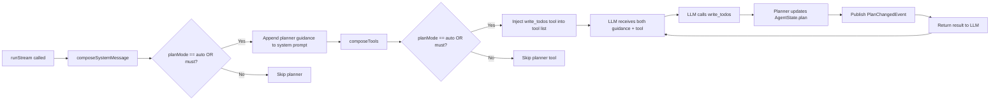

The `PlanMode` system gives `StatefulAgent` a structured task-tracking capability through an injectable `write_todos` tool. When enabled, the LLM can create and maintain an ordered checklist of subtasks, updating each step's status as it progresses through complex multi-step workflows. This page explains the three planning modes, the underlying data model, how the planner integrates with the agentic loop, and how to react to plan updates from your application code.

Sources: [lib/src/agent/planner.dart#L1-L11](lib/src/agent/planner.dart#L1-L11)

## Why PlanMode Exists

LLMs often receive complex requests that require multiple sequential or parallel steps — research a topic, cross-reference data, draft a response, and verify accuracy. Without explicit tracking, the model may skip steps, repeat completed work, or lose context about what remains. `PlanMode` addresses this by injecting a `write_todos` tool that the LLM uses to declare its intent up front and update the checklist as it works, giving both the agent and the application developer a real-time view of progress.

Sources: [lib/src/agent/planner.dart#L67-L76](lib/src/agent/planner.dart#L67-L76)

## PlanMode Enumeration

The `PlanMode` enum lives in `lib/src/agent/planner.dart` and offers three values that control whether and how the planner tool is activated:

| Value | Planner Tool Injected | System Prompt Guidance | Typical Use Case |
|-------|----------------------|----------------------|------------------|
| `PlanMode.none` | No | None | Simple single-step tasks, or when planning adds unnecessary overhead |
| `PlanMode.auto` | Yes | General principle mentions tracking tasks | Tasks of varying complexity — the LLM decides whether to plan |
| `PlanMode.must` | Yes | Strong instruction to use the planner | Multi-step workflows where structured tracking is essential |

When `planMode` is `auto` or `must`, the agent's `composeSystemMessage()` method appends a general principle line: *"Track tasks with Planner"*. For `must`, this guidance is functionally identical but the stronger framing encourages the model to use the tool even for moderately complex tasks. Sub-agents created via [Sub-Agent Delegation](12-sub-agent-delegation) always receive `PlanMode.auto` so they inherit planning capability without forced overhead.

Sources: [lib/src/agent/planner.dart#L6](lib/src/agent/planner.dart#L6) · [lib/src/agent/stateful_agent.dart#L569-L572](lib/src/agent/stateful_agent.dart#L569-L572) · [lib/src/agent/sub_agent.dart#L80](lib/src/agent/sub_agent.dart#L80)

## Data Model: PlanStep and PlanState

The planner's state is represented by two serializable classes that live inside `AgentState.plan`:

### PlanStep

Each step tracks a single subtask with a human-readable description and one of four status values:

| Status | Meaning | Visual Indicator |
|--------|---------|-----------------|
| `pending` | Not yet started | ⏳ |
| `in_progress` | Currently being worked on | 👉 |
| `completed` | Successfully finished | ✅ |
| `cancelled` | No longer needed | 🚫 |

A `PlanStep` serializes to and from JSON, making it safe for persistence in [State Management and File Persistence](7-state-management-and-file-persistence). Unknown status strings gracefully fall back to `pending`, preventing data loss from malformed LLM output.

Sources: [lib/src/agent/planner.dart#L14-L37](lib/src/agent/planner.dart#L14-L37)

### PlanState

`PlanState` holds an ordered list of `PlanStep` instances. Each call to `write_todos` **replaces the entire list** rather than appending — this gives the LLM full control to reorder, remove, or reclassify steps as the task evolves. The current plan is persisted as part of `AgentState` and survives session restarts.

```dart
// Typical plan state after a few tool calls
PlanState(
  steps: [
    PlanStep(description: 'Research topic', status: StepStatus.completed),
    PlanStep(description: 'Draft outline', status: StepStatus.inProgress),
    PlanStep(description: 'Write full report', status: StepStatus.pending),
    PlanStep(description: 'Review and proofread', status: StepStatus.pending),
  ],
)
```

Sources: [lib/src/agent/planner.dart#L39-L54](lib/src/agent/planner.dart#L39-L54)

## How the Planner Integrates with the Agentic Loop

The `Planner` class is initialized as a private field of `StatefulAgent` and exposes a single tool: `write_todos`. Integration happens at two points during each loop iteration.



### System Prompt Injection

During `composeSystemMessage()`, when `planMode` is `auto` or `must`, the agent appends a planner-tracking instruction to the general principles section. This tells the LLM that a planning tool is available and should be used for task management.

Sources: [lib/src/agent/stateful_agent.dart#L569-L572](lib/src/agent/stateful_agent.dart#L569-L572)

### Tool Injection

During `composeTools()`, the planner's `write_todos` tool is appended to the tool list alongside any user-defined tools, skill tools, sub-agent tools, and memory tools. This happens automatically — no manual tool registration is required.

Sources: [lib/src/agent/stateful_agent.dart#L589-L593](lib/src/agent/stateful_agent.dart#L589-L593)

### The write_todos Tool

The injected tool accepts a single `todos` parameter — a JSON array of objects, each with a `description` (string) and a `status` (one of `pending`, `in_progress`, `completed`, `cancelled`). The LLM sends the complete list on every call, replacing the previous plan entirely.

```dart
// JSON Schema for write_todos parameters
{
  "type": "object",
  "properties": {
    "todos": {
      "type": "array",
      "description": "The complete list of todo items. This will replace the existing list.",
      "items": {
        "type": "object",
        "properties": {
          "description": { "type": "string" },
          "status": { "type": "string", "enum": ["pending", "in_progress", "completed", "cancelled"] }
        },
        "required": ["description", "status"]
      }
    }
  },
  "required": ["todos"]
}
```

After execution, the tool returns a formatted summary of the updated plan, which the LLM uses as feedback to confirm its progress.

Sources: [lib/src/agent/planner.dart#L79-L114](lib/src/agent/planner.dart#L79-L114)

## Reacting to Plan Changes

The `Planner` publishes a `PlanChangedEvent` through the `AgentController` whenever the LLM calls `write_todos`. This event carries the updated `PlanState` and lets your application build live UIs, trigger notifications, or log progress without polling.

```dart
final controller = AgentController();

controller.on<PlanChangedEvent>((event) {
  for (final step in event.plan.steps) {
    final icon = switch (step.status) {
      StepStatus.completed   => '✅',
      StepStatus.inProgress  => '👉',
      StepStatus.cancelled   => '🚫',
      StepStatus.pending     => '⏳',
    };
    print('$icon ${step.description}');
  }
});

final agent = StatefulAgent(
  name: 'planning_agent',
  client: client,
  modelConfig: modelConfig,
  state: AgentState.empty(),
  planMode: PlanMode.must,
  controller: controller,
);
```

The plan is also persisted in `AgentState.plan` and serialized/deserialized automatically by `FileStateStorage`. If the agent is suspended and resumed, the plan survives across the boundary without manual intervention.

Sources: [lib/src/agent/events.dart#L83-L87](lib/src/agent/events.dart#L83-L87) · [lib/src/agent/planner.dart#L128-L130](lib/src/agent/planner.dart#L128-L130)

## Complete Example

The following example demonstrates a `PlanMode.must` agent that searches for information across two steps. The agent creates a plan before executing any tools, and the application prints the plan at each update.

```dart
import 'dart:io';
import 'package:dart_agent_core/dart_agent_core.dart';

String searchInternet(String query) {
  if (query.contains('capital of France')) return 'Paris';
  if (query.contains('population of Paris')) return 'About 2.1 million';
  return 'No results found.';
}

void main() async {
  final apiKey = Platform.environment['OPENAI_API_KEY'] ?? 'YOUR_API_KEY';
  final client = OpenAIClient(apiKey: apiKey);
  final modelConfig = ModelConfig(model: 'gpt-4o');

  final searchTool = Tool(
    name: 'search_internet',
    description: 'Search the internet for factual information.',
    executable: searchInternet,
    parameters: {
      'type': 'object',
      'properties': {
        'query': {'type': 'string', 'description': 'The search query'},
      },
      'required': ['query'],
    },
  );

  final controller = AgentController();
  controller.on<PlanChangedEvent>((event) {
    print('\n📝 Plan Updated:');
    for (final step in event.plan.steps) {
      print('  [${step.status.name}] ${step.description}');
    }
  });

  final agent = StatefulAgent(
    name: 'planning_agent',
    client: client,
    tools: [searchTool],
    modelConfig: modelConfig,
    state: AgentState.empty(),
    planMode: PlanMode.must,
    controller: controller,
  );

  final responses = await agent.run([
    UserMessage.text('Find the capital of France and then tell me its population.'),
  ]);

  print('\nFinal response: ${(responses.last as ModelMessage).textOutput}');
}
```

Sources: [example/simple_agent_with_plan_example.dart#L1-L49](example/simple_agent_with_plan_example.dart#L1-L49)

## Choosing the Right PlanMode

| Scenario | Recommended Mode | Rationale |
|----------|-----------------|-----------|
| Single-step queries ("What's the weather?") | `PlanMode.none` | No benefit from tracking a single task |
| Varying complexity with capable models | `PlanMode.auto` | LLM self-selects when planning helps |
| Complex multi-step workflows | `PlanMode.must` | Guarantees a plan exists before tool execution |
| Sub-agents | `PlanMode.auto` (automatic) | Inherited from parent — no configuration needed |

When using `PlanMode.auto` or `PlanMode.must`, the planner adds one tool to the agent's tool list and a single instruction to the system prompt. This has minimal token overhead — typically under 200 tokens — making it practical even for cost-sensitive deployments.

## Relationship to Other Extension Points

The planner operates alongside but independently from other agent extension points:

| Extension Point | Interaction with Planner |
|----------------|-------------------------|
| [Skills: Dynamic Capability System](9-skills-dynamic-capability-system) | Skill tools and planner tools are injected in parallel; no conflicts |
| [Sub-Agent Delegation](12-sub-agent-delegation) | Sub-agents receive `PlanMode.auto` automatically |
| [AgentHook Pipeline](14-agenthook-pipeline) | Hooks can observe plan state via `AgentCallToolContext.current.state.plan` |
| [State Management and File Persistence](7-state-management-and-file-persistence) | `AgentState.plan` serializes/deserializes with full state |

The planner does not interact with [Context Compression and Episodic Memory](13-context-compression-and-episodic-memory) — plan state lives in `AgentState.plan`, not in the message history, so compression preserves it regardless of context window management.

## Next Steps

- Explore how the `write_todos` tool executes within the full [Tool System and Parameter Modes](6-tool-system-and-parameter-modes) pipeline
- See how sub-agents inherit planning in [Sub-Agent Delegation](12-sub-agent-delegation)
- Learn how to persist plan state across sessions in [State Management and File Persistence](7-state-management-and-file-persistence)