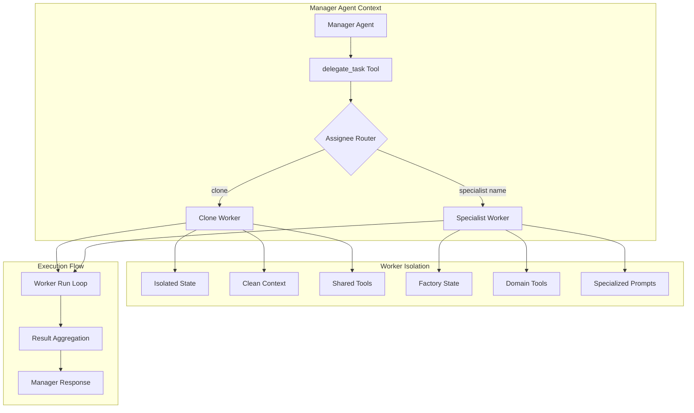
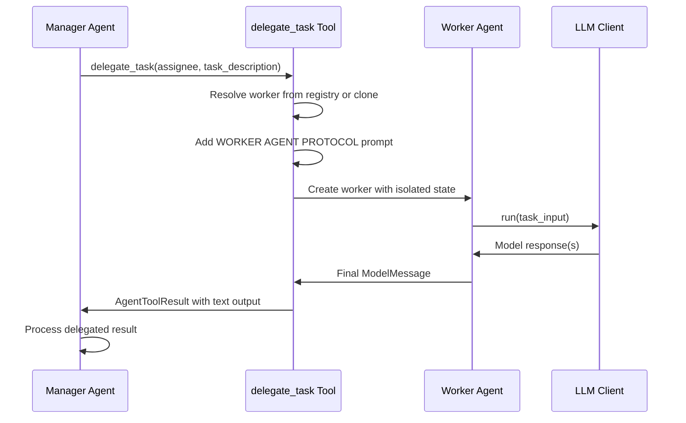

Sub-agent delegation enables a **manager-worker architecture** where a primary agent can offload complex, specialized, or context-isolated tasks to separate agent instances. This pattern is fundamental for building systems that require parallel execution, domain specialization, or context window management.

The delegation system transforms a single agent into a **coordinator** that can dynamically spawn or invoke specialized workers, each running in their own isolated agent loop with distinct tools, prompts, and state.

## Architecture Overview

The sub-agent system follows a **factory pattern** where workers are instantiated on-demand through registered factories. The manager agent retains decision-making authority while delegating execution.



The architecture maintains clear separation of concerns: the manager focuses on task decomposition and coordination, while workers execute specific sub-tasks with optimized configurations.

Sources: [sub_agent.dart](lib/src/agent/sub_agent#L1-L17), [stateful_agent.dart](lib/src/agent/stateful_agent#L444-L460)

## Sub-Agent Registration

Sub-agents are registered as named factories that produce specialized `StatefulAgent` instances. Each registration defines a worker's identity, capabilities, and instantiation logic.

### SubAgent Structure

The `SubAgent` class encapsulates three essential components:
- **name**: Unique identifier for delegation routing
- **description**: Documentation for the manager's system prompt
- **agentFactory**: Function that creates a configured worker from the parent context

```dart
final researchSubAgent = SubAgent(
  name: 'researcher',
  description: 'Searches the web and summarizes findings on a given topic.',
  agentFactory: (parent) => StatefulAgent(
    name: 'researcher',
    client: parent.client,
    modelConfig: parent.modelConfig,
    state: AgentState.empty(),
    tools: [webSearchTool, fetchPageTool],
    systemPrompts: ['You are a research specialist. Be thorough and cite sources.'],
    isSubAgent: true,  // Critical: marks this as a worker
  ),
);
```

The `isSubAgent: true` flag is mandatory—it triggers the worker-specific behavior throughout the system, including context isolation and result handling.

Sources: [sub_agent.dart](lib/src/agent/sub_agent#L7-L17), [example/simple_agent_with_sub_agent_example.dart](example/simple_agent_with_sub_agent_example#L61-L76)

### Manager Agent Integration

Register sub-agents with the parent manager to enable delegation capabilities:

```dart
final agent = StatefulAgent(
  name: 'manager_agent',
  client: client,
  modelConfig: modelConfig,
  state: AgentState.empty(),
  systemPrompts: ['You are a manager agent. Delegate research tasks to your researcher.'],
  subAgents: [researchSubAgent],  // Register available workers
);
```

The manager automatically receives:
1. A system prompt section documenting available workers
2. The `delegate_task` tool for triggering delegation
3. Best practices for effective delegation

Sources: [example/simple_agent_with_sub_agent_example.dart](example/simple_agent_with_sub_agent_example#L78-L88), [tools_and_planning.md](doc/tools_and_planning.md#L250-L253)

## Delegation Mechanism

The `delegate_task` tool orchestrates the entire delegation workflow, from worker selection to result aggregation.

### Tool Parameters

| Parameter | Type | Required | Description |
|-----------|------|----------|-------------|
| `assignee` | string | Yes | Target worker: `"clone"` for context-isolated copy, or specific sub-agent name |
| `task_description` | string | Yes | Self-contained instructions including all necessary context |

Sources: [sub_agent.dart](lib/src/agent/sub_agent#L21-L46)

### Execution Flow



Sources: [sub_agent.dart](lib/src/agent/sub_agent#L48-L177)

### Worker Protocol Injection

Every worker receives a standardized protocol prompt that establishes behavioral constraints:

```dart
workerAgent.systemPrompts.add("""
## WORKER AGENT PROTOCOL
You are currently running as a delegated **Sub-Agent** (Worker).
- **Manager Context**: A snapshot of the manager's recent conversation has been injected into your **Episodic Memory**.

## OUTPUT CONSTRAINTS
1. **Direct Execution**: Do not engage in small talk. Start directly with the solution.
2. **Self-Contained**: Your response will be parsed programmatically by the Manager Agent.
3. **No Handoffs**: Do not ask the user for more info; use your best judgment.
""");
```

This protocol ensures workers produce structured, parseable responses suitable for automated processing.

Sources: [sub_agent.dart](lib/src/agent/sub_agent#L118-L127)

## Context Isolation and History Management

Sub-agents operate with carefully managed context isolation to prevent pollution while maintaining necessary continuity.

### Clone Mode (assignee: "clone")

The clone mechanism creates a **context-isolated copy** of the parent agent:

```dart
if (assignee.toLowerCase() == 'clone') {
  String workerSessionId = "${parentState.sessionId}_${assignee}_${uuid.v4()}";
  final history = _copyParentHistory(parentState.history);
  
  AgentState workerState = AgentState(
    sessionId: workerSessionId,
    metadata: Map.from(parentState.metadata)
      ..addAll({
        'parent_session_id': parentState.sessionId,
        'sub_agent_mode': true,
      }),
    history: history,
  );
  
  workerAgent = StatefulAgent(
    name: '${parentAgent.name}_cloned_worker',
    client: parentAgent.client,
    modelConfig: parentAgent.modelConfig,
    state: workerState,
    tools: parentAgent.tools,  // Inherits parent tools
    isSubAgent: true,
    // ... other parent properties
  );
}
```

Key isolation properties:
- **Unique Session ID**: `{parent_id}_clone_{uuid}` prevents state collision
- **Fresh State**: Clean `AgentState.empty()` with injected history snapshot
- **Shared Tools**: Inherits parent's tool configuration
- **Isolated History**: Parent conversation history is copied and condensed

Sources: [sub_agent.dart](lib/src/agent/sub_agent#L59-L91)

### History Copy Strategy

The `_copyParentHistory` function implements a **selective history transfer**:

```dart
AgentMessageHistory _copyParentHistory(AgentMessageHistory parentHistory) {
  final parentHistoryJson = parentHistory.toJson();
  final history = AgentMessageHistory.fromJson(parentHistoryJson);
  
  if (history.messages.isNotEmpty) {
    // Keep only last 10 messages for context window efficiency
    final recentHistory = history.messages.length > 10
        ? history.messages.sublist(history.messages.length - 10)
        : history.messages;
    
    final recentHistoryString = buildConversationHistory(recentHistory);
    final recentHistorySnapshot =
        'Here is the recent conversation history of the parent agent:\n\n'
        '<parent_agent_state_snapshot>\n$recentHistoryString\n'
        '</parent_agent_state_snapshot>';
    
    history.messages.clear();
    history.messages.addAll([
      UserMessage.text(recentHistorySnapshot),
      UserMessage.text(
        "Got it. Thanks for the additional context! I already know the parent agent's context, I will focus on completing my task",
      ),
    ]);
  }
  return history;
}
```

This strategy:
- Caps context at **10 recent messages** to prevent token overflow
- Formats history as a structured snapshot in XML tags
- Injects an acknowledgment message to prime the worker's understanding
- Preserves episodic memories from the parent state

Sources: [sub_agent.dart](lib/src/agent/sub_agent#L179-L198), [util.dart](lib/src/agent/util#L8-L95)

## Worker Mode Detection

The system distinguishes between manager and worker agents through the `isSubAgentMode` check:

```dart
bool isSubAgentMode(AgentState state) {
  return state.metadata['sub_agent_mode'] ?? false;
}
```

This flag controls several critical behaviors:

1. **System Prompt Assembly**: Workers skip sub-agent documentation
2. **Tool Injection**: Workers don't receive `delegate_task` tool
3. **Protocol Injection**: Workers receive the WORKER AGENT PROTOCOL
4. **Result Handling**: Workers return text results directly

Sources: [util.dart](lib/src/agent/util#L97-L99), [stateful_agent.dart](lib/src/agent/stateful_agent#L535-L542)

## Tool Injection Strategy

The `_prepareTools` method demonstrates conditional tool registration:

```dart
// Inject sub agent tools
if (!isSubAgentMode(state)) {
  if (!disableSubAgents) {
    toolsCopy.addAll(subAgentTools);  // Only for managers
  }
}
```

This prevents workers from attempting to delegate tasks recursively, maintaining a clean hierarchy.

Sources: [stateful_agent.dart](lib/src/agent/stateful_agent#L648-L653)

## Error Handling and Resilience

The delegation system implements comprehensive error handling:

### Worker Not Found
```dart
catch (e) {
  _subAgentLogger.warning(
    "[${parentAgent.name}] Sub-agent ($assignee) not found in registry",
  );
  return AgentToolResult(
    content: TextPart("Error: Sub-agent '$assignee' not found in registry."),
  );
}
```

### Execution Failure
```dart
if (lastMessage is! ModelMessage) {
  return AgentToolResult(
    content: TextPart("Sub-agent ($assignee) execution failed"),
    metadata: {
      "sub_agent_session_id": workerAgent.state.sessionId,
      "status": "error",
    },
  );
}
```

### Metadata Propagation
Every result includes diagnostic metadata:
- `sub_agent_session_id`: For debugging and tracing
- `task_description`: Original request context
- `assignee`: Target worker identifier
- `status`: `"success"` or `"error"`

Sources: [sub_agent.dart](lib/src/agent/sub_agent#L93-L176)

## Configuration Options

| Option | Type | Default | Description |
|--------|------|---------|-------------|
| `subAgents` | `List<SubAgent>?` | `null` | Registered worker factories |
| `disableSubAgents` | `bool` | `false` | Completely disable delegation capability |
| `isSubAgent` | `bool` | `false` | Mark agent as worker (prevents recursion) |

### Disabling Sub-Agents

For evaluation scenarios or cost-sensitive deployments:

```dart
final agent = StatefulAgent(
  ...
  disableSubAgents: true,  // Removes delegation tools and prompts
);
```

This optimization is common in evaluation harnesses where deterministic behavior is required.

Sources: [stateful_agent.dart](lib/src/agent/stateful_agent#L446-L447), [eval-guide.md](doc/eval-guide.md#L461)

## Integration with Other Systems

### AgentHook Pipeline
Sub-agents inherit the parent's hook configuration, allowing consistent lifecycle management:

```dart
workerAgent = StatefulAgent(
  ...
  hooks: parentAgent.hooks,  // Shared hook pipeline
  loopDetector: parentAgent.loopDetector,  // Shared loop detection
);
```

### Episodic Memory
Workers can access parent memories through the `retrieve_memory` tool, maintaining knowledge continuity across delegation boundaries.

### Context Compression
The `ContextCompressor` operates independently in each worker, managing token limits within isolated contexts.

Sources: [stateful_agent.dart](lib/src/agent/stateful_agent#L72-L91)

## Best Practices for Delegation

1. **Self-Contained Task Descriptions**: Include all necessary context in `task_description`—don't assume workers can access parent conversation history.

2. **Specialized Workers**: Create domain-specific sub-agents with tailored tools and prompts rather than relying solely on clones.

3. **Session ID Management**: The system generates unique session IDs automatically; avoid manual session management.

4. **Result Parsing**: Workers return plain text; structure responses with Markdown for reliable parsing.

5. **Error Propagation**: Workers surface errors through `AgentToolResult` metadata—monitor these for debugging.

6. **Tool Inheritance**: Clone workers inherit parent tools; specialized workers should define their own toolset.

Sources: [tools_and_planning.md](doc/tools_and_planning.md#L226-L260), [sub_agent.dart](lib/src/agent/sub_agent#L226-L233)

## Next Steps

Sub-agent delegation integrates naturally with other extension points:

- **[Skills: Dynamic Capability System](9-skills-dynamic-capability-system)**: Combine delegation with skill activation for modular capability composition
- **[Context Compression and Episodic Memory](13-context-compression-and-episodic-memory)**: Understand memory management across delegation boundaries
- **[AgentHook Pipeline](14-agenthook-pipeline)**: Extend delegation behavior through lifecycle hooks
- **[Planning with PlanMode](11-planning-with-planmode)**: Coordinate multi-step tasks with delegation

The delegation system transforms agents from monolithic processors into distributed coordinators, enabling scalable, maintainable AI architectures.