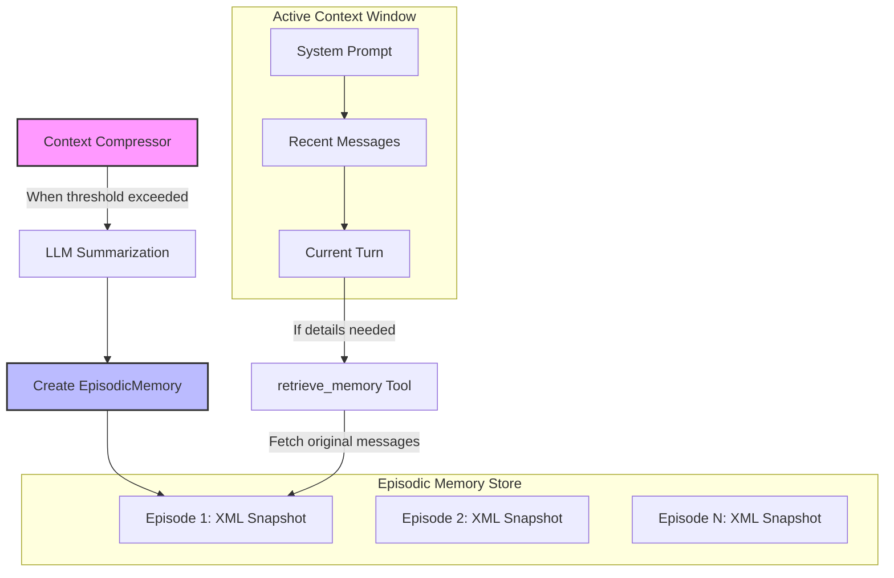
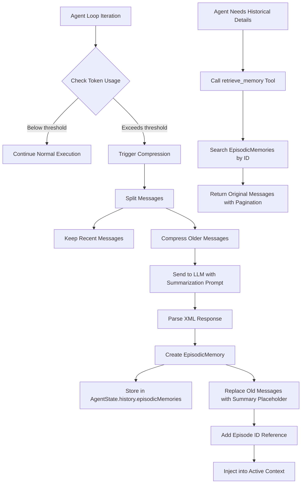

This page provides a comprehensive explanation of how `dart_agent_core` handles long-running conversations through automatic context compression and episodic memory storage. When an agent's conversation history grows too large for the LLM's context window, the framework automatically compresses older messages into structured snapshots while preserving the ability to retrieve original details when needed.

## The Problem: Context Window Limitations

LLMs have finite context windows, typically ranging from 4K to 200K tokens. In agentic workflows where tools are called frequently and conversations extend over many turns, the active context can quickly exceed these limits. Simply truncating history loses critical information, while keeping everything risks hitting token limits and degrading performance.

The framework solves this with a two-tier memory architecture:

1. **Active Context**: Recent messages that remain in the immediate conversation flow
2. **Episodic Memory**: Compressed snapshots of older conversations that can be retrieved on demand



The `LLMBasedContextCompressor` monitors token usage and automatically triggers compression when the context grows too large, ensuring the agent can continue working without manual intervention.

Sources: [context_compressor.dart](lib/src/agent/context_compressor.dart#L1-L30)

## Architecture Overview

The context compression system consists of three core components that work together:

| Component | Purpose | Key Methods |
|-----------|---------|-------------|
| `ContextCompressor` | Abstract interface for compression strategies | `compress(AgentState state)` |
| `LLMBasedContextCompressor` | LLM-powered summarization implementation | `_compressToEpisodicMemory()` |
| `EpisodicMemory` | Data structure storing compressed snapshots | `toJson()`, `fromJson()` |

The compression process follows a systematic pattern:



Sources: [context_compressor.dart](lib/src/agent/context_compressor.dart#L32-L80), [memory.dart](lib/src/agent/memory.dart#L1-L50)

## LLM-Based Compression Implementation

The `LLMBasedContextCompressor` uses an LLM to generate structured XML snapshots of conversation history. This approach preserves semantic understanding while dramatically reducing token count.

### Compression Parameters

The compressor accepts several configuration parameters to control when and how compression occurs:

| Parameter | Default | Description |
|-----------|---------|-------------|
| `totalTokenThreshold` | 64000 | Token count that triggers compression |
| `keepRecentMessageSize` | 10 | Number of recent messages to preserve |
| `client` | Required | LLM client for generating summaries |
| `modelConfig` | Required | Model configuration for summarization |

```dart
final compressor = LLMBasedContextCompressor(
  client: client,
  modelConfig: ModelConfig(model: 'gpt-4o-mini'),
  totalTokenThreshold: 64000,
  keepRecentMessageSize: 10,
);

final agent = StatefulAgent(
  name: 'my_agent',
  client: client,
  modelConfig: modelConfig,
  compressor: compressor, // Attach compressor
);
```

### Smart Message Splitting

The compressor respects tool call/result pairs when splitting messages. It scans backward from the proposed split point to ensure it doesn't separate a `FunctionCall` from its `FunctionExecutionResult`:

```dart
// From context_compressor.dart
int splitIndex = state.history.messages.length - keepRecentMessageSize;

// Adjust splitIndex to respect FunctionCall/ToolResult pairs
while (splitIndex > 0) {
  final firstToKeep = state.history.messages[splitIndex];
  bool isToolCallResult = firstToKeep is FunctionExecutionResultMessage;
  if (isToolCallResult) {
    splitIndex--;
  } else {
    break;
  }
}
```

This prevents leaving orphaned tool calls or results in the active context, which would confuse the LLM.

Sources: [context_compressor.dart](lib/src/agent/context_compressor.dart#L80-L130)

## The Summarization Prompt Structure

The compressor sends messages to the LLM with a carefully designed prompt that generates structured XML snapshots. The prompt instructs the LLM to:

1. **Reason in a scratchpad**: Think through the entire conversation history
2. **Generate a state snapshot**: Create an XML structure with specific sections
3. **Be information-dense**: Omit conversational filler while preserving critical facts

### XML Snapshot Structure

The generated XML follows this structure:

```xml
<state_snapshot>
    <overall_goal>
        <!-- Single sentence describing the user's high-level objective -->
    </overall_goal>
    
    <key_knowledge>
        <!-- Bullet points of crucial facts, conventions, and constraints -->
    </key_knowledge>
    
    <file_system_state>
        <!-- List of files created, read, modified, or deleted -->
    </file_system_state>
    
    <recent_actions>
        <!-- Summary of last significant agent actions and outcomes -->
    </recent_actions>
    
    <current_plan>
        <!-- Step-by-step plan with completion status -->
    </current_plan>
</state_snapshot>
```

This structure ensures the compressed snapshot contains all essential information needed for the agent to continue its work effectively.

Sources: [context_compressor.dart](lib/src/agent/context_compressor.dart#L30-L80)

## Episodic Memory Storage

Compressed conversations are stored as `EpisodicMemory` objects within `AgentState.history.episodicMemories`. Each episode contains:

| Field | Type | Description |
|-------|------|-------------|
| `id` | `String` | Unique identifier (e.g., `episode_aB3xYz`) |
| `summary` | `String` | XML snapshot generated by the LLM |
| `messages` | `List<LLMMessage>` | Original raw messages before compression |

### Memory Persistence

Episodic memories are serialized as part of `AgentMessageHistory` and can be persisted using `FileStateStorage`:

```dart
final storage = FileStateStorage(Directory('.state_dir'));
final state = await storage.loadOrCreate('session_123');

// Episodic memories are automatically saved/loaded
await storage.save(state);
```

The compression process adds the new episode to the history and replaces the compressed messages with a summary placeholder:

```dart
// Add to Episodic Memory
EpisodicMemory newEpisodicMemory = EpisodicMemory(
  id: generateEpisodeId('episode'),
  summary: xmlString,
  messages: messagesToSummarize,
);

state.history.episodicMemories.add(newEpisodicMemory);

// Create summary message for active context
final snapshotMessage = '$xmlString\n\n'
    '(Snapshot ID: ${newEpisodicMemory.id}. '
    'If you need to recall specific details from this compressed history, '
    'use the `retrieve_memory` tool with this ID.)';
```

Sources: [memory.dart](lib/src/agent/memory.dart#L1-L50), [context_compressor.dart](lib/src/agent/context_compressor.dart#L130-L180)

## The retrieve_memory Tool

When episodic memories exist, the agent automatically gains access to the `retrieve_memory` tool. This allows the agent to fetch original messages when the compressed snapshot lacks sufficient detail.

### Tool Parameters

| Parameter | Type | Required | Description |
|-----------|------|----------|-------------|
| `snapshot_id` | `String` | Yes | ID of the memory to retrieve |
| `limit` | `Integer` | No | Maximum messages to return (default: 20) |
| `offset` | `Integer` | No | Pagination offset (default: 0) |

### Automatic Tool Injection

The tool is automatically added to the agent's available tools when episodic memories exist:

```dart
// From stateful_agent.dart
if (state.history.episodicMemories.isNotEmpty) {
  toolsCopy.addAll(memoryTools);
}
```

### Retrieval Process

The `_retrieveMemory` function searches through episodic memories and returns original messages with pagination support:

```dart
final episodic = state.history.episodicMemories.firstWhere(
  (m) => m.id == snapshotId,
  orElse: () => EpisodicMemory(id: '', summary: '', messages: []),
);

if (episodic.id.isNotEmpty) {
  messages = episodic.messages;
}

// Apply pagination
final end = (effectiveOffset + effectiveLimit < messages.length)
    ? effectiveOffset + effectiveLimit
    : messages.length;
final slicedMessages = messages.sublist(effectiveOffset, end);
```

Sources: [memory.dart](lib/src/agent/memory.dart#L80-L144), [stateful_agent.dart](lib/src/agent/stateful_agent.dart#L650-L660)

## Integration with the Agent Loop

Context compression is seamlessly integrated into the agent's main loop. The compressor is called at the beginning of each iteration, before preparing the model call:

```dart
// From stateful_agent.dart
while (true) {
  if (state.currentLoopCount >= currentMaxTurns) {
    throw AgentException(
      AgentExceptionCode.loopDetection,
      'Maximum turns reached ($currentMaxTurns).',
    );
  }

  if (compressor != null) {
    await compressor!.compress(state); // Check and compress if needed
  }

  final modelCall = await _prepareModelCallPhase(...);
  // Continue with normal execution
}
```

### Compression Flow

1. **Token Monitoring**: The compressor checks `state.usages.last.promptTokens`
2. **Threshold Check**: Compares against `totalTokenThreshold`
3. **Message Splitting**: Separates messages to compress from those to keep
4. **LLM Summarization**: Sends older messages to LLM for compression
5. **State Update**: Adds episodic memory and updates active context
6. **Tool Injection**: Makes `retrieve_memory` available if memories exist

This automatic process ensures the agent never exceeds context limits while maintaining access to historical information.

Sources: [stateful_agent.dart](lib/src/agent/stateful_agent.dart#L880-L920)

## Configuration and Best Practices

### Choosing Threshold Values

The `totalTokenThreshold` should be set based on your LLM's context window:

| Model Type | Recommended Threshold | Notes |
|------------|----------------------|-------|
| GPT-4o | 120,000 | Large context window |
| GPT-4o-mini | 64,000 | Default in framework |
| Claude 3.5 | 180,000 | Very large context |
| Gemini 1.5 Pro | 1,000,000 | Extremely large |

### Adjusting Recent Message Buffer

The `keepRecentMessageSize` parameter controls how many messages remain in active context:

- **Smaller values (5-10)**: More aggressive compression, saves more tokens
- **Larger values (15-20)**: Preserves more recent context, less frequent compression

### Monitoring Compression Events

Use logging to monitor when compression occurs:

```dart
import 'package:logging/logging.dart';

Logger('LLMBasedContextCompressor').onRecord.listen((record) {
  print('${record.level.name}: ${record.message}');
});
```

Expected log messages:
- "Compression Complete. Added 1 Episodic Memory. X messages compressed."
- "Context compressed. Original: X, New: Y."

### Memory Retrieval Patterns

When the agent needs historical details, it should:

1. **Check the summary first**: The XML snapshot often contains sufficient information
2. **Use pagination**: For large histories, retrieve in chunks using `limit` and `offset`
3. **Be specific**: Ask for particular time ranges or message types when possible

Sources: [context_compressor.dart](lib/src/agent/context_compressor.dart#L1-L30), [doc/state_and_memory.md](doc/state_and_memory.md#L80-L120)

## Error Handling and Edge Cases

The compressor includes several safeguards:

### Insufficient History

Compression is skipped if there aren't enough messages to summarize:

```dart
if (messagesToSummarize.length < 3) {
  return; // Not enough messages to compress
}
```

### XML Parsing Errors

The compressor handles malformed XML responses gracefully:

```dart
try {
  final String xmlString = _extractXmlFromResponse(summaryText);
  // Process successful summary
} catch (e) {
  _logger.severe("❌ Error parsing summary XML: $e");
  _logger.fine("Raw Output: $summaryText");
}
```

### Empty Summaries

If the LLM returns an empty summary, the compression is aborted:

```dart
if (summaryText == null || summaryText.isEmpty) {
  _logger.warning("Warning: Empty summary generated.");
  return;
}
```

These safeguards ensure the agent remains stable even when compression encounters issues.

Sources: [context_compressor.dart](lib/src/agent/context_compressor.dart#L100-L150)

## Next Steps

Now that you understand how context compression and episodic memory work, you might want to explore:

- [State Management and File Persistence](7-state-management-and-file-persistence) - How agent state is persisted across sessions
- [AgentHook Pipeline](14-agenthook-pipeline) - Customizing agent behavior with hooks
- [Loop Detection and Recovery](15-loop-detection-and-recovery) - Preventing infinite loops in long conversations

The episodic memory system integrates seamlessly with other agent extension points, providing a robust foundation for building long-running, context-aware agents.