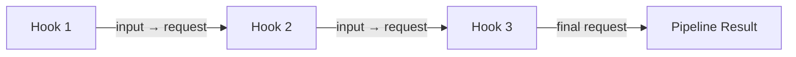
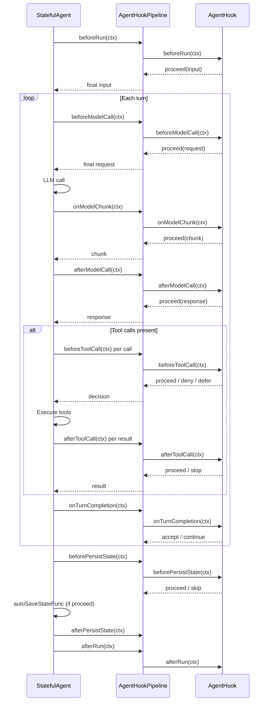

The **AgentHook Pipeline** is the primary extension mechanism for intercepting and controlling every phase of a `StatefulAgent`'s lifecycle — from input preparation through model invocation, tool execution, and state persistence. Rather than subclassing the agent, you compose a list of `AgentHook` subclasses that the pipeline threads through sequentially, passing mutable context at each stage and receiving structured result objects that dictate next actions.

This page covers the pipeline architecture, all eight hook phases, the context/result type system, composition semantics, and practical integration patterns. For the agentic loop that orchestrates these hooks, see [StatefulAgent and the Agentic Loop](5-statefulagent-and-the-agentic-loop).

---

## Architecture Overview

The pipeline is built on two types defined in a single source file: the abstract `AgentHook` base class (which you subclass) and the `AgentHookPipeline` class (which the `StatefulAgent` constructs internally). Every `StatefulAgent` instance creates a pipeline at construction time from the `hooks` parameter and invokes it at precise integration points within the agentic loop.

```mermaid
flowchart TD
    subgraph "StatefulAgent.run() Lifecycle"
        A["<b>beforeRun</b><br/>Input rewriting / abort"] --> B["<b>beforeModelCall</b><br/>Request rewriting / synthetic response"]
        B --> C{"Synthetic<br/>response?"}
        C -- Yes --> D["<b>onModelChunk</b><br/>Chunk filtering"]
        C -- No --> E["LLM call (stream or generate)"]
        E --> F["<b>onModelChunk</b><br/>Per-chunk filtering"]
        D --> G["<b>afterModelCall</b><br/>Response rewrite / retry"]
        F --> G
        G --> H{"Tool calls?"}
        H -- No --> I["<b>onTurnCompletion</b><br/>Accept or continue"]
        H -- Yes --> J["<b>beforeToolCall</b><br/>Deny / defer / rewrite args"]
        J --> K["Tool execution"]
        K --> L["<b>afterToolCall</b><br/>Rewrite result / inject messages / stop"]
        L --> I
        I -->|"continue"| B
        I -->|"accept"| M["<b>beforePersistState</b><br/>Proceed / skip / abort"]
        M --> N["autoSaveStateFunc"]
        N --> O["<b>afterPersistState</b>"]
        O --> P["<b>afterRun</b><br/>Observation"]
    end
```



Sources: [lib/src/agent/agent_hook.dart](lib/src/agent/agent_hook.dart#L1-L685), [lib/src/agent/stateful_agent.dart](lib/src/agent/stateful_agent.dart#L456-L511)

---

## The Eight Hook Phases

Each phase corresponds to a method on `AgentHook` and a specific integration point inside the agentic loop. All methods return `FutureOr<T>`, allowing both synchronous and asynchronous implementations.

| Phase | Hook Method | When It Fires | Primary Use Cases |
|---|---|---|---|
| **1. Before Run** | `beforeRun()` | Once, before the loop begins | Rewrite input messages, abort early |
| **2. Before Model Call** | `beforeModelCall()` | Each turn, before the LLM is called | Rewrite system prompt, inject context, return synthetic response |
| **3. Model Chunk** | `onModelChunk()` | Each streamed chunk or single response | Filter, rewrite, or drop chunks in real time |
| **4. After Model Call** | `afterModelCall()` | Each turn, after the full response is assembled | Rewrite response, trigger retry, abort |
| **5. Before Tool Call** | `beforeToolCall()` | Per tool call, before execution | Deny tools, defer execution, rewrite arguments |
| **6. After Tool Call** | `afterToolCall()` | Per tool result, after execution | Rewrite results, inject follow-up messages, stop the loop |
| **7. Turn Completion** | `onTurnCompletion()` | When the model produces a final text response | Continue the run with additional messages |
| **8. State Persistence** | `beforePersistState()` / `afterPersistState()` | Each time state is about to be saved | Skip persistence, observe writes, abort |

Sources: [lib/src/agent/agent_hook.dart](lib/src/agent/agent_hook.dart#L470-L548)

---

## Context and Result Type System

Every hook phase has a dedicated **context** class (read-only input) and a **result** class (mutable output). All context classes extend `AgentHookContext`, which provides access to the `StatefulAgent` instance and its `AgentState`. Result classes use named constructors for each available **action**, following a discriminated-union pattern.

### Context Classes

| Context Class | Key Properties |
|---|---|
| `BeforeRunHookContext` | `input`, `stream`, `cancelToken` |
| `ModelCallHookContext` | `request` (a `ModelCallRequest`), `turnIndex`, `cancelToken` |
| `ModelChunkHookContext` | `params`, `chunk` |
| `ModelResponseHookContext` | `params`, `response` |
| `ToolCallHookContext` | `call`, `modelMessage`, `availableTools` |
| `ToolResultHookContext` | `result`, `modelMessage` |
| `TurnCompletionHookContext` | `finalMessage`, `continuationCount`, `maxContinuations` |
| `StatePersistenceHookContext` | `reason`, `runError` |
| `AfterRunHookContext` | `input`, `modelMessages`, `error` |

All contexts expose `agent` (the `StatefulAgent`) and `state` (the `AgentState`) through the base class.

Sources: [lib/src/agent/agent_hook.dart](lib/src/agent/agent_hook.dart#L65-L270)

### Result Classes and Actions

Each result class enumerates its possible actions via an enum and provides named constructors:

**BeforeRunHookResult** — actions: `proceed`, `abort`
- `proceed([input])` — optionally rewrite the input list
- `abort({error, reason})` — halt the entire run

**ModelCallHookResult** — actions: `proceed`, `respond`, `abort`
- `proceed({request, changed})` — pass or rewrite the `ModelCallRequest`
- `respond(response, {request, reason})` — return a synthetic response without calling the LLM
- `abort({error, reason})` — halt the run

**ModelChunkHookResult** — actions: `proceed`, `drop`, `abort`
- `proceed([chunk])` — pass or rewrite the chunk
- `drop({reason})` — discard the chunk (useful for filtering streaming output)
- `abort({error, reason})` — halt the run

**ModelResponseHookResult** — actions: `proceed`, `retry`, `abort`
- `proceed([response])` — accept or rewrite the assembled response
- `retry(retryReason)` — re-invoke the LLM
- `abort({error, reason})` — halt the run

**ToolCallHookResult** — actions: `proceed`, `deny`, `defer`, `abort`
- `proceed([call])` — pass or rewrite the `FunctionCall` (arguments, name)
- `deny({content, isError, metadata, reason})` — block execution with a synthetic error result
- `denyWithResult(syntheticResult)` — block with a fully supplied `ExecutionToolResult`
- `defer({content, metadata, reason})` — block execution with a non-error synthetic result
- `abort({error, reason})` — halt the run

**ToolResultHookResult** — actions: `proceed`, `stop`, `abort`
- `proceed({result, injectedMessages})` — pass or rewrite the result, optionally inject messages into history
- `stop({result, injectedMessages, reason})` — same as proceed but breaks the agentic loop
- `abort({error, reason})` — halt the run

**TurnCompletionHookResult** — actions: `accept`, `continueRun`, `abort`
- `accept()` — allow the run to finish normally
- `continueWith(messages)` — append messages and trigger another turn
- `abort({error, reason})` — halt the run

**StatePersistenceHookResult** — actions: `proceed`, `skip`, `abort`
- `proceed()` — allow `autoSaveStateFunc` to execute
- `skip({reason})` — suppress the save call
- `abort({error, reason})` — halt the run

Sources: [lib/src/agent/agent_hook.dart](lib/src/agent/agent_hook.dart#L275-L548)

---

## Pipeline Composition Semantics

`AgentHookPipeline` wraps a `List<AgentHook>` and executes each hook sequentially within every phase. The composition rules differ by phase to support distinct interaction patterns:

### Transformation Chains (beforeRun, beforeModelCall, afterModelCall, afterToolCall)

Each hook receives the output of the previous hook as its input. The final hook's output becomes the pipeline's result. This enables incremental rewriting — for example, one hook rewrites the system message while another appends tool-use context.



In the `afterToolCall` phase, injected messages from all hooks are **accumulated** into a single list, rather than being replaced.

### Short-Circuit Phases (onTurnCompletion, beforePersistState)

For `onTurnCompletion`, the pipeline iterates hooks and **returns immediately** on the first non-`accept` action (either `continueRun` or `abort`). This ensures only one hook can trigger continuation.

For `beforePersistState`, the first hook to return `skip` or `abort` wins, and subsequent hooks are not called.

### Observational Phases (afterPersistState, afterRun)

These are fire-and-forget — the pipeline calls every hook in sequence regardless of results, useful for logging, metrics, or cleanup.

Sources: [lib/src/agent/agent_hook.dart](lib/src/agent/agent_hook.dart#L550-L685)

### Tool Call ID Preservation

When `beforeToolCall` rewrites a `FunctionCall`, the pipeline preserves the original call's `id` to maintain correlation with the LLM's expected response structure. This is handled by the internal `_preserveToolCallId` helper.

Sources: [lib/src/agent/agent_hook.dart](lib/src/agent/agent_hook.dart#L679-L685)

---

## Integration with StatefulAgent

The `StatefulAgent` constructor accepts an optional `hooks` parameter and immediately wraps it in a pipeline:

```dart
final agent = StatefulAgent(
  name: 'my_agent',
  client: client,
  modelConfig: modelConfig,
  state: state,
  hooks: [myHook],  // List<AgentHook>?
  maxTurnContinuations: 3,
);
```

The `maxTurnContinuations` parameter (default: 3) limits how many times `onTurnCompletion` can return `continueWith` before the pipeline forces acceptance. This prevents infinite continuation loops.

### Abort Propagation

When any hook returns an `abort` action, the pipeline throws an `AgentException` with code `AgentExceptionCode.stopByController`. The exception is caught by the `run()` method's error handling, which still fires `afterRun` and `beforePersistState` (via the `finally` block) to allow cleanup hooks to execute.

Sources: [lib/src/agent/stateful_agent.dart](lib/src/agent/stateful_agent.dart#L494-L511), [lib/src/agent/stateful_agent.dart](lib/src/agent/stateful_agent.dart#L1249-L1260)

---

## Pattern: Blocking Dangerous Tools

A `beforeToolCall` hook can deny tool execution without running the tool's executable. The hook returns a `ToolCallHookResult.deny` or `ToolCallHookResult.defer` with synthetic content, and the pipeline constructs a `FunctionExecutionResultMessage` from the synthetic data.

| Action | Error Flag | Use Case |
|---|---|---|
| `deny` | `true` | Tool is forbidden (e.g., sandboxing) |
| `defer` | `false` | Tool will run later (e.g., queued for batch) |
| `denyWithResult` | Custom | Supply a complete pre-built result with specific ID |

Sources: [test/agent_hooks_test.dart](test/agent_hooks_test.dart#L81-L117)

## Pattern: Injecting Persistent Context

A `beforeModelCall` hook can both mutate the current request **and** persist messages into `state.history`. This is critical for cross-turn context injection — for example, injecting a system-injected user message once that persists across subsequent loops.

The pattern:
1. Add the message to `context.state.history.messages`
2. Include the same message in the `requestMessages` of the returned `ModelCallRequest`
3. Track state (e.g., a boolean flag) to inject only once

Sources: [test/agent_hooks_test.dart](test/agent_hooks_test.dart#L30-L79)

## Pattern: Synthetic Model Responses

A `beforeModelCall` hook can return `ModelCallHookResult.respond(response)` to completely bypass the LLM. The synthetic response passes through `onModelChunk` (for consistent filtering) and then continues through `afterModelCall` and the rest of the loop. This is useful for deterministic testing or cached responses.

Sources: [test/agent_hooks_test.dart](test/agent_hooks_test.dart#L233-L260)

## Pattern: Stream Chunk Filtering

The `onModelChunk` hook fires for every streaming chunk (or the single response in non-streaming mode). Returning `ModelChunkHookResult.drop()` removes a chunk from the aggregation, while `ModelChunkHookResult.proceed(chunk)` can rewrite the chunk entirely. This enables real-time content filtering during streaming.

Sources: [test/agent_hooks_test.dart](test/agent_hooks_test.dart#L262-L290)

## Pattern: Forced Retry with Rewrite

`afterModelCall` can trigger a re-invocation of the LLM via `ModelResponseHookResult.retry(reason)` or rewrite the final response before it enters the history. The pipeline supports retry counting in the agentic loop to prevent infinite retry spirals.

Sources: [test/agent_hooks_test.dart](test/agent_hooks_test.dart#L292-L319)

## Pattern: Post-Tool Message Injection and Loop Stop

`afterToolCall` can inject arbitrary `LLMMessage`s into the conversation history alongside the tool result. Combined with `ToolResultHookResult.stop`, this lets a hook terminate the agentic loop after a tool executes — for example, after a critical error that should not be retried.

Sources: [test/agent_hooks_test.dart](test/agent_hooks_test.dart#L395-L422)

## Pattern: Turn Continuation

`onTurnCompletion` can force the agent to run additional turns by returning `TurnCompletionHookResult.continueWith(messages)`. The messages are appended to `state.history` and the loop continues from the next model call. The `continuationCount` and `maxContinuations` parameters in the context prevent unbounded continuation.

Sources: [test/agent_hooks_test.dart](test/agent_hooks_test.dart#L139-L171)

## Pattern: State Persistence Control

`beforePersistState` can suppress `autoSaveStateFunc` execution by returning `StatePersistenceHookResult.skip()`. The `reason` field in the context explains why persistence is happening (e.g., `"afterToolCall"`, `"finally"`), enabling hooks to make selective decisions.

Sources: [test/agent_hooks_test.dart](test/agent_hooks_test.dart#L340-L392)

---

## Hook Lifecycle Summary



Sources: [lib/src/agent/stateful_agent.dart](lib/src/agent/stateful_agent.dart#L1249-L1620)

---

## Next Steps

- **Understand the loop that invokes these hooks**: [StatefulAgent and the Agentic Loop](5-statefulagent-and-the-agentic-loop)
- **Add loop safety to hook-driven continuations**: [Loop Detection and Recovery](15-loop-detection-and-recovery)
- **See how tools work before hooking them**: [Tool System and Parameter Modes](6-tool-system-and-parameter-modes)
- **Full working example with multiple hook patterns**: [example/simple_agent_with_hooks_example.dart](example/simple_agent_with_hooks_example.dart)
- **Complete test coverage of all hook phases**: [test/agent_hooks_test.dart](test/agent_hooks_test.dart)