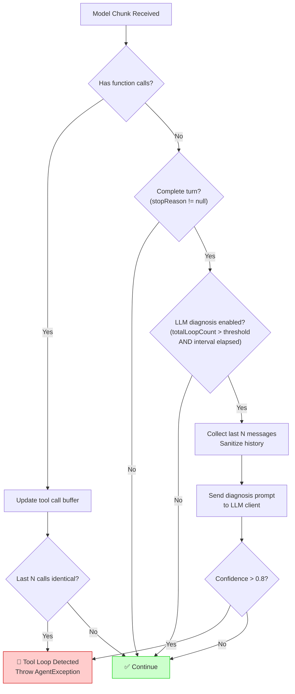

The agentic loop — where the LLM reasons, calls tools, observes results, and repeats — is the heartbeat of every `StatefulAgent`. But this heartbeat can become pathological: the agent repeats the same failing tool call indefinitely, oscillates between two states, or drifts into cognitive stagnation where each response adds no meaningful progress. The **Loop Detection and Recovery** system is the safety net that identifies these failure modes and terminates execution before they consume unbounded resources. This page explains the architecture, the two complementary detection strategies, how they integrate into the agentic loop, and how to configure them.

## Architecture Overview

Loop detection in `dart_agent_core` is **layered**, combining fast in-process pattern matching with periodic LLM-assisted diagnosis. This dual approach balances responsiveness (catching obvious tool loops instantly) with nuance (catching subtle cognitive loops that only an LLM can recognize).



The system exposes an abstract `LoopDetector` interface, allowing callers to substitute custom implementations. The built-in `DefaultLoopDetector` implements both strategies. Sources: [loop_detector.dart](lib/src/agent/loop_detector.dart#L13-L17)

## The LoopDetector Interface

The contract is deliberately minimal — a single `detect` method that receives each model chunk as it arrives:

```dart
abstract class LoopDetector {
  Future<LoopDetectorResult> detect(ModelMessage chunkMessage);
}
```

The result is a simple value object carrying a boolean flag and an optional human-readable message:

```dart
class LoopDetectorResult {
  final bool isLoop;
  final String? message;
  LoopDetectorResult({required this.isLoop, this.message});
}
```

This interface-level design means loop detection is **decoupled** from the agent's core loop. The `StatefulAgent` calls `loopDetector.detect(...)` on every meaningful model chunk, but it has no knowledge of _how_ detection works. Sources: [loop_detector.dart](lib/src/agent/loop_detector.dart#L13-L17)

## Strategy 1: Tool Call Loop Detection

The first strategy is a **pure in-memory pattern matcher** that operates on a sliding window of recent tool call signatures. It is fast, deterministic, and requires no external calls.

### How It Works

Each tool call is reduced to a **signature** — a string combining the tool name and its serialized arguments:

```dart
String _getSignature(FunctionCall call) => '${call.name}:${call.arguments}';
```

The detector maintains a fixed-size buffer (`_recentToolCalls`) capped at `toolLoopThreshold` entries. On each new tool call, it either updates the last entry (for streaming incremental updates with the same ID) or appends a new entry. When the buffer is full and all entries share the identical signature, a loop is declared.

### Streaming Awareness

A critical subtlety: during streaming, the LLM may send the same `FunctionCall` ID across multiple chunks as arguments arrive incrementally. The detector handles this by checking whether the incoming call's ID matches the last buffered entry — if so, it _updates_ the signature rather than appending a new one. This prevents false positives from partial argument deltas.

```dart
void _updateToolCalls(List<FunctionCall> calls) {
  for (final call in calls) {
    final signature = _getSignature(call);
    if (_recentToolCalls.isNotEmpty && _recentToolCalls.last.id == call.id) {
      _recentToolCalls.last.signature = signature;  // Update in place
    } else {
      _recentToolCalls.add(_ToolCallEntry(call.id, signature));
      if (_recentToolCalls.length > toolLoopThreshold) {
        _recentToolCalls.removeAt(0);
      }
    }
  }
}
```

### Initialization from History

When a `DefaultLoopDetector` is created, it scans the existing conversation history to populate its buffer. This ensures detection works correctly even when resuming a stateful agent that may already be mid-loop. Sources: [loop_detector.dart](lib/src/agent/loop_detector.dart#L43-L75)

| Aspect | Behavior |
|---|---|
| **Signature format** | `"toolName:serializedArguments"` |
| **Buffer size** | Capped at `toolLoopThreshold` (default: 5) |
| **Streaming handling** | Same-ID chunks update the last entry in-place |
| **History bootstrapping** | Scans existing `state.history.messages` on construction |
| **Detection trigger** | Fires immediately on every tool-carrying chunk |

## Strategy 2: LLM Smart Diagnosis

The second strategy is an **asynchronous, periodic consultation** with an LLM — essentially using a separate LLM call to judge whether the agent's conversation history exhibits loop behavior. This catches the subtle cases that signature matching cannot: flip-flopping between two tool sets, repeating similar but not identical questions, or generating verbose responses that lack forward progress.

### Activation Conditions

LLM diagnosis does not run on every turn. It activates only when **all three** conditions are met:

1. **Turn count exceeds threshold**: `state.totalLoopCount > llmCheckAfterTurns` (default: 30) — avoids overhead during early exploration
2. **Interval has elapsed**: `(state.totalLoopCount - _lastLLMCheckTurn) >= llmCheckInterval` (default: 10) — limits frequency
3. **The chunk is a complete turn**: `chunkMessage.stopReason != null` — streaming deltas and tool-calling responses are excluded

### History Sanitization

Before sending history to the diagnosis LLM, the detector performs two sanitization passes to prevent API errors:

1. **Remove leading orphaned tool results**: `FunctionExecutionResultMessage` entries at the start of the window are stripped
2. **Ensure valid conversation start**: If the first message is a `ModelMessage`, a synthetic `UserMessage` is prepended to satisfy strict alternation requirements

```dart
// Sanitize history to prevent API errors
while (history.isNotEmpty && history.first is FunctionExecutionResultMessage) {
  history.removeAt(0);
}
if (history.isNotEmpty && history.first is ModelMessage) {
  history.insert(0, UserMessage.text("...previous context..."));
}
```

### Diagnosis Prompt

The LLM receives a structured prompt defining three loop categories:

| Loop Type | Description |
|---|---|
| **Repeating wrong action** | Same failing action attempted despite errors |
| **Repeating same question/text** | Identical or near-identical responses without progress |
| **Flip-flopping** | Alternating between two states without resolution |

The LLM returns structured JSON with `is_loop`, `reason`, and `confidence` fields. A loop is only declared when confidence exceeds **0.8**, preventing false positives from the LLM's own uncertainty.

### Graceful Degradation

If the LLM call fails for any reason (network error, parsing failure, malformed response), the detector logs a warning and returns `isLoop: false`. This ensures that diagnosis failures never block agent execution — they simply skip the check. Sources: [loop_detector.dart](lib/src/agent/loop_detector.dart#L98-L218)

## Integration with StatefulAgent

The loop detector is wired into the agentic loop at multiple safety boundaries within `StatefulAgent`.

### Initialization

By default, a `DefaultLoopDetector` is created in the `StatefulAgent` constructor. You can supply a custom implementation via the `loopDetector` parameter:

```dart
final agent = StatefulAgent(
  name: 'my-agent',
  client: client,
  modelConfig: modelConfig,
  state: state,
  loopDetector: DefaultLoopDetector(
    state: state,
    client: client,
    modelConfig: modelConfig,
    toolLoopThreshold: 7,       // Allow 7 identical calls before alarm
    llmCheckAfterTurns: 20,     // Start LLM diagnosis after 20 turns
    llmCheckInterval: 5,        // Check every 5 turns thereafter
    llmCheckHistorySize: 30,    // Send last 30 messages for diagnosis
  ),
);
```

Sources: [stateful_agent.dart](lib/src/agent/stateful_agent.dart#L495-L518)

### Where Detection Fires

The detector is invoked in `_applyModelChunkPhase`, which runs on every model chunk — both streaming deltas and complete responses. The `detectLoop` parameter controls whether detection runs:

```dart
Future<ModelMessage?> _applyModelChunkPhase(
  CallLLMParams params,
  ModelMessage chunk, {
  required bool detectLoop,
}) async {
  // ... hook pipeline ...
  if (detectLoop) {
    final loopDetectResult = await loopDetector.detect(nextChunk);
    if (loopDetectResult.isLoop) {
      throw AgentException(
        AgentExceptionCode.loopDetection,
        'Loop detected, ${loopDetectResult.message}',
      );
    }
  }
  return nextChunk;
}
```

In the main agentic loop, `detectLoop: true` is used for streamed chunks and non-synthetic generated responses. Synthetic responses (from hooks) bypass detection since they are not agent-initiated behavior. Sources: [stateful_agent.dart](lib/src/agent/stateful_agent.dart#L1380-L1410)

### Additional Safety Boundaries

Beyond the `LoopDetector` itself, `StatefulAgent` enforces several hard limits that serve as last-resort loop breakers:

| Boundary | Default | Exception Code | Trigger |
|---|---|---|---|
| **Max turns per run** | 20 (`maxTurns`) | `loopDetection` | `currentLoopCount >= maxTurns` |
| **Empty stop reason retries** | 3 (`maxRetryCount`) | `loopDetection` | Consecutive empty `stopReason` |
| **Empty response retries** | 3 (`maxRetryCount`) | `loopDetection` | Consecutive empty `ModelMessage` |
| **Hook retry limit** | 3 (`maxRetryCount`) | `loopDetection` | Consecutive hook-requested retries |
| **Turn continuations** | 3 (`maxTurnContinuations`) | (loop break) | Hook-driven `continueWith` limit |

All of these throw `AgentException` with `AgentExceptionCode.loopDetection`, providing a unified error type for callers to handle. Sources: [stateful_agent.dart](lib/src/agent/stateful_agent.dart#L859-L1061)

## Comparison: Two Detection Strategies

| Dimension | Tool Call Loop Detection | LLM Smart Diagnosis |
|---|---|---|
| **Speed** | Instant (in-memory) | Async (requires LLM call) |
| **Cost** | Zero | Token cost for diagnosis call |
| **What it catches** | Identical tool+args repeated N times | Cognitive stagnation, flip-flops, verbal loops |
| **False positive risk** | Very low (deterministic) | Moderate (mitigated by 0.8 confidence threshold) |
| **Streaming safe** | Yes (ID-based dedup) | Yes (only runs on complete turns) |
| **Activation** | Every tool-carrying chunk | Periodic (after turn threshold, at intervals) |
| **Customizable** | `toolLoopThreshold` | `llmCheckAfterTurns`, `llmCheckInterval`, `llmCheckHistorySize` |

## Handling Loop Detection Events

When a loop is detected, `StatefulAgent` throws an `AgentException` that propagates through the agentic loop. The exception carries the `AgentExceptionCode.loopDetection` code and a human-readable message. Callers can catch this at multiple levels:

**At the agent level** — the `runStream` method yields an `AgentStoppedEvent` with the error attached:

```dart
await for (final event in agent.runStream([UserMessage.text('...')])) {
  // ...
}
// After the stream completes, check state.lastError
if (state.lastError != null) {
  print('Agent stopped: ${state.lastError}');
}
```

**Via the controller** — subscribe to `OnAgentExceptionEvent` for real-time notification:

```dart
agent.controller?.on<OnAgentExceptionEvent>((event) {
  if (event.error is AgentException) {
    final ex = event.error as AgentException;
    if (ex.code == AgentExceptionCode.loopDetection) {
      print('Loop detected: ${ex.message}');
    }
  }
});
```

Sources: [exception.dart](lib/src/agent/exception.dart#L1-L20), [events.dart](lib/src/agent/events.dart#L1-L100)

## Custom Loop Detector

Because the system is built on the `LoopDetector` interface, you can implement domain-specific detection logic. For example, a detector that monitors token cost escalation or tracks specific "productive" tool calls to ensure the agent is making progress toward a goal:

```dart
class CostAwareLoopDetector implements LoopDetector {
  final AgentState state;
  final double maxCostPerTurn;

  CostAwareLoopDetector({required this.state, this.maxCostPerTurn = 0.50});

  @override
  Future<LoopDetectorResult> detect(ModelMessage chunkMessage) async {
    if (chunkMessage.usage != null) {
      final cost = chunkMessage.usage!.estimatedCost;
      if (cost > maxCostPerTurn) {
        return LoopDetectorResult(
          isLoop: true,
          message: 'Cost limit exceeded: \$${cost.toStringAsFixed(3)} > \$${maxCostPerTurn}',
        );
      }
    }
    return LoopDetectorResult(isLoop: false);
  }
}
```

Register it at construction time:

```dart
final agent = StatefulAgent(
  name: 'cost-aware-agent',
  client: client,
  modelConfig: modelConfig,
  state: state,
  loopDetector: CostAwareLoopDetector(state: state, maxCostPerTurn: 1.00),
);
```

Sources: [loop_detector.dart](lib/src/agent/loop_detector.dart#L13-L17), [stateful_agent.dart](lib/src/agent/stateful_agent.dart#L495-L518)

## Next Steps

Now that you understand how loop detection protects the agentic loop, consider these related topics:

- For the full lifecycle of the loop that detection monitors, see [StatefulAgent and the Agentic Loop](5-statefulagent-and-the-agentic-loop)
- For the hook pipeline that provides additional loop-break capabilities, see [AgentHook Pipeline](14-agenthook-pipeline)
- For state fields that track loop counts (`totalLoopCount`, `currentLoopCount`), see [State Management and File Persistence](7-state-management-and-file-persistence)
- For exception handling patterns, see [Streaming and Controller Events](8-streaming-and-controller-events)