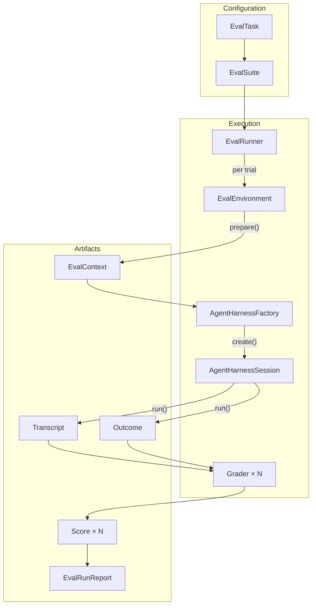
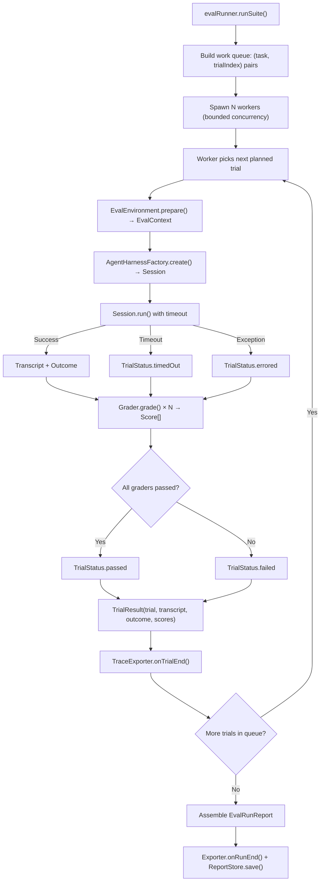

`dart_agent_core` includes a built-in evaluation (eval) subsystem designed for rigorous, reproducible testing of AI agents. It implements the eight-step methodology described in Anthropic's [Demystifying evals for AI agents](https://www.anthropic.com/engineering/demystifying-evals-for-ai-agids), providing a Dart-native alternative to tools like OpenAI Evals, Inspect AI, or Promptfoo — with zero external service dependencies.

This page gives you the big picture: the major components, how they interact, and where each concept fits. It does not cover the API details of individual classes — those live in the deeper pages linked at the bottom.

Sources: [lib/eval.dart](lib/eval.dart#L1-L10)

---

## Design Principles

The eval subsystem is guided by three architectural constraints:

1. **Separate import boundary.** The eval library is exposed through a dedicated `package:dart_agent_core/eval.dart` barrel, independent from the main `dart_agent_core.dart`. Applications that never run evals pay zero import cost. Sources: [lib/eval.dart](lib/eval.dart#L7-L9)
2. **Grade the right evidence.** For questions about the final world state, graders inspect the `Outcome` (what changed in the environment). For process questions, graders inspect the `Transcript` (what the agent did). This separation prevents graders from fabricating evidence and keeps persisted reports self-contained. Sources: [lib/src/eval/core/outcome.dart](lib/src/eval/core/outcome.dart#L2-L7)
3. **Harness-agnostic plumbing.** The framework handles concurrency, timeouts, recording, rate limiting, tracing, and reporting. You only supply the thin `AgentHarnessFactory` layer that knows your agent's shape. One `EvalEnvironment` can serve multiple harness implementations. Sources: [lib/src/eval/core/eval_runner.dart](lib/src/eval/core/eval_runner.dart#L24-L58)

---

## Component Map

The following diagram shows the five runtime roles and their relationships during a single eval run. A `TraceExporter` fan-out and `RecordingStore` are omitted for clarity — they attach to the runner and context respectively.



Sources: [lib/src/eval/core/eval_runner.dart](lib/src/eval/core/eval_runner.dart#L60-L133)

---

## The Five Roles

Each role maps to a clean interface boundary. Understanding these roles is the single most important step toward productive use of the framework.

| Role | Interface | Responsibility | You implement? |
|---|---|---|---|
| **Task** | `EvalTask` | One test case: input, graders, reference solution, metadata | ✅ Yes (or load from JSON) |
| **Suite** | `EvalSuite` | Collection of tasks targeting one agent, with a `SuiteKind` contract | ✅ Yes (or load from JSON) |
| **Environment** | `EvalEnvironment` | Per-trial resource setup (temp dirs, DB seeding, clock, LLM client wrapping) and teardown | ✅ Yes |
| **Harness** | `AgentHarnessFactory` → `AgentHarnessSession` | Translates `task.input` into agent calls, runs the agent, extracts `Outcome` from the workspace | ✅ Yes |
| **Runner** | `EvalRunner` | Orchestrates concurrency, timeouts, grading, tracing, reporting | ❌ No — call `runSuite()` |

Sources: [lib/src/eval/core/eval_task.dart](lib/src/eval/core/eval_task.dart#L16-L49), [lib/src/eval/core/eval_suite.dart](lib/src/eval/core/eval_suite.dart#L19-L76), [lib/src/eval/core/eval_context.dart](lib/src/eval/core/eval_context.dart#L12-L46), [lib/src/eval/core/eval_runner.dart](lib/src/eval/core/eval_runner.dart#L24-L58)

---

## Trial Lifecycle

A single trial proceeds through a strict lifecycle managed by `EvalRunner._runOneTrial()`. The runner guarantees that `prepare` and `dispose` are always called, even on error or timeout.



Sources: [lib/src/eval/core/eval_runner.dart](lib/src/eval/core/eval_runner.dart#L207-L356)

---

## Two Core Artifacts

The framework distinguishes **what the agent did** from **what the world looks like afterwards**. This separation is fundamental to grading correctness.

### Transcript — what the agent did

The `Transcript` captures the complete execution trace: every LLM message, every tool call with its arguments and results, reasoning steps, streaming events, and quantitative metrics (turn count, token count, time-to-first-token). The runner populates this automatically via `EvalTranscriptRecorder` attached to the `AgentController` — harnesses can return an empty `Transcript` and the runner replaces it with the recorder snapshot. Sources: [lib/src/eval/core/transcript.dart](lib/src/eval/core/transcript.dart#L7-L29)

### Outcome — what the world became

The `Outcome` holds the final environment state as a free-form `Map<String, dynamic>` and an optional `WorkspaceDiff` capturing filesystem-level changes (created, modified, deleted files with content snippets). **Graders never read disk.** All filesystem scanning, fact extraction, and state summarization happen inside the harness's `run()` method, and the results land in the `Outcome`. This makes persisted reports self-contained — they can be inspected offline without the original workspace. Sources: [lib/src/eval/core/outcome.dart](lib/src/eval/core/outcome.dart#L8-L22)

| Artifact | Content | Grader use |
|---|---|---|
| `Transcript` | Messages, tool calls, reasoning, events, perf metrics | Process questions: did the agent call the right tool? Did it reason before acting? |
| `Outcome` | Environment state map + `WorkspaceDiff` | Final-state questions: did the file get written? Is the fact recorded? |

Sources: [lib/src/eval/core/transcript.dart](lib/src/eval/core/transcript.dart#L7-L29), [lib/src/eval/core/outcome.dart](lib/src/eval/core/outcome.dart#L8-L22)

---

## Grading System

A `Grader` scores one facet of a trial. Tasks carry multiple graders, and a trial passes only when **every** grader passes. The framework provides three base classes aligned with Anthropic's three grading styles.

| Grader Kind | Base Class | Scoring mechanism | When to use |
|---|---|---|---|
| **Code** | `CodeGrader` | Deterministic assertions over `Outcome`/`Transcript` | Structural checks, exact value matches, tool-call audits |
| **Model** | `ModelGrader` | LLM-as-judge against a rubric prompt | Subjective quality, natural language correctness, multi-step reasoning |
| **Human** | `HumanGrader` | Queue for human review | Exploratory, aesthetic, ethical judgment |

Each `Grader.grade()` returns a `Score` containing:

- **`value`** — continuous 0.0–1.0 (supports partial credit), or `null` when the grader could not decide
- **`passed`** — whether `value` exceeds `passThreshold`
- **`assertions`** — granular sub-checks so a human can see exactly which sub-criterion failed
- **`rationale`** — required on failure; Anthropic Step 5 emphasizes "failures should seem fair"

Sources: [lib/src/eval/graders/grader.dart](lib/src/eval/graders/grader.dart#L16-L36), [lib/src/eval/graders/code_grader.dart](lib/src/eval/graders/code_grader.dart#L13-L62), [lib/src/eval/graders/model_grader.dart](lib/src/eval/graders/model_grader.dart#L10-L19), [lib/src/eval/graders/score.dart](lib/src/eval/graders/score.dart#L37-L71)

---

## Suite Kinds and Pass Semantics

The `SuiteKind` enum controls how task-level pass rates are computed, which directly affects CI gating decisions.

| Kind | Task passes when… | Metric equivalent | Typical use |
|---|---|---|---|
| `capability` | At least one trial passes | pass@N | "Can the agent do this at all?" Tolerates occasional misses |
| `regression` | Every trial passes | pass^N | "Is the agent stable?" One miss blocks the PR |
| `mixed` | Same as regression | pass^N | Transitional suites that haven't been split yet |

The `EvalSuite.validate()` method enforces structural invariants at construction time: unique task IDs, non-empty grader lists, and optional reference solution requirements. Sources: [lib/src/eval/core/eval_suite.dart](lib/src/eval/core/eval_suite.dart#L5-L15), [lib/src/eval/core/eval_suite.dart](lib/src/eval/core/eval_suite.dart#L57-L75)

---

## Supporting Subsystems

The eval framework wraps the five core roles with several cross-cutting subsystems. Each is optional and pluggable.

| Subsystem | Key interfaces | Purpose |
|---|---|---|
| **Recording / Replay** | `RecordingLLMClient`, `ReplayLLMClient`, `RecordingStore` | Record live LLM calls for deterministic replay; CI regression suites run in `replay` mode at zero cost. Sources: [lib/src/eval/llm/recording_llm_client.dart](lib/src/eval/llm/recording_llm_client.dart#L29-L53) |
| **Rate Limiting** | `RateLimitGate` (e.g. `RpmRateLimitGate`) | Throttle real LLM calls during live/record runs to respect provider quotas. Sources: [lib/src/eval/llm/rate_limit_gate.dart](lib/src/eval/llm/rate_limit_gate.dart) |
| **Observability** | `TraceExporter`, `JsonlTraceExporter`, `LangfuseTraceExporter` | Stream trial events (LLM calls, tool calls, trial start/end) to JSONL files, Langfuse, or custom backends. Sources: [lib/src/eval/observability/trace_exporter.dart](lib/src/eval/observability/trace_exporter.dart#L19-L58) |
| **Metrics** | `passAtK()`, `passCaretK()`, `ClassificationMetrics` | Statistical aggregation of trial outcomes using unbiased combinatorial formulas from the Codex paper. Sources: [lib/src/eval/metrics/pass_at_k.dart](lib/src/eval/metrics/pass_at_k.dart#L10-L24) |
| **Reporting** | `ReportStore`, `ReportGenerator`, `DiffReporter` | Persist `EvalRunReport` to disk, generate Markdown summaries, compute cross-run diffs. Sources: [lib/src/eval/reporting/report_store.dart](lib/src/eval/reporting/report_store.dart) |
| **Suite Health** | `SuiteHealthAnalyzer`, `SaturationStatus` | Detect when capability suites are saturated (tasks should graduate to regression) and when tasks are broken across runs. Sources: [lib/src/eval/suite_health/suite_health_analyzer.dart](lib/src/eval/suite_health/suite_health_analyzer.dart#L7-L42) |
| **Calibration** | `JudgeCalibrator`, `CalibrationReport` | Measure LLM-as-judge agreement with human scores; detect rubric drift. Sources: [lib/src/eval/calibration/judge_calibrator.dart](lib/src/eval/calibration/judge_calibrator.dart) |
| **Suite Loading** | `loadEvalSuiteFromDir()`, `GraderRegistry` | Load task definitions from a JSON directory layout instead of Dart classes. Sources: [lib/src/eval/loaders/suite_loader.dart](lib/src/eval/loaders/suite_loader.dart#L11-L41) |

---

## Three Run Modes

The `EvalRunner` supports three execution modes, selectable via `--mode` on the CLI or programmatically:

| Mode | LLM calls | Recording | Use case |
|---|---|---|---|
| **`live`** | Real | None | Capability suites, nightly CI |
| **`record`** | Real | Writes to `RecordingStore` | Bootstrap a recording cache |
| **`replay`** | None (replays from store) | Reads only | Regression suites in CI — millisecond-fast, zero token cost |

Sources: [lib/src/eval/llm/recording_llm_client.dart](lib/src/eval/eval/llm/recording_llm_client.dart#L13-L28)

---

## Module Organization

The `lib/src/eval/` directory is organized by concern:

```
lib/src/eval/
├── core/              ← Core types: Task, Suite, Runner, Context, Outcome, Transcript, Trial
├── graders/           ← Grader interface + Code/Model/Human base classes, Score/Assertion
├── llm/               ← Recording, Replay, RateLimitGate, request hashing
├── loaders/           ← JSON suite loading, GraderRegistry
├── metrics/           ← pass@k, pass^k, classification metrics
├── observability/     ← TraceExporter interface + JSONL/Langfuse implementations
├── reporting/         ← ReportStore, ReportGenerator, DiffReporter
├── suite_health/      ← SaturationStatus, SuiteHealthAnalyzer
└── calibration/       ← JudgeCalibrator, CalibrationReport
```

The public API surface is exported through `lib/eval.dart`, organized into the same logical groups with section comments. Sources: [lib/eval.dart](lib/eval.dart#L12-L75)

---

## Task Definition: Two Approaches

Tasks can be defined as Dart classes (implementing `EvalTask`) or as JSON files loaded from disk. The JSON approach is better suited for large task sets, non-developer contributions, and git-friendly workflows.

| Approach | Pros | Cons |
|---|---|---|
| **Dart class** | Full type safety, IDE completion, complex logic in graders | Requires Dart knowledge, every change needs compilation |
| **JSON + `SuiteLoader`** | One file per task, reviewable PRs, sub-folder organization, non-developer friendly | Graders must be pre-registered, no compile-time validation of input schema |

The JSON layout follows a convention:

```
suites/<suite_name>/
  suite.json           ← suite metadata (name, agent_name, kind)
  tasks/
    positive/
      task_001.json
    negative/
      task_002.json
```

Sources: [lib/src/eval/loaders/suite_loader.dart](lib/src/eval/loaders/suite_loader.dart#L11-L41), [lib/src/eval/core/eval_task.dart](lib/src/eval/core/eval_task.dart#L16-L49)

---

## Where to Go Next

After grasping the architecture, the natural reading path through the eval documentation follows the order of data flow — from defining what to test, through running trials, to analyzing results:

1. **[Defining Tasks, Suites, and Graders](17-defining-tasks-suites-and-graders)** — author `EvalTask` and `EvalSuite` instances in Dart or JSON, wire up `Grader` implementations
2. **[Trials, Outcomes, and Transcripts](18-trials-outcomes-and-transcripts)** — understand what the runner captures for each trial and how harnesses populate `Outcome`
3. **[pass@k and pass^k Metrics](19-passatk-and-pass-k-metrics)** — compute statistical summaries that measure non-determinism
4. **[Recording, Replay, and Rate Limiting](20-recording-replay-and-rate-limiting)** — bootstrap recordings, run regression suites in replay mode, throttle live runs
5. **[Observability and Trace Export](21-observability-and-trace-export)** — stream trial events to JSONL or Langfuse for external analysis
6. **[Suite Health Analysis and Graduation](22-suite-health-analysis-and-graduation)** — detect saturation, broken tasks, and graduation candidates across runs
7. **[Reporting and Markdown Output](23-reporting-and-markdown-output)** — generate human-readable summaries and cross-run diffs