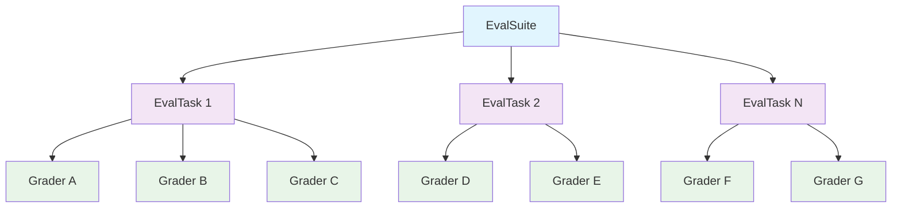
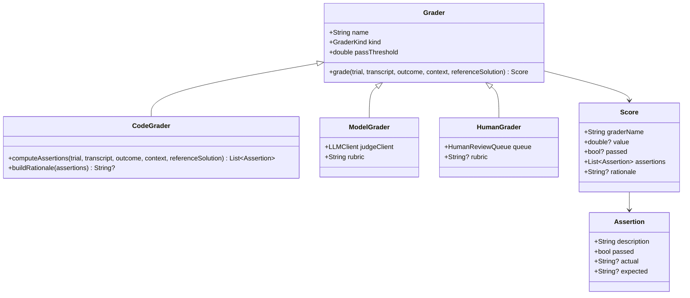

The evaluation framework's core abstraction layer consists of three interconnected components that form the foundation for agent capability assessment. **Tasks** define what to test, **Suites** organize tasks into coherent evaluation sets, and **Graders** determine success criteria. This separation of concerns enables both programmatic and data-driven test definitions while maintaining strict validation guarantees.

## The Task-Suite-Grader Architecture

The relationship between these components follows a hierarchical containment model with clear responsibility boundaries:



**Key design principle**: A suite targets a specific agent (`agentName`), while tasks within that suite share the same target agent. Graders score individual facets of performance, with multiple graders per task enabling multi-dimensional assessment.

Sources: [eval_suite.dart](lib/src/eval/core/eval_suite#L1-L77), [eval_task.dart](lib/src/eval/core/eval_task#L1-L50)

## EvalTask: The Atomic Test Unit

An `EvalTask` represents a single, unambiguous test case with defined inputs and success criteria. The interface enforces immutability after creation and clear separation between test definition and execution.

### Core Fields and Responsibilities

| Field | Type | Purpose | Design Rationale |
|-------|------|---------|------------------|
| `id` | `String` | Globally unique identifier | Immutable after creation; semantic changes require new id (e.g., `card_001` → `card_001_v2`) |
| `description` | `String` | One-line human description | For documentation and filtering; not used by graders |
| `input` | `Map<String, dynamic>` | Agent harness input | Schema is application-defined; harness interprets, not raw LLM prompt |
| `metadata` | `Map<String, String>` | Free-form labels | Conventional keys: `failure_bucket`, `difficulty`, `language` |
| `referenceSolution` | `ReferenceSolution?` | Known working solution | Proves task solvability; may be required by parent suite |
| `graders` | `List<Grader>` | Success criteria | At least one required; multiple enable multi-faceted scoring |
| `trialsPerRun` | `int` | Non-determinism measurement | Defaults to 1; set ≥3 for pass^k metrics |
| `timeout` | `Duration?` | Per-trial timeout | Falls back to runner default if null |

**Critical design decision**: The success contract lives entirely inside `graders`, not in a mirrored `successCriteria` map. This prevents drift between human-readable descriptions and actual scoring logic.

Sources: [eval_task.dart](lib/src/eval/core/eval_task#L1-L50)

### Reference Solutions: Proving Solvability

A `ReferenceSolution` provides a known working solution that passes all graders. This serves two purposes:

1. **Task validation**: Proves the task is actually solvable with current graders
2. **Grader calibration**: Ensures graders are configured correctly

```dart
class ReferenceSolution {
  final Map<String, dynamic>? expectedOutcome;  // Mirrors Outcome.environmentState
  final Transcript? sampleTranscript;           // Optional captured transcript
  final ReferenceSolutionSource source;         // manual | captured | synthesized
}
```

The `source` field tracks provenance: `manual` for hand-crafted solutions, `captured` for runs recorded from working agents, `synthesized` for generated solutions.

Sources: [reference_solution.dart](lib/src/eval/core/reference_solution#L1-L46)

## EvalSuite: Organizing Tasks by Capability

An `EvalSuite` groups tasks targeting the same agent, with validation rules that enforce consistency at construction time.

### SuiteKind: Purpose-Driven Organization

The framework distinguishes three suite kinds with different success semantics:

| SuiteKind | Task Pass Criteria | Use Case | Graduation Trigger |
|-----------|-------------------|----------|-------------------|
| `capability` | At least one trial passes | "Can the agent do this at all?" | High pass rate suggests graduation to regression |
| `regression` | Every trial passes | "Is the agent stable?" | Any decline blocks PR |
| `mixed` | Same as regression | Suites not yet split | N/A |

**Anthropic alignment**: Capability suites start at low pass rates and improve over time; regression suites stay near 100% and any decline is a red flag.

### Suite Validation Rules

The `validate()` method enforces structural integrity:

```dart
List<String> validate() {
  final problems = <String>[];
  final seen = <String>{};
  for (final t in tasks) {
    if (!seen.add(t.id)) problems.add('duplicate task id "${t.id}"');
    if (t.graders.isEmpty) problems.add('task "${t.id}" has no graders');
    if (requireReferenceSolution && t.referenceSolution == null)
      problems.add('task "${t.id}" missing referenceSolution');
    if (t.trialsPerRun <= 0)
      problems.add('task "${t.id}" has trialsPerRun <= 0');
  }
  return problems;
}
```

**Key validation rules**:
- Task IDs must be unique within a suite
- Every task must have at least one grader
- If `requireReferenceSolution` is true, all tasks must declare one
- `trialsPerRun` must be positive

Sources: [eval_suite.dart](lib/src/eval/core/eval_suite#L1-L77)

### Directory Layout for Data-Driven Suites

Large task sets benefit from a directory-based layout that supports version control, code review, and organizational flexibility:

```
suites/<suite_name>/
  suite.json                 ← Suite metadata (name, agent_name, kind)
  tasks/                     ← One JSON file per task
    positive/                ← Optional sub-folders for organization
      my_task.json
    negative/
      my_other_task.json
```

**Why a directory layout?** One file per task enables:
- Product owners to review/PR individual tasks
- Readable git diffs
- Sub-folders for grouping by failure bucket, source, or difficulty
- Stable ordering across runs (alphabetical by path)

Sources: [suite_loader.dart](lib/src/eval/loaders/suite_loader#L1-L209)

## Grader Hierarchy: Three Strategies for Scoring

The framework provides three grader families, each optimized for different scoring scenarios:



### 1. CodeGrader: Deterministic, Fast, Assertional

Best for exact string match, numeric comparison, file existence, JSON schema validation, tool-call counting — anything decidable in code.

**Implementation pattern**: Subclasses implement `computeAssertions()` and the base composes them into a `Score`:

```dart
class AnswerCorrectnessGrader extends CodeGrader {
  final num expected;
  final double tolerance;
  
  @override
  Future<List<Assertion>> computeAssertions({...}) async {
    final actual = (outcome.environmentState['answer'] as num?)?.toDouble();
    return [
      Assertion(
        description: 'answer == $expected within $tolerance',
        passed: actual != null && (actual - expected.toDouble()).abs() <= tolerance,
        actual: '$actual',
        expected: '$expected',
      ),
    ];
  }
}
```

**Score composition**:
- `value = passed_assertions / total_assertions` (0.0 to 1.0)
- `passed = value >= passThreshold` (default 1.0 = all must pass)
- Rationale auto-generated from failed assertions

Sources: [code_grader.dart](lib/src/eval/graders/code_grader#L1-L63)

### 2. ModelGrader: LLM-as-Judge, Flexible

Best for open-ended response relevance, style consistency, safety, and other subjective dimensions.

**Critical design requirement**: Rubrics must include an "Unknown" escape hatch. When the judge can't decide, return `Score(value: null)` rather than fabricating a number.

```dart
abstract class ModelGrader implements Grader {
  LLMClient get judgeClient;  // LLM client used for judging
  String get rubric;          // Must include "Unknown" escape hatch
}
```

**Why null scores matter**: Null scores are excluded from grader means but tracked separately, preventing fabricated scores from distuting metrics.

Sources: [model_grader.dart](lib/src/eval/graders/model_grader#L1-L20)

### 3. HumanGrader: Gold Standard, Queue-Based

Primary use is calibrating LLM judges, not scoring every run. The framework provides an abstraction layer for integration with review platforms.

**Flow**:
1. First `grade()` call enqueues trial and returns pending null score
2. Reviewer scores via external platform (Langfuse Annotation Queue, custom UI, Slack)
3. Subsequent run picks up verdict

```dart
abstract class HumanReviewQueue {
  Future<void> enqueue({...});
  Future<Score?> fetchVerdict(Trial trial);
}
```

Sources: [human_grader.dart](lib/src/eval/graders/human_grader#L1-L71)

## Score and Assertion: The Grading Output

### Score Structure

A `Score` captures one grader's evaluation of a trial:

| Field | Type | Purpose |
|-------|------|---------|
| `graderName` | `String` | Stable name for reports |
| `value` | `double?` | 0.0..1.0 with partial credit; null = couldn't decide |
| `passed` | `bool?` | Whether value crosses passThreshold; null when value is null |
| `assertions` | `List<Assertion>` | Sub-checks for human readability |
| `rationale` | `String?` | **Required on failure**: human-readable explanation |
| `metadata` | `Map<String, dynamic>` | Free-form (judge response, diff details) |

**Anthropic Step 5 emphasis**: "Failures should seem fair" — rationales are mandatory when `passed == false` or `value == null`.

### Assertion: The Sub-Check Unit

An `Assertion` provides granular pass/fail information:

```dart
class Assertion {
  final String description;  // What was checked
  final bool passed;         // Did it pass?
  final String? actual;      // Observed value (stringified)
  final String? expected;    // Expected value
}
```

**Design rationale**: Assertions enable humans to understand why a grader failed without re-running the trial. The `actual`/`expected` fields provide concrete evidence.

Sources: [score.dart](lib/src/eval/graders/score#L1-L96)

## Data-Driven Loading: JSON Schema and Registry

### GraderRegistry: The Bridge Between JSON and Code

The `GraderRegistry` maps grader names to factory functions, enabling JSON-driven task definitions:

```dart
class GraderRegistry {
  void register(String name, GraderFactoryFunction factory);
  Grader build(String name, Map<String, dynamic> config);
  bool contains(String name);
  Iterable<String> get registeredNames;
}
```

**Usage pattern**:
```dart
final reg = GraderRegistry();
reg.register('answer_correctness',
  (cfg) => AnswerCorrectnessGrader(expected: cfg['expected'] as num));
```

Sources: [grader_registry.dart](lib/src/eval/loaders/grader_registry#L1-L45)

### JSON Task Schema

Tasks can be defined as JSON files instead of Dart classes:

```json
{
  "id": "pkm_area_health",
  "description": "Long-term health habit: should write under Areas/.",
  "trials_per_run": 2,
  "timeout_seconds": 180,
  "metadata": {
    "failure_bucket": "route_to_areas",
    "difficulty": "easy"
  },
  "input": {
    "prompt": "Process the following user fact..."
  },
  "reference_solution": {
    "expected_outcome": {"updated_insight": true, "skipped": false},
    "source": "manual"
  },
  "graders": [
    {
      "name": "pkm_organized",
      "config": {
        "fact_id": "fact_pkm_001",
        "buckets": ["Areas/"],
        "must_contain": ["mobility"]
      }
    }
  ]
}
```

**Key differences from Dart tasks**:
- `agent_name` lives in `suite.json`, not on individual tasks
- Graders are resolved by name through `GraderRegistry`
- `timeout_seconds` (snake_case) vs `timeout` (Dart Duration)

Sources: [json_eval_task.dart](lib/src/eval/loaders/json_eval_task#L1-L64)

## Implementation Patterns: Code vs Data-Driven

The framework supports two implementation strategies:

### Programmatic Definition (Dart Classes)

**Advantages**:
- Type safety and IDE support
- Complex logic in task setup
- Direct grader instantiation

**Example from calculator demo**:
```dart
class _SimpleAdditionTask implements EvalTask {
  @override
  String get id => 'task_simple_addition';
  
  @override
  List<Grader> get graders => [
    AnswerCorrectnessGrader(expected: 5),
    ToolUsageGrader(minArithmeticCalls: 1),
  ];
}
```

Sources: [tasks.dart](example/eval_demo/calculator/tasks#L1-L132)

### Data-Driven Definition (JSON + Registry)

**Advantages**:
- Non-developers can author tasks
- Version control without code changes
- Organizational flexibility (sub-folders)

**Example from PKM agent**:
```dart
GraderRegistry buildPkmGraderRegistry() {
  final reg = GraderRegistry();
  reg.register('pkm_organized',
    (cfg) => PkmOrganizedGrader(
      expectedFactId: cfg['fact_id'] as String,
      expectedBuckets: (cfg['buckets'] as List).cast<String>(),
    ));
  return reg;
}
```

Sources: [tasks.dart](example/eval_demo/pkm_agent/tasks#L1-L39)

## Validation and Error Handling

### Suite Construction Validation

The `EvalSuite` constructor validates structural integrity immediately:

```dart
// This will throw if tasks have duplicate IDs or missing graders
final suite = EvalSuite(
  name: 'test_suite',
  agentName: 'my_agent',
  kind: SuiteKind.capability,
  tasks: [task1, task2, task3],
  requireReferenceSolution: true,
);
```

**Common validation errors**:
- Duplicate task IDs
- Tasks with empty graders list
- Missing reference solutions when required
- Non-positive `trialsPerRun`

### Grader Registry Safety

The registry throws `StateError` for unregistered grader names:

```dart
try {
  graderRegistry.build('nonexistent_grader', {});
} catch (e) {
  // StateError: Grader "nonexistent_grader" is not registered.
  // Known graders: [answer_correctness, tool_usage, ...]
}
```

Sources: [suite_loader.dart](lib/src/eval/loaders/suite_loader#L1-L209)

## Next Steps

Now that you understand how tasks, suites, and graders are defined, explore how they execute:

- [Trials, Outcomes, and Transcripts](18-trials-outcomes-and-transcripts) — See how tasks become executable trials and what evidence graders consume
- [pass@k and pass^k Metrics](19-passatk-and-pass-k-metrics) — Understand how multiple trials per task enable non-determinism measurement
- [Suite Health Analysis and Graduation](22-suite-health-analysis-and-graduation) — Learn how capability suites graduate to regression suites based on pass rates