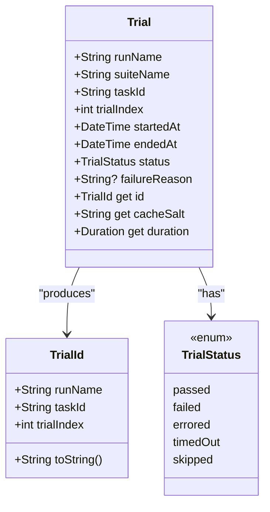
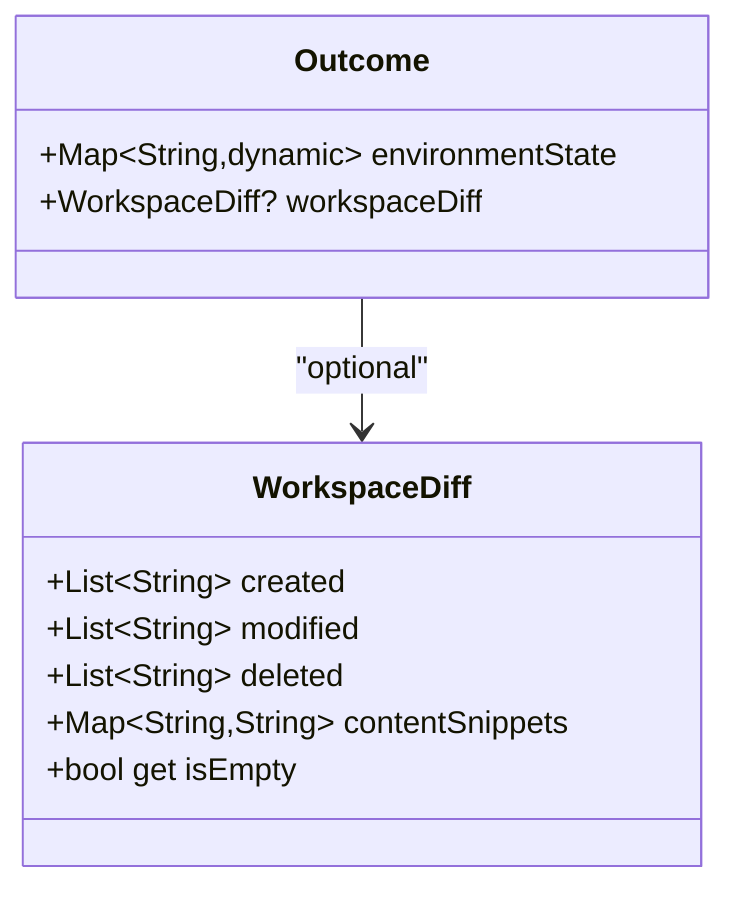
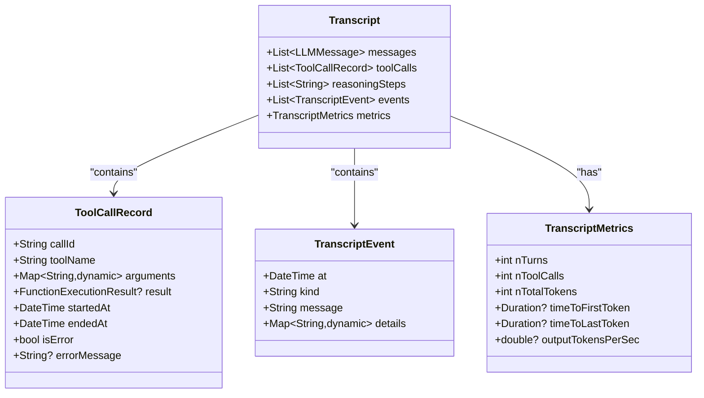
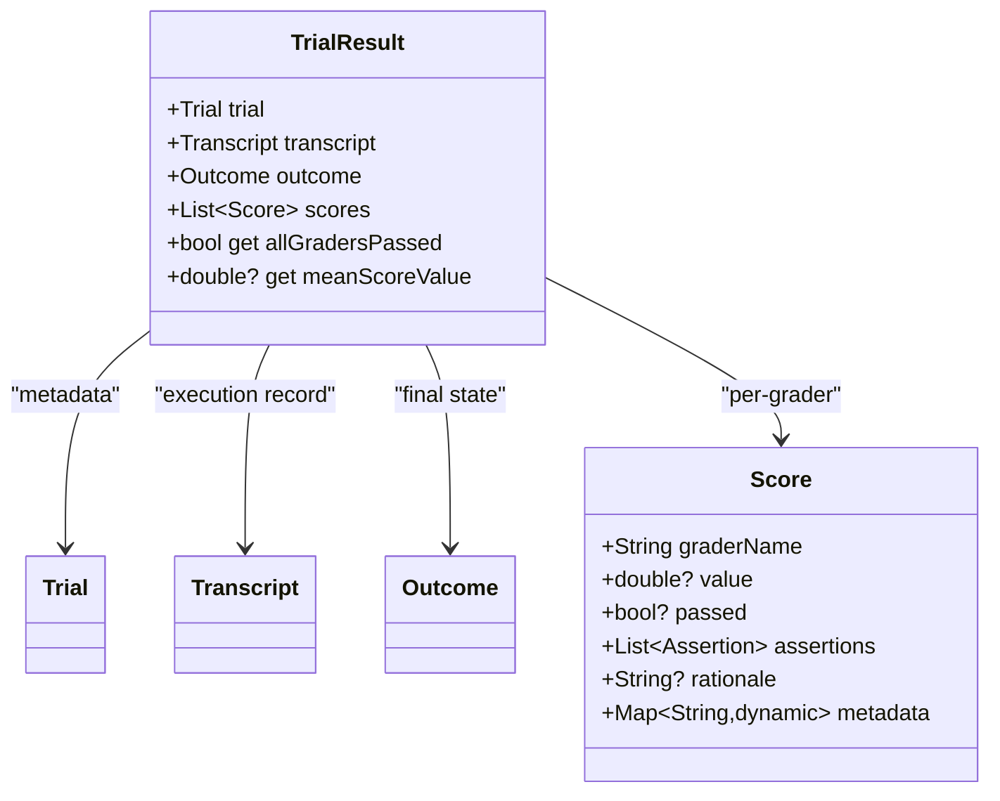
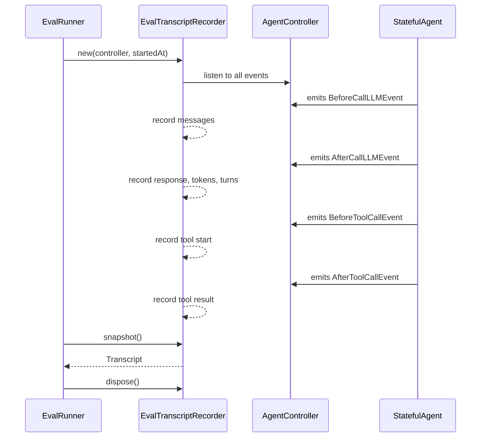
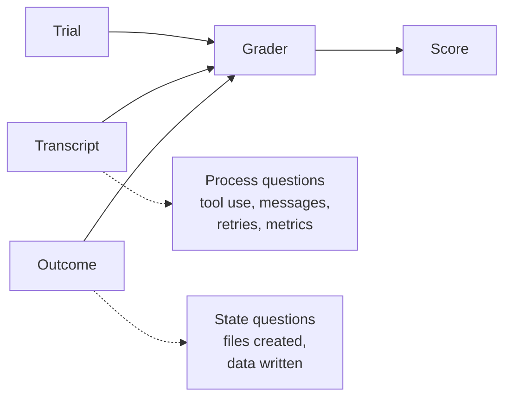

The evaluation framework produces three core artifacts for every trial: a **Trial** (metadata about the attempt), a **Transcript** (what the agent did), and an **Outcome** (what the environment became). Together, they enable Anthropic's principle of "grade the right evidence" — graders inspect the artifact that contains the evidence they need, whether that's the final state or the process path.

## Trial: The Execution Identity

A **Trial** represents one attempt at running a task. Each trial carries enough metadata to be uniquely identified across runs, suites, and tasks.



**Sources:** [lib/src/eval/core/trial.dart](lib/src/eval/core/trial.dart#L1-L109)

### TrialId: The Composite Key

`TrialId` uniquely identifies a trial across the entire evaluation system using three components: `runName` (which evaluation run), `taskId` (which task), and `trialIndex` (which attempt within that task). The format is `{runName}/{taskId}#{trialIndex}`.

### cacheSalt: Cross-Run Replay Isolation

A critical detail for recording/replay: `Trial.cacheSalt` generates a stable salt formatted as `{taskId}#trialIndex` — deliberately **excluding** `runName`. This means recordings made in one run can be replayed in a different run, while still maintaining per-trial isolation for pass@k/pass^k metrics.

```dart
// From Trial class:
String get cacheSalt => '$taskId#$trialIndex';
```

**Sources:** [lib/src/eval/core/trial.dart#L72-L82](lib/src/eval/core/trial.dart#L72-L82)

## Outcome: What the World Became

The **Outcome** captures the final state of the environment after a trial completes. It is intentionally separate from the Transcript — the transcript records what the agent *did*; the outcome records what the environment *became*.



**Sources:** [lib/src/eval/core/outcome.dart#L1-L82](lib/src/eval/core/outcome.dart#L1-L82)

### environmentState: The Grader's Facts Table

`environmentState` is an application-defined map whose schema is a contract between the harness and its graders. The harness populates it at the end of `run()` by scanning the workspace, checking database state, or extracting key facts — so that **graders never read disk**.

| ❌ Wrong (what the agent said) | ✅ Right (what the world became) |
|---|---|
| `{'agent_said': 'I booked the flight'}` | `{'flight_booked': true, 'flight_id': 'AA123'}` |
| `{'response': 'Logged to Areas/Health.md'}` | `{'updated_files': ['Areas/Health.md'], 'fact_id': 'fact_001'}` |

**Sources:** [doc/eval-guide.md#L200-L204](doc/eval-guide.md#L200-L204)

### WorkspaceDiff: Structural Filesystem Snapshot

`WorkspaceDiff` captures filesystem-level changes — created, modified, and deleted files — with optional content snippets (trimmed at 4 KiB per file). This allows graders to inspect file contents without accessing the actual filesystem.

```dart
class WorkspaceDiff {
  final List<String> created;          // paths relative to workspace root
  final List<String> modified;
  final List<String> deleted;
  final Map<String, String> contentSnippets;  // path → utf-8 text
  bool get isEmpty => created.isEmpty && modified.isEmpty && deleted.isEmpty;
}
```

**Sources:** [lib/src/eval/core/outcome.dart#L41-L82](lib/src/eval/core/outcome.dart#L41-L82)

## Transcript: What the Agent Did

The **Transcript** is the complete record of a trial's execution — messages, tool calls, reasoning steps, events, and performance metrics. It answers questions about *process*: Did the agent call the right tool? Did it retry? How many tokens did it consume?



**Sources:** [lib/src/eval/core/transcript.dart#L1-L193](lib/src/eval/core/transcript.dart#L1-L193)

### TranscriptEvent Kinds

Events capture non-message/non-tool-call occurrences that affect the trial:

| Kind | Description | Example Details |
|---|---|---|
| `llm_retry` | LLM call retried (rate limit, transient error) | reason string |
| `agent_exception` | Exception thrown during agent execution | error toString |
| `agent_error` | Agent-level error (tool failure, etc.) | error message |
| `agent_cancel` | Agent execution cancelled | reason or exception |
| `plan_changed` | PlanMode plan modified | `{'plan': ...}` |

**Sources:** [lib/src/eval/core/transcript_recorder.dart#L123-L171](lib/src/eval/core/transcript_recorder.dart#L123-L171)

### TranscriptMetrics: Performance Counters

Quantitative metrics collected automatically by the recorder:

| Metric | Description |
|---|---|
| `nTurns` | Number of LLM round-trips |
| `nToolCalls` | Number of tool invocations |
| `nTotalTokens` | Cumulative token usage |
| `timeToFirstToken` | Duration from trial start to first LLM response |
| `timeToLastToken` | Duration from trial start to last LLM response |
| `outputTokensPerSec` | Throughput metric |

**Sources:** [lib/src/eval/core/transcript.dart#L150-L193](lib/src/eval/core/transcript.dart#L150-L193)

## TrialResult: The Combined Artifact

`TrialResult` bundles all three artifacts plus grader scores into a single, serializable unit.



**Sources:** [lib/src/eval/core/trial_result.dart#L1-L42](lib/src/eval/core/trial_result.dart#L1-L42)

### pass/fail Determination

`allGradersPassed` returns `true` only when every non-null score reports `passed == true`. Null-valued scores (e.g., a judge returning "Unknown") are ignored — they don't block a passing result, nor do they contribute to averages.

```dart
bool get allGradersPassed {
  final passing = scores.where((s) => s.passed != null);
  if (passing.isEmpty) return false;
  return passing.every((s) => s.passed == true);
}
```

**Sources:** [lib/src/eval/core/trial_result.dart#L20-L26](lib/src/eval/core/trial_result.dart#L20-L26)

## EvalTranscriptRecorder: Automatic Trace Capture

The framework doesn't require harnesses to build transcripts manually. `EvalTranscriptRecorder` listens to the shared `AgentController` event bus and captures the full execution trace automatically.



**Sources:** [lib/src/eval/core/transcript_recorder.dart#L1-L196](lib/src/eval/core/transcript_recorder.dart#L1-L196)

### How the Runner Wires It Up

Inside `EvalRunner._runOneTrial`, the recorder is created with the trial's `startedAt` timestamp and the context's clock. The runner attaches it to `context.controller` before the harness runs, then takes a snapshot at the end:

```dart
// From eval_runner.dart _runOneTrial:
final recorder = EvalTranscriptRecorder(
  controller: context.controller,
  startedAt: startedAt,
  now: context.clock.now,
);
// ... run the harness ...
// If harness returned empty transcript, replace with recorder snapshot:
if (currentTranscript == null || _isEmptyTranscript(currentTranscript)) {
  transcript = recorder.snapshot();
}
```

This means harnesses can return an empty `Transcript` from `run()` and the framework will populate it automatically — the harness only needs to focus on populating the `Outcome`.

**Sources:** [lib/src/eval/core/eval_runner.dart#L238-L273](lib/src/eval/core/eval_runner.dart#L238-L273)

## How Graders Use the Artifacts

The `Grader` interface receives all three artifacts — trial, transcript, and outcome — so each grader can inspect the evidence relevant to its scoring criterion.



**Sources:** [lib/src/eval/graders/grader.dart#L1-L37](lib/src/eval/graders/grader.dart#L1-L37)

### Outcome-Based Grading (State)

When the question is "did the agent produce the right result?", the grader inspects `outcome.environmentState` and `outcome.workspaceDiff`. The PKM agent example shows this pattern:

```dart
class PkmOrganizedGrader extends CodeGrader {
  @override
  Future<List<Assertion>> computeAssertions({
    required Outcome outcome,
    // ...
  }) async {
    final wrote = (outcome.environmentState['wrote_files'] as List).cast<String>();
    final factIds = (outcome.environmentState['fact_ids_in_files'] as List).cast<String>();
    return [
      Assertion(
        description: 'wrote into Areas/',
        passed: wrote.any((p) => p.startsWith('Areas/')),
        actual: '$wrote',
        expected: 'starts with Areas/',
      ),
    ];
  }
}
```

**Sources:** [doc/eval-guide.md#L265-L283](doc/eval-guide.md#L265-L283)

### Transcript-Based Grading (Process)

When the question is "did the agent follow the right process?", the grader inspects `transcript.messages`, `transcript.toolCalls`, `transcript.events`, or `transcript.metrics`. Examples:

- Did the agent call `read_file` before `write_file`?
- Were there retry events (indicating instability)?
- Did token usage stay within budget?

### ReferenceSolution: The Known-Good Baseline

Tasks may carry a `ReferenceSolution` containing both `expectedOutcome` and `sampleTranscript` — a known-good result that proves the task is solvable and graders are correctly configured. This is Anthropic Step 2.

**Sources:** [lib/src/eval/core/reference_solution.dart#L1-L46](lib/src/eval/core/reference_solution.dart#L1-L46)

## Transcript CLI: Inspecting Trials

The `transcripts` CLI tool (at `bin/transcripts.dart`) provides commands for inspecting stored trial data:

| Command | Description | Example |
|---|---|---|
| `list` | List recent runs, optionally filtered by suite | `dart run bin/transcripts.dart list --suite card --limit 10` |
| `show` | Show one trial's full details | `--trial run_v3/card_001#0` |
| `diff` | Compare same task across two runs | `--task card_001 --runs run_v2,run_v3` |
| `export` | Export a run as markdown | `--run run_v3 --format markdown` |

**Sources:** [lib/src/eval/observability/transcript_viewer.dart#L10-L32](lib/src/eval/observability/transcript_viewer.dart#L10-L32)

## Integration with EvalRunReport

After all trials complete, `EvalRunReport` aggregates their results into run-level metrics. Each `TrialResult` contributes its `allGradersPassed` boolean to pass-rate calculations:

```dart
// Aggregated metrics from EvalRunReport:
double trialPassRate;      // passed trials / total trials
double taskPassRate;       // depends on SuiteKind (capability vs regression)
Map<String, double> graderMeans;  // per-grader average scores
Map<String, double> bucketPassRates;  // per-failure-bucket
```

The `trialsByTask()` method groups results by task ID, enabling per-task pass@k and pass^k calculations across multiple trials.

**Sources:** [lib/src/eval/core/eval_run_report.dart#L1-L94](lib/src/eval/core/eval_run_report.dart#L1-L94)

## Next Steps

Now that you understand how trials produce transcripts and outcomes, and how graders score them, you can explore:

- [pass@k and pass^k Metrics](19-passatk-and-pass-k-metrics) — how trial results are aggregated into statistical metrics
- [Recording, Replay, and Rate Limiting](20-recording-replay-and-rate-limiting) — how `Trial.cacheSalt` enables cross-run replay
- [Defining Tasks, Suites, and Graders](17-defining-tasks-suites-and-graders) — how to structure your evaluation tasks
- [Observability and Trace Export](21-observability-and-trace-export) — how trial events flow to Langfuse and JSONL