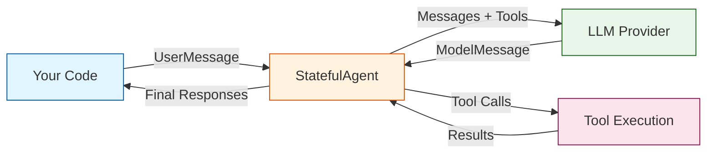

Welcome to the **dart_agent_core** Quick Start guide. This page will help you go from zero to a running AI agent in under five minutes. You will learn how to install the library, configure an LLM provider, define a simple tool, and run your first agentic loop.

**What you will achieve**: A working Dart program that sends a user message to an LLM, lets the model invoke a tool you define, and prints the final response.

**Prerequisites**: Dart SDK 3.9.2 or later, a text editor, and an API key for at least one supported LLM provider.

Sources: [README.md](README.md#L1-L20)

## Architecture Overview

Before diving in, here is a high-level view of how the pieces fit together. When you call `agent.run(...)`, the library enters an **agentic loop** that repeats until the model decides it has enough information.



The **StatefulAgent** is the central orchestrator. It holds your configuration, tools, skills, and conversation state. The **LLM Client** is a pluggable adapter that speaks to OpenAI, Gemini, Claude, or any OpenAI-compatible endpoint. **Tools** are plain Dart functions wrapped with JSON Schema metadata so the model can call them.

Sources: [lib/src/agent/stateful_agent.dart](lib/src/agent/stateful_agent.dart#L1-L30), [doc/architecture.md](doc/architecture.md#L1-L40)

## Step 1 — Install the Package

Add `dart_agent_core` to your project:

```bash
dart pub add dart_agent_core
```

Or add it manually to your `pubspec.yaml`:

```yaml
dependencies:
  dart_agent_core: ^2.0.4
```

Then run `dart pub get`.

**Platform compatibility**: The library runs on all six Dart/Flutter platforms — Android, iOS, Web, Windows, macOS, and Linux — and is WebAssembly compatible. On Web, use in-memory or `localStorage`-backed state storage instead of `FileStateStorage`.

Sources: [pubspec.yaml](pubspec.yaml#L1-L10), [README.md](README.md#L110-L140)

## Step 2 — Choose an LLM Provider

`dart_agent_core` ships with five built-in clients. Pick the one that matches your API key:

| Provider | Client Class | Auth Method | Example Model |
|----------|-------------|-------------|---------------|
| OpenAI Chat Completions | `OpenAIClient` | API key | `gpt-4o-mini` |
| OpenAI Responses API | `ResponsesClient` | API key | `gpt-4o` |
| Google Gemini | `GeminiClient` | API key | `gemini-2.5-flash` |
| Anthropic Claude (direct) | `ClaudeClient` | API key | `claude-sonnet-4-20250514` |
| AWS Bedrock (Claude) | `BedrockClaudeClient` | AWS Signature V4 | `us.anthropic.claude-opus-4-6-v1` |

Set your API key as an environment variable. For OpenAI:

```bash
export OPENAI_API_KEY="sk-..."
```

Then create the client in Dart:

```dart
import 'dart:io';
import 'package:dart_agent_core/dart_agent_core.dart';

final apiKey = Platform.environment['OPENAI_API_KEY'] ?? '';
final client = OpenAIClient(apiKey: apiKey);
final modelConfig = ModelConfig(model: 'gpt-4o-mini');
```

Sources: [example/simple_agent_example.dart](example/simple_agent_example.dart#L1-L15), [README.md](README.md#L145-L185)

## Step 3 — Define a Tool

Tools are how your agent interacts with the outside world. Wrap any Dart function — synchronous or asynchronous — with a name, description, and JSON Schema parameters.

```dart
String getWeather(String location) {
  if (location.toLowerCase().contains('tokyo')) {
    return 'The weather in Tokyo is sunny and 25°C.';
  }
  return 'Weather data not available for $location';
}

final weatherTool = Tool(
  name: 'get_weather',
  description: 'Get the current weather for a location.',
  executable: getWeather,
  parameters: {
    'type': 'object',
    'properties': {
      'location': {
        'type': 'string',
        'description': 'The city name, e.g. Tokyo',
      },
    },
    'required': ['location'],
  },
);
```

**Key points**:

- `name` is what the model sees when it decides to call this tool.
- `description` helps the model understand when to use it.
- `parameters` is a standard JSON Schema object. The model generates arguments matching this schema.
- The function signature must accept the parameter types declared in the schema. Positional parameters are mapped by order; named parameters require `namedParameters: ['paramName']`.

Sources: [example/simple_agent_example.dart](example/simple_agent_example.dart#L10-L30), [README.md](README.md#L185-L230)

## Step 4 — Create and Run the Agent

Assemble everything into a `StatefulAgent` and call `run()`:

```dart
void main() async {
  final apiKey = Platform.environment['OPENAI_API_KEY'] ?? '';
  final client = OpenAIClient(apiKey: apiKey);
  final modelConfig = ModelConfig(model: 'gpt-4o-mini');

  final weatherTool = Tool(
    name: 'get_weather',
    description: 'Get the current weather for a location.',
    executable: getWeather,
    parameters: {
      'type': 'object',
      'properties': {
        'location': {'type': 'string', 'description': 'City name'},
      },
      'required': ['location'],
    },
  );

  final agent = StatefulAgent(
    name: 'weather_agent',
    client: client,
    modelConfig: modelConfig,
    tools: [weatherTool],
    state: AgentState.empty(),
    systemPrompts: ['You are a helpful assistant that can check the weather.'],
  );

  final responses = await agent.run([
    UserMessage.text('What is the weather like in Tokyo right now?'),
  ]);

  print((responses.last as ModelMessage).textOutput);
}
```

**What happens under the hood**:

1. The agent sends your messages plus tool definitions to the LLM.
2. The model responds — either with text or with a tool call request.
3. If the model requests a tool, the agent executes it and sends the result back.
4. This loop repeats until the model produces a final text response (or hits a stop condition).

The `responses` list contains every message exchanged during the loop: `UserMessage`, `ModelMessage`, and `FunctionExecutionResultMessage`.

Sources: [example/simple_agent_example.dart](example/simple_agent_example.dart#L32-L56), [lib/src/agent/stateful_agent.dart](lib/src/agent/stateful_agent.dart#L1-L50)

## Step 5 — Run It

Save the code as `bin/weather_agent.dart` and run:

```bash
dart run bin/weather_agent.dart
```

Expected output (will vary based on model behavior):

```
The weather in Tokyo is sunny and 25°C. Right now it's a beautiful day!
```

If you want to see the full conversation loop, add logging:

```dart
import 'package:logging/logging.dart';

void main() {
  Logger.root.level = Level.ALL;
  Logger.root.onRecord.listen((record) {
    print('[${record.level.name}] ${record.message}');
  });
  // ... rest of the code
}
```

Sources: [example/simple_agent_example.dart](example/simple_agent_example.dart#L1-L56)

## What to Try Next

Now that you have a working agent, here are the natural next steps based on what you want to build:

| Goal | Try This | Guide |
|------|----------|-------|
| Stream responses for a Flutter UI | Use `agent.runStream()` instead of `agent.run()` | [Streaming and Controller Events](8-streaming-and-controller-events) |
| Persist conversations across sessions | Add `FileStateStorage` and `autoSaveStateFunc` | [State Management and File Persistence](7-state-management-and-file-persistence) |
| Let the agent plan multi-step tasks | Pass `planMode: PlanMode.auto` to the agent | [Planning with PlanMode](11-planning-with-planmode) |
| Organize capabilities into modules | Create `Skill` subclasses with their own prompts and tools | [Skills: Dynamic Capability System](9-skills-dynamic-capability-system) |
| Delegate work to specialist agents | Register `SubAgent` instances | [Sub-Agent Delegation](12-sub-agent-delegation) |
| Observe and control the agent loop | Attach an `AgentController` and/or `AgentHook` | [AgentHook Pipeline](14-agenthook-pipeline) |
| Use a different provider (Gemini, Claude, etc.) | Swap the client class | [Supported LLM Providers](4-supported-llm-providers) |
| Evaluate your agent systematically | Build test suites with graders and metrics | [Eval Architecture Overview](16-eval-architecture-overview) |

## Complete Example — All Provider Variants

The `example/` directory contains ready-to-run variants for every supported provider. Here is a summary:

| File | Provider | Notable Feature |
|------|----------|-----------------|
| `simple_agent_example.dart` | OpenAI | Basic tool use |
| `simple_agent_stream_example.dart` | Gemini | Streaming responses |
| `simple_agent_with_claude_example.dart` | Claude (direct) | Anthropic Messages API |
| `simple_agent_with_bedrock_claude_example.dart` | Claude via Bedrock | AWS Signature V4 auth |
| `simple_agent_with_gemini_example.dart` | Google Gemini | Gemini-specific models |
| `simple_agent_with_ollama_example.dart` | Ollama (local) | No API key needed |
| `simple_agent_with_openrouter_example.dart` | OpenRouter | OpenAI-compatible proxy |
| `simple_agent_with_state_example.dart` | OpenAI | FileStateStorage persistence |
| `simple_agent_with_plan_example.dart` | OpenAI | PlanMode.must planning |
| `simple_agent_with_skills_example.dart` | OpenAI | Dynamic skill activation |
| `simple_agent_with_sub_agent_example.dart` | OpenAI | Sub-agent delegation |
| `simple_agent_with_hooks_example.dart` | Scripted | AgentHook pipeline |
| `simple_agent_with_controller_example.dart` | OpenAI | Controller events + policy hook |
| `simple_agent_with_thinking_example.dart` | Bedrock Claude | Extended thinking |

Run any of them with:

```bash
dart run example/simple_agent_example.dart
```