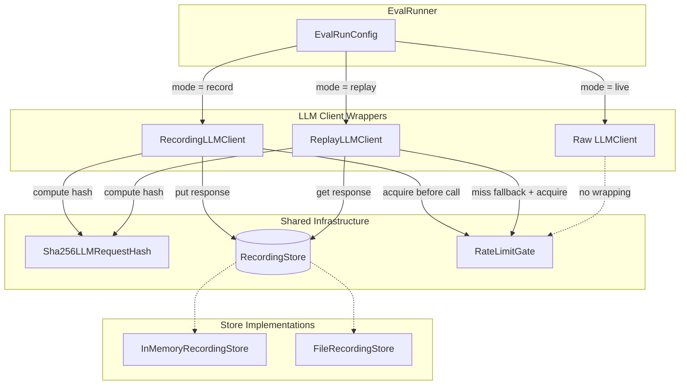

This page documents the eval subsystem's **LLM response caching** and **call throttling** infrastructure — three tightly coupled components that enable deterministic eval runs, CI-friendly replay, and protection against upstream rate-limit violations. These components live under `lib/src/eval/llm/` and are designed to wrap any `LLMClient` implementation with zero changes to the agent under test.

The three concerns are: (1) **content-addressable recording** of LLM request/response pairs, (2) **cache-first replay** that either returns a stored response or falls back to a live client, and (3) **token-bucket rate limiting** that decouples concurrency from API quotas. Together they form the pipeline that makes `EvalRunner` capable of record, replay, and live modes.

---

## Architecture Overview

The following diagram shows how the three components interact within the eval pipeline. The `EvalEnvironment.prepare()` method is the wiring point — it constructs the appropriate `LLMClient` wrapper based on the run mode and passes it into the `EvalContext`.



Sources: [recording_llm_client.dart](lib/src/eval/llm/recording_llm_client.dart#L1-L110), [replay_llm_client.dart](lib/src/eval/llm/replay_llm_client.dart#L1-L130), [rate_limit_gate.dart](lib/src/eval/llm/rate_limit_gate.dart#L1-L140)

---

## Request Hashing: Content-Addressable Cache Keys

Every record/replay operation is keyed by a **deterministic hash** of the logical LLM request. The `Sha256LLMRequestHash` implementation produces a SHA-256 digest over a canonical JSON encoding of the request tuple `(messages, tools, modelConfig, jsonOutput, trialSalt)`.

### Stability Guarantees

The hash must satisfy two opposing constraints:

| Property | Requirement | Implementation |
|---|---|---|
| **Determinism** | Same logical request → same hash | Canonical JSON with sorted keys, UTF-8 encoding |
| **Selectivity** | Semantically different requests → different hash | Hashes messages, tools, model id, temperature, maxTokens, topP, topK, jsonOutput |
| **Noise filtering** | Non-deterministic fields → ignored | `timestamp` is always stripped; `Tool.executable` closures are excluded (not in `toJson`) |
| **Per-trial isolation** | Same prompt, different trial → different hash | `trialSalt` parameter (e.g. `taskId#trialIndex`) |

### Timestamp Stripping

The framework always strips `timestamp` from message JSON before hashing. `UserMessage`, `ModelMessage`, and `FunctionExecutionResultMessage` all carry `DateTime.now()`-derived timestamps for tracing, but these values are never semantically part of the LLM request — including them would make every hash unique per process invocation and defeat the cache entirely.

### Custom Strip Keys

Applications that embed non-deterministic fields in message metadata (e.g. trace IDs inside system reminders) can supply additional keys to strip via the `stripMessageKeys` constructor parameter:

```dart
const hasher = Sha256LLMRequestHash(stripMessageKeys: {'metadata'});
```

This is a recursive operation — it descends into nested maps and lists to remove the specified keys at every level.

### Per-Trial Salt

When `trialsPerRun > 1`, every trial sends the **same** request (same messages, same tools, same model). Without extra signal, the hash collapses across trials and the cache forces every trial to receive an identical response — silently destroying the non-determinism that `pass^k` / `pass@k` metrics are designed to measure.

The `trialSalt` parameter solves this. Its canonical form is `taskId#trialIndex` (derived from `Trial.cacheSalt`), which is deliberately **independent of run name** so that recordings made in run A can be replayed by run B.

| Salt Value | Behavior |
|---|---|
| `null` | No per-trial axis. Cache is shared across all callers — appropriate for judges, ad-hoc analysis |
| `"task_a#0"` | Trial 0 of task_a gets its own cache slot |
| `"task_a#1"` | Trial 1 of task_a gets a separate cache slot |
| `"task_a#0"` (different run name) | Same slot as above — recordings are run-agnostic |

Sources: [llm_request_hash.dart](lib/src/eval/llm/llm_request_hash.dart#L1-L121), [trial.dart](lib/src/eval/core/trial.dart#L85-L95), [llm_record_replay_test.dart](test/eval/llm_record_replay_test.dart#L37-L88)

---

## RecordingStore: Persistent Response Storage

The `RecordingStore` abstraction is an append-only key-value store mapping request hashes to `ModelMessage` responses. The framework provides two implementations.

### InMemoryRecordingStore

A simple `Map<String, ModelMessage>` wrapper. Useful for unit tests of the eval subsystem and short-lived runs where persistence is unnecessary.

### FileRecordingStore

A filesystem-backed store that writes one JSON file per recording under a root directory. The layout uses a **two-level prefix** (`ab/cd/abcdef…json`) to avoid overwhelming filesystems that struggle with 100k+ files in a single directory.

| Feature | Detail |
|---|---|
| **Layout** | `rootDir/{hash[0:2]}/{hash[2:4]}/{hash}.json` |
| **Buffered writes** | `put()` buffers in memory; `flush()` writes to disk |
| **Lazy flushing** | `put()` schedules a microtask flush; callers don't await each write |
| **Idempotent flush** | `flush()` awaits any in-flight flush, then drains the remaining buffer |
| **Re-read on miss** | `get()` always reads from disk on cache miss (never trusts stale memory) |
| **Overwrite semantics** | `put()` overwrites existing recordings — useful when re-recording after a known-broken capture |
| **No compaction** | The store is intentionally append-only; archiving old recordings is an external concern |

The `EvalRunner` calls `recordingStore.flush()` after all trials complete, ensuring all buffered writes reach disk before the process exits.

Sources: [recording_store.dart](lib/src/eval/llm/recording_store.dart#L1-L131), [eval_runner.dart](lib/src/eval/core/eval_runner.dart#L108-L110)

---

## RecordingLLMClient: The Write Path

`RecordingLLMClient` wraps an inner `LLMClient` and records every successful (request, response) pair into a `RecordingStore`. It is the **write side** of the caching pipeline.

### Lifecycle

1. The `acquire()` gate is awaited before every upstream call (rate limiting).
2. The inner client's `generate()` is called with the original parameters.
3. A hash is computed from the request tuple (including optional `trialSalt`).
4. The response is written to the store via `put()`.
5. The response is returned to the caller.

### Streaming Caveat

Stream recording is **not yet implemented**. When `stream()` is called on a `RecordingLLMClient`, it awaits the rate gate and delegates directly to the inner client's `stream()`. The comment in the source indicates that streamed eval runs should use `generate()` in eval mode instead.

### Per-Trial Cloning

The `withTrialSalt(salt)` method returns a copy of the client bound to a specific trial salt. This is the recommended way to construct per-trial clients inside `EvalEnvironment.prepare()`:

```dart
final salt = trial.cacheSalt; // e.g. "task_a#0"
llmClient = RecordingLLMClient(
  inner: liveClientFactory(),
  store: recordingStore,
  rateLimitGate: gate,
  trialSalt: salt,
);
```

Sources: [recording_llm_client.dart](lib/src/eval/llm/recording_llm_client.dart#L1-L110), [calculator/environment.dart](example/eval_demo/calculator/environment.dart#L55-L66)

---

## ReplayLLMClient: The Read Path

`ReplayLLMClient` is the **read side** of the caching pipeline. It computes the hash for each request, looks it up in the `RecordingStore`, and either returns the cached response or takes an alternative path.

### Strict vs. Non-Strict Mode

| Mode | Behavior on Cache Miss | Use Case |
|---|---|---|
| `strictReplay: true` | Throws `RecordingNotFoundException` | CI pipelines — forces re-recording if prompts or tools change |
| `strictReplay: false` | Falls back to the inner (live) client | Development — replay what's cached, hit the API for new requests |

### Rate Limiting on Fallback

The `RateLimitGate` is only consulted on the **fallback path** (cache miss + non-strict). Cache hits bypass the gate entirely, which means replay-only runs incur zero throttling overhead.

### Stream Synthesis

When `stream()` is called on a `ReplayLLMClient`, it calls `generate()` internally and wraps the result in a single-chunk `Stream<StreamingMessage>`. This provides a unified API even though the recording store only stores complete responses, not streaming chunks.

### RecordingNotFoundException

When strict replay finds no matching recording, it throws `RecordingNotFoundException` with the hash and an optional request summary. The error message suggests re-recording with `--mode record` if the prompt or tools changed.

Sources: [replay_llm_client.dart](lib/src/eval/llm/replay_llm_client.dart#L1-L130), [llm_record_replay_test.dart](test/eval/llm_record_replay_test.dart#L130-L195)

---

## Rate Limiting: Decoupling Concurrency from API Quotas

The `RateLimitGate` abstraction throttles outgoing LLM calls independently from runner concurrency. This separation is critical: a runner with `concurrency: 8` might need to respect a provider's 60 RPM limit, and the gate ensures those 8 workers don't collectively exceed it.

### Token Bucket Implementation

Both `RpmRateLimitGate` and `TpmRateLimitGate` use a **token bucket** algorithm with continuous refill:

1. The bucket starts full (N tokens for RPM, N tokens for TPM).
2. Each `acquire()` call consumes tokens (1 for RPM, `estimatedTokens` for TPM).
3. Tokens refill at a constant rate (N/60 per second).
4. When the bucket is empty, callers are queued and woken when tokens become available.

### RPM vs. TPM

| Gate Type | Cost Model | Best For |
|---|---|---|
| `RpmRateLimitGate` | 1 unit per request | Providers that throttle by request count (e.g. 60 RPM) |
| `TpmRateLimitGate` | `estimatedTokens` units per request | Providers that throttle by token volume (e.g. 400k TPM) |
| `NoopRateLimitGate` | 0 units (always passes) | Default — no throttling, used when rate limits are irrelevant |

### Concurrency Safety

All gate implementations are safe to call concurrently from multiple trials. The `RpmRateLimitGate` uses a `Queue<Completer<void>>` for waiters and schedules wake-ups via `Timer`. The `TpmRateLimitGate` uses a similar pattern with per-waiter cost tracking.

### Integration with EvalRunner

The `EvalRunner` accepts an optional `RateLimitGate` and passes it to `RecordingLLMClient` / `ReplayLLMClient` through the environment. The CLI parser (`parseEvalRunArgs`) supports `--rpm N` and `--tpm N` flags:

```bash
dart run example/eval_demo/main.dart \
  --suite calculator \
  --mode live \
  --rpm 60 \
  --concurrency 4
```

Sources: [rate_limit_gate.dart](lib/src/eval/llm/rate_limit_gate.dart#L1-L140), [eval_run_config.dart](lib/src/eval/core/eval_run_config.dart#L42-L48), [eval_demo/main.dart](example/eval_demo/main.dart#L120-L125)

---

## Run Modes: Record, Replay, and Live

The `EvalRunMode` enum controls how the `LLMClient` is constructed inside `EvalEnvironment.prepare()`. The wiring pattern is consistent across all demo environments.

### Mode Comparison

| Mode | Client Construction | Store Required | API Key Required | Primary Use Case |
|---|---|---|---|---|
| `record` | `RecordingLLMClient(inner: live, store: ...)` | Yes | Yes | Seed the cache for the first time |
| `replay` | `ReplayLLMClient(store: ..., strictReplay: true)` | Yes | No | CI deterministic replay |
| `live` | Raw `LLMClient` (no wrapping) | No | Yes | Exploratory runs, no caching |

### Canonical Wiring Pattern

The following pattern from `CalculatorEvalEnvironment` demonstrates the standard approach:

```dart
@override
Future<EvalContext> prepare({required Trial trial, required EvalTask task}) async {
  final salt = trial.cacheSalt;
  final LLMClient llmClient;

  if (replayOnly) {
    llmClient = ReplayLLMClient(
      store: recordingStore!,
      strictReplay: true,
      rateLimitGate: rateLimitGate,
      trialSalt: salt,
    );
  } else if (recordingStore != null) {
    llmClient = RecordingLLMClient(
      inner: liveClientFactory(),
      store: recordingStore!,
      rateLimitGate: rateLimitGate,
      trialSalt: salt,
    );
  } else {
    llmClient = liveClientFactory();
  }

  return EvalContext(llmClient: llmClient, ...);
}
```

The `replayOnly` flag is derived from `config.mode == EvalRunMode.replay` at the top level. When `replayOnly` is true, the live client factory is never invoked — no API key is needed, and any cache miss immediately fails.

Sources: [eval_run_config.dart](lib/src/eval/core/eval_run_config.dart#L1-L17), [calculator/environment.dart](example/eval_demo/calculator/environment.dart#L42-L82)

---

## CLI Reference

The `parseEvalRunArgs` function in `eval_run_config.dart` provides a lightweight CLI parser for eval runs. The recording/replay/rate-limiting relevant flags are:

| Flag | Type | Default | Description |
|---|---|---|---|
| `--mode` | `record\|replay\|live` | `replay` | Run mode controlling LLM client wrapping |
| `--rpm` | `int` | none | Requests-per-minute limit (creates `RpmRateLimitGate`) |
| `--tpm` | `int` | none | Tokens-per-minute limit (creates `TpmRateLimitGate`) |
| `--recording-dir` | `path` | `.eval_recordings` | Root directory for `FileRecordingStore` |
| `--concurrency` | `int` | 8 | Number of concurrent trial workers |

When neither `--rpm` nor `--tpm` is specified, a `NoopRateLimitGate` is used (no throttling). The recording directory is created automatically by `FileRecordingStore` if it doesn't exist.

Sources: [eval_run_config.dart](lib/src/eval/core/eval_run_config.dart#L72-L172)

---

## Filesystem Layout

A typical eval run with `--mode record` produces the following directory structure:

```
.eval_recordings/
  ab/cd/abcdef01234567.json    ← one file per unique request hash
  12/34/1234abcd5678ef.json
  ...

.eval_reports/
  calculator_1719000000000.md  ← markdown report per run
  calculator_1719000000000.json
  ...

.eval_traces/
  calculator_1719000000000.jsonl  ← JSONL trace per run
```

The two-level prefix in the recordings directory (`ab/cd/`) prevents filesystem performance degradation with large numbers of files. Each JSON file contains a serialized `ModelMessage` that can be deserialized back via `ModelMessage.fromJson()`.

Sources: [recording_store.dart](lib/src/eval/llm/recording_store.dart#L48-L56)

---

## Key Design Decisions

### Why SHA-256?

SHA-256 provides collision resistance adequate for cache keys while being fast enough for per-request computation. The 64-character hex string is also filesystem-friendly (no special characters, reasonable length for the two-level prefix layout).

### Why Separate Recording and Replay Clients?

Keeping `RecordingLLMClient` and `ReplayLLMClient` as distinct types enforces the **single-responsibility principle** and makes the wiring pattern explicit in `EvalEnvironment.prepare()`. A combined client would require mode flags and obscure the data flow.

### Why trialSalt is Run-Agnostic

The `cacheSalt` format `taskId#trialIndex` deliberately excludes `runName`. This means recordings from an early development run can be replayed in a later CI run without re-recording, as long as the prompts and tools haven't changed. This is verified by the test case "recordings made in run A can be replayed by run B".

### Why Rate Limiting is Decoupled

Rate limiting is orthogonal to caching. A recording run needs rate limiting (to avoid API violations), but a replay-only run does not (no API calls). By making the gate an optional parameter on both clients, the framework avoids unnecessary throttling overhead in CI while protecting live runs.

---

## Next Steps

For broader context on the eval subsystem, see:
- [Eval Architecture Overview](16-eval-architecture-overview) — how the recording/replay components fit into the overall eval pipeline
- [Defining Tasks, Suites, and Graders](17-defining-tasks-suites-and-graders) — the task/suite model that drives recording
- [Trials, Outcomes, and Transcripts](18-trials-outcomes-and-transcripts) — how trial-level data flows through the system
- [pass@k and pass^k Metrics](19-passatk-and-pass-k-metrics) — why per-trial cache isolation matters for metric accuracy
- [Observability and Trace Export](21-observability-and-trace-export) — complementing recordings with trace data