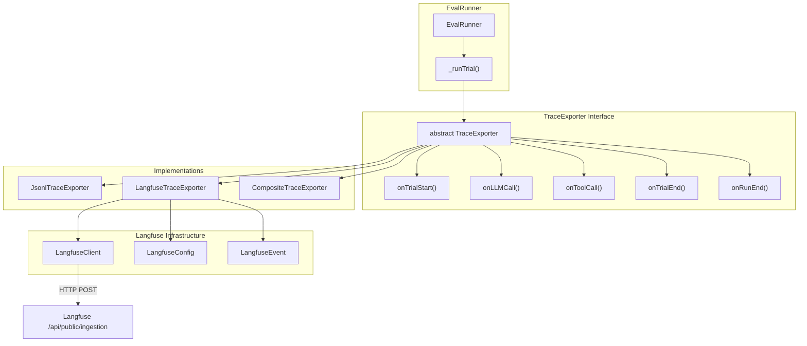
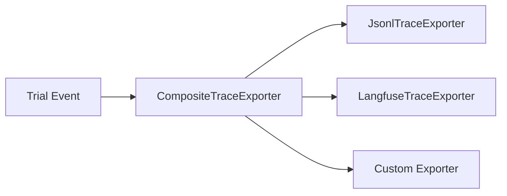
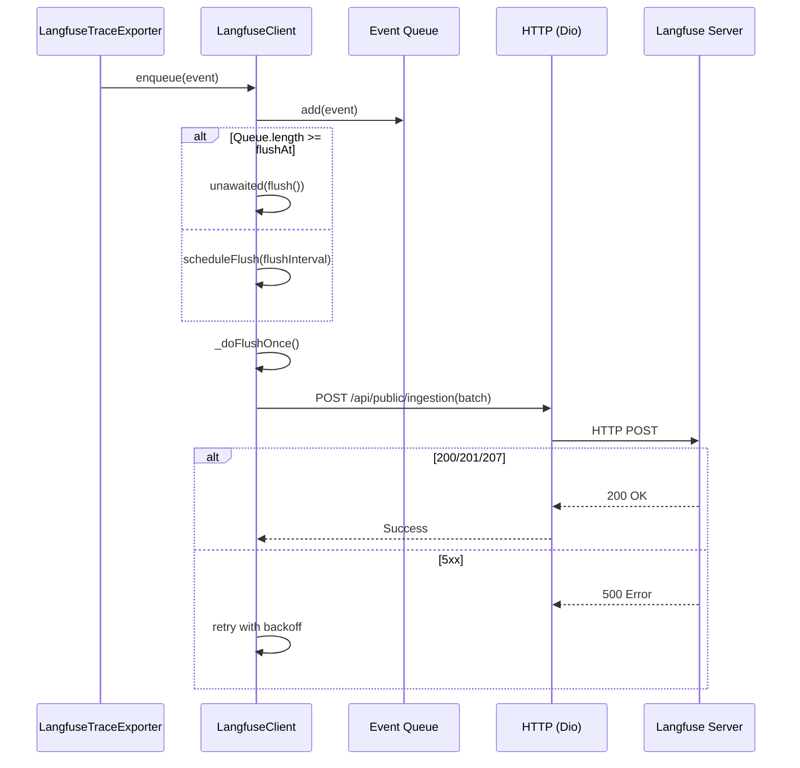
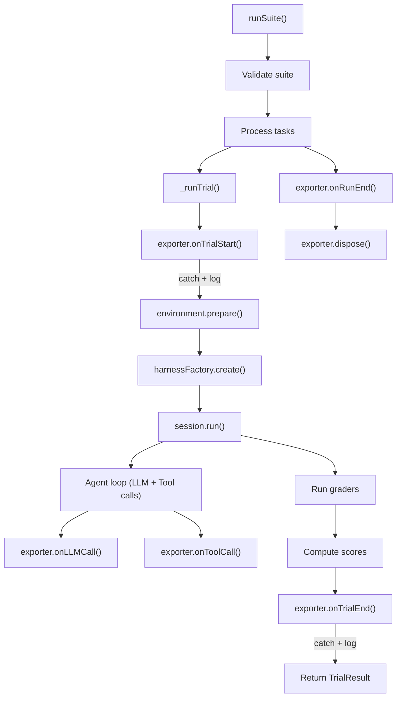
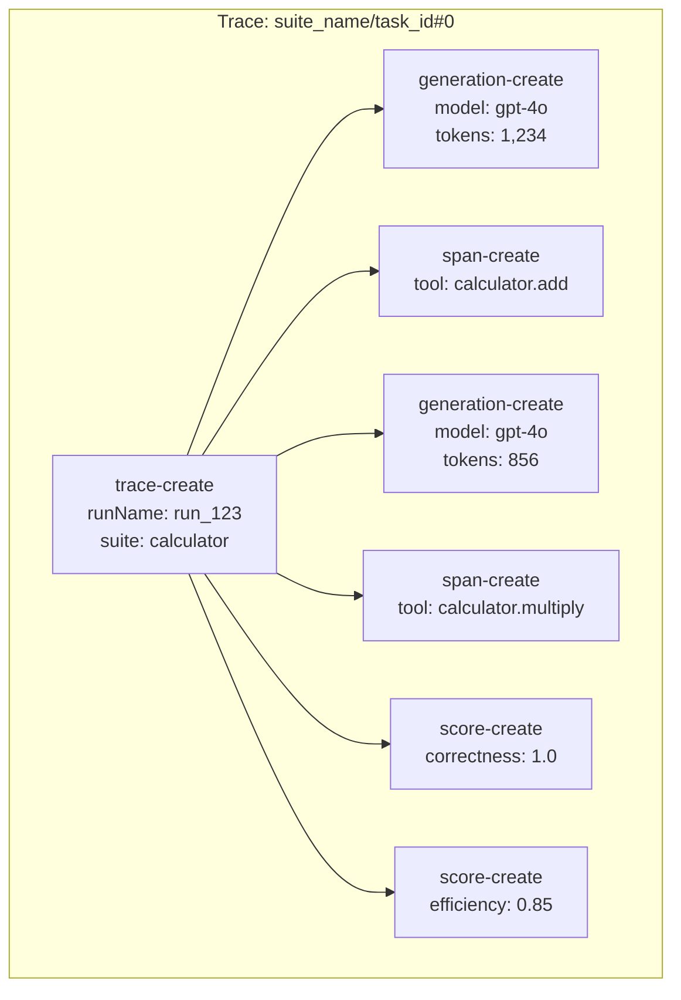

Observability in `dart_agent_core`'s evaluation framework provides a structured mechanism for streaming trial events to external backends, enabling deep inspection of agent behavior, LLM interactions, and tool usage during eval runs. The trace export system follows an **OTel-style** model: each trial produces a tree of spans that captures the complete execution lifecycle — from trial initiation through LLM calls and tool invocations to final scoring.

## Architecture Overview

The observability subsystem is built around a **strategy pattern** with three layers: the abstract `TraceExporter` interface, concrete implementations for different backends, and a composite pattern for fan-out to multiple exporters simultaneously.



Sources: [trace_exporter.dart](lib/src/eval/observability/trace_exporter.dart#L9-L58), [composite_trace_exporter.dart](lib/src/eval/observability/composite_trace_exporter.dart#L10-L80)

## The TraceExporter Interface

The `TraceExporter` abstract class defines the contract for streaming trial events. Each callback corresponds to a specific phase in the trial lifecycle, creating a structured trace tree:

| Callback | Trigger | Purpose |
|----------|---------|---------|
| `onTrialStart()` | Trial begins | Initialize trace context, record trial metadata |
| `onLLMCall()` | Each LLM request completes | Capture model, tokens, latency, errors |
| `onToolCall()` | Each tool invocation completes | Record tool name, arguments, results |
| `onTrialEnd()` | Trial finishes | Finalize trace, attach scores and outcome |
| `onRunEnd()` | Dataset run completes | Aggregate run-level metrics (pass@k, F1) |

**Concurrency model**: Implementations must be safe for concurrent trials. Each trial's events arrive in order, but trials interleave with each other across threads. This allows the runner to process multiple trials simultaneously while maintaining per-trial event ordering.

Sources: [trace_exporter.dart](lib/src/eval/observability/trace_exporter.dart#L9-L58)

## Implementation Patterns

### JsonlTraceExporter: File-Based Tracing

The `JsonlTraceExporter` provides a lightweight, grep-friendly trace format that writes one JSON object per line to a file. This implementation is ideal for local development, debugging, and integration with log analysis tools.

**Event Format**: Each line contains a JSON object with a `kind` discriminator:

| Event Kind | Top-Level Keys | Description |
|------------|----------------|-------------|
| `trial_start` | `trial`, `task` | Trial initialization with task metadata |
| `llm_call` | `trialId`, `model`, `durationMs`, `response` | LLM interaction details |
| `tool_call` | `trialId`, `record` | Tool invocation with arguments and results |
| `trial_end` | `trial`, `transcript`, `outcome`, `scores` | Complete trial result with all graders |
| `run_end` | `runName`, `suiteName`, `aggregateScores` | Dataset-level aggregation |

**Usage Pattern**:
```dart
final tracesFile = File('.eval_traces/${runName}.jsonl');
final exporter = JsonlTraceExporter(tracesFile);

final runner = EvalRunner(
  environment: env,
  harnessFactory: harness,
  exporters: [exporter],
  // ...
);
```

The exporter buffers writes internally and flushes automatically on `dispose()`. For immediate persistence, call `flush()` explicitly.

Sources: [jsonl_trace_exporter.dart](lib/src/eval/observability/jsonl_trace_exporter.dart#L13-L121), [eval_demo/main.dart](example/eval_demo/main.dart#L144-L155)

### CompositeTraceExporter: Fan-Out Pattern

The `CompositeTraceExporter` enables simultaneous tracing to multiple backends — for example, local JSONL files for debugging and Langfuse for production dashboards. It broadcasts each event to all registered exporters in parallel using `Future.wait()`.



**Key characteristics**:
- **Order preservation**: Events maintain order within each exporter
- **Cross-exporter independence**: No ordering guarantees between different exporters
- **Graceful degradation**: If one exporter fails, others continue (caught exceptions logged)

The runner automatically wraps multiple exporters in a `CompositeTraceExporter` when provided as a list:

```dart
final runner = EvalRunner(
  exporters: [
    JsonlTraceExporter(localFile),
    LangfuseTraceExporter(config),
  ],
  // ...
);
// Runner internally creates: CompositeTraceExporter([jsonl, langfuse])
```

Sources: [composite_trace_exporter.dart](lib/src/eval/observability/composite_trace_exporter.dart#L10-L80), [eval_runner.dart](lib/src/eval/core/eval_runner.dart#L46-L57)

## Langfuse Integration

Langfuse provides a managed observability platform with a rich dashboard for visualizing LLM traces. The `dart_agent_core` integration maps the internal trial model to Langfuse's trace/span/generation/score primitives.

### Mapping Table

| dart_agent_core Concept | Langfuse Event Type | ID Generation | Parent Relationship |
|------------------------|-------------------|---------------|-------------------|
| Trial | `trace-create` | UUID (stable per trial) | Root of trace tree |
| LLM call | `generation-create` | UUID | Child of trace |
| Tool call | `span-create` | UUID | Child of trace |
| Grader score | `score-create` | UUID | Associated with trace |
| Run aggregate | `trace-create` + `score-create` | UUID | Separate summary trace |

### Configuration

The `LangfuseConfig` class manages authentication, environment labeling, and transport tuning. Configuration can be loaded from environment variables or constructed explicitly:

| Parameter | Default | Description |
|-----------|---------|-------------|
| `host` | `https://cloud.langfuse.com` | Langfuse server URL (self-hosted supported) |
| `publicKey` | Required | Langfuse API public key |
| `secretKey` | Required | Langfuse API secret key |
| `environment` | `default` | Environment label (dev/staging/prod) |
| `release` | `null` | Optional release identifier |
| `version` | `null` | Optional version identifier |
| `flushAt` | 50 | Batch size threshold for immediate flush |
| `flushInterval` | 1 second | Maximum time before flush |
| `maxRetries` | 3 | HTTP retry attempts with exponential backoff |
| `requestTimeout` | 10 seconds | HTTP request timeout |

**Environment variables** (for CI/CD):
```bash
export LANGFUSE_PUBLIC_KEY="pk-..."
export LANGFUSE_SECRET_KEY="sk-..."
export LANGFUSE_HOST="https://langfuse.your-domain.com"  # optional
export LANGFUSE_ENVIRONMENT="production"                   # optional
export LANGFUSE_RELEASE="v1.2.3"                          # optional
```

Sources: [langfuse_config.dart](lib/src/eval/observability/langfuse/langfuse_config.dart#L13-L80)

### Transport Layer: LangfuseClient

The `LangfuseClient` handles HTTP communication with Langfuse's `/api/public/ingestion` endpoint, implementing batched ingestion with resilience patterns:



**Resilience features**:
- **Batched ingestion**: Events accumulate until `flushAt` threshold or `flushInterval` timer
- **Serial flush**: Only one HTTP request in flight at a time (prevents duplicate sends)
- **Exponential backoff**: 100ms, 200ms, 400ms... up to 5s cap
- **Graceful failure**: HTTP errors log warnings but never crash the eval run
- **Force shutdown**: `shutdown()` flushes remaining events and closes HTTP connections

Sources: [langfuse_client.dart](lib/src/eval/observability/langfuse/langfuse_client.dart#L10-L190)

### Langfuse Event Structure

Each event sent to Langfuse follows a standardized envelope format:

```json
{
  "id": "<uuid>",
  "type": "trace-create | generation-create | span-create | score-create",
  "timestamp": "2026-05-22T...Z",
  "body": { /* type-specific payload */ }
}
```

The `LangfuseEvent` class encapsulates this structure, with the `body` field containing Langfuse-specific schemas for traces, generations, spans, and scores.

Sources: [langfuse_event.dart](lib/src/eval/observability/langfuse/langfuse_event.dart#L15-L40)

## Transcript Viewer CLI

The `transcripts` CLI tool provides command-line access to trace data stored in `FileReportStore`. It supports listing runs, inspecting individual trials, comparing across runs, and exporting to markdown.

```bash
# List recent runs
dart run bin/transcripts.dart list --suite calculator --limit 10

# Show a specific trial
dart run bin/transcripts.dart show --trial run_name/task_id#0 --format human

# Compare same task across two runs
dart run bin/transcripts.dart diff --task task_001 --runs run_a,run_b

# Export full run as markdown
dart run bin/transcripts.dart export --run run_name --format markdown
```

| Command | Description | Required Options |
|---------|-------------|-----------------|
| `list` | List recent runs | `--suite` (optional), `--limit` |
| `show` | Display trial details | `--trial RUN/TASK#INDEX` |
| `diff` | Compare trials across runs | `--task TASK_ID`, `--runs RUN_A,RUN_B` |
| `export` | Export run as markdown blob | `--run RUN_NAME` |

Sources: [transcript_viewer.dart](lib/src/eval/observability/transcript_viewer.dart#L10-L33), [transcripts.dart](bin/transcripts.dart#L1-L9)

## Integration with EvalRunner

The `EvalRunner` integrates trace exporters at specific lifecycle points, with error handling to ensure observability never blocks the eval run:



**Error handling pattern**: Each exporter call is wrapped in try-catch with logging. If an exporter throws, the exception is logged as a warning but does not fail the trial or the overall run.

Sources: [eval_runner.dart](lib/src/eval/core/eval_runner.dart#L226-L353)

## Langfuse Trace Visualization

When using Langfuse, the trace tree appears as:



**Dashboard filtering**:
- **By run**: `userId = runName` (filter in Langfuse UI)
- **By suite**: `sessionId = suiteName`
- **By tags**: `suite:calculator`, `task:add_basic`, `run:exp_123`, `trial:0`
- **By environment**: Filter by `environment` field (dev/staging/prod)

Sources: [langfuse_trace_exporter.dart](lib/src/eval/observability/langfuse/langfuse_trace_exporter.dart#L15-L36)

## Best Practices

**Development workflow**: Use `JsonlTraceExporter` for local debugging — the JSONL format is grep-friendly and integrates with tools like `jq`:

```bash
# Find all failed tool calls
cat traces.jsonl | jq 'select(.kind == "tool_call" and .record.isError)'

# Extract token usage per model
cat traces.jsonl | jq 'select(.kind == "llm_call") | {model: .model.model, tokens: .response.usage.totalTokens}'
```

**Production deployment**: Combine `JsonlTraceExporter` with `LangfuseTraceExporter` for comprehensive observability:

```dart
final runner = EvalRunner(
  exporters: [
    JsonlTraceExporter(File('.eval_traces/${runName}.jsonl')),
    LangfuseTraceExporter(LangfuseConfig.fromEnv()),
  ],
  // ...
);
```

**Environment isolation**: Use `LangfuseConfig.environment` to separate traces across environments:

```dart
final config = LangfuseConfig(
  publicKey: pubKey,
  secretKey: secKey,
  environment: kReleaseMode ? 'production' : 'development',
);
```

Sources: [eval_demo/main.dart](example/eval_demo/main.dart#L67-L155), [min_eval/main.dart](example/min_eval/main.dart#L171-L178)

## Related Topics

- [Trials, Outcomes, and Transcripts](18-trials-outcomes-and-transcripts) — Understand the data structures that trace exporters consume
- [Eval Architecture Overview](16-eval-architecture-overview) — System-wide context for the evaluation framework
- [Recording, Replay, and Rate Limiting](20-recording-replay-and-rate-limiting) — Complementary observability for LLM requests
- [Reporting and Markdown Output](23-reporting-and-markdown-output) — Final report generation alongside trace export