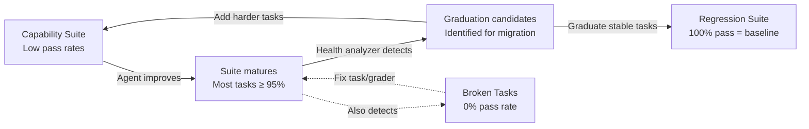
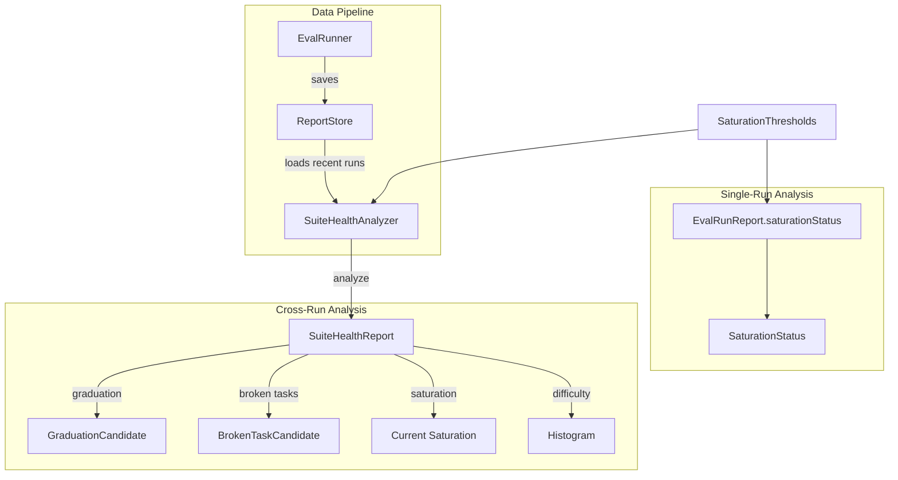
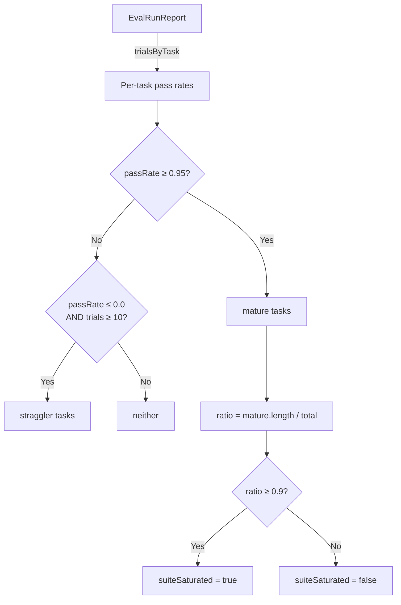
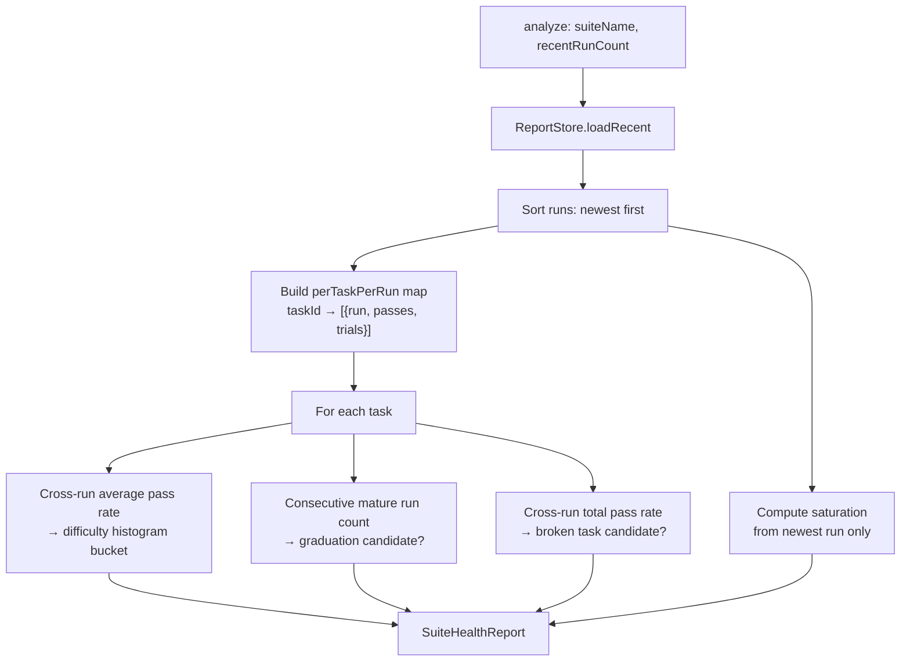
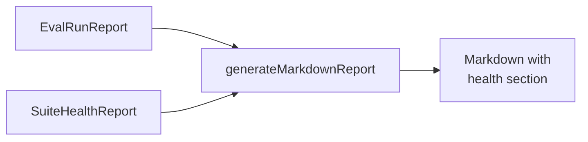

Suite health analysis is the mechanism that keeps an eval suite relevant over time. Without it, capability suites silently saturate — every task reaches ~100% pass rate, the suite stops detecting regressions, and it becomes dead weight. The health analyzer detects two failure modes (graduation candidates and broken tasks) and two health signals (saturation ratio and difficulty distribution), giving teams actionable data for suite lifecycle management. This system is the Dart implementation of Anthropic's Step 7–8 methodology.

Sources: [saturation_status.dart](lib/src/eval/suite_health/saturation_status.dart#L1-L10)

## Conceptual Model: The Suite Lifecycle

The health analysis system is built around a core insight from Anthropic's eval methodology: **capability suites should evolve, while regression suites should stay stable**. A capability suite starts with tasks at low pass rates; as the agent improves, tasks mature and should be "graduated" to a regression suite, while harder tasks replace them. This creates a natural lifecycle.



The three `SuiteKind` values define this contract directly in code: **capability** suites measure "what can the agent do?", **regression** suites measure "does it still work?", and **mixed** is a transitional state. The `taskPassRate` calculation changes based on suite kind — capability suites use pass@N (any trial passing suffices), while regression suites use pass^N (every trial must pass).

Sources: [eval_suite.dart](lib/src/eval/core/eval_suite.dart#L6-L28)

## Architecture Overview

The health system comprises three tightly coupled layers: a threshold configuration layer, a single-run saturation snapshot, and a cross-run analyzer that produces actionable health reports.



The `EvalRunner` persists every `EvalRunReport` to a `ReportStore` when one is configured. The `SuiteHealthAnalyzer` then pulls recent runs from this store and computes cross-run signals. This separation means the health analysis never runs during the eval itself — it's a post-hoc diagnostic step.

Sources: [eval_runner.dart](lib/src/eval/core/eval_runner.dart#L56-L60), [suite_health_analyzer.dart](lib/src/eval/suite_health/suite_health_analyzer.dart#L15-L23)

## SaturationThresholds: The Configuration Surface

All health judgments are governed by a single `SaturationThresholds` object with five tunable parameters. The defaults are calibrated to Anthropic's recommended thresholds:

| Parameter | Default | Meaning |
|---|---|---|
| `matureTaskPassRate` | 0.95 | pass@1 ≥ this → task is "mature" in a single run |
| `consecutiveRunsForGraduation` | 5 | Number of consecutive mature runs required to suggest graduation |
| `brokenTaskPassRate` | 0.0 | pass@1 ≤ this → task is "broken" (likely a grader/task bug) |
| `minTrialsForBrokenJudgment` | 10 | Minimum total trials across runs before flagging as broken |
| `saturatedSuiteRatio` | 0.9 | Fraction of mature tasks needed to declare the suite "saturated" |

The threshold design reflects two distinct time horizons. `matureTaskPassRate` and `saturatedSuiteRatio` evaluate a **single run** — they answer "is the suite healthy right now?" The `consecutiveRunsForGraduation` parameter evaluates **temporal stability** — it answers "has the agent been consistently good at this task, or was last run a fluke?" The `brokenTaskPassRate` and `minTrialsForBrokenJudgment` serve as a **noise filter** — a task must fail consistently across enough trials before being flagged, avoiding false positives from genuinely non-deterministic tasks.

Sources: [saturation_status.dart](lib/src/eval/suite_health/saturation_status.dart#L4-L33)

## Single-Run Saturation: SaturationStatus

Before cross-run analysis is possible, the system provides a synchronous, single-run snapshot. `SaturationStatus` is computed from one `EvalRunReport` and answers: "given only this run, which tasks are mature, which are straggling, and what fraction of the suite has reached maturity?"



This is exposed in two ways: as a method on `SuiteHealthAnalyzer.computeSaturationStatus(report)` for explicit use, and as `EvalRunReport.saturationStatus()` for inline access. The implementation in both locations is identical — the analyzer delegates to an internal `_computeSaturationFor` method that mirrors the report's own logic.

The `SaturationStatus` object carries four fields: `saturatedTaskRatio` (the fraction of mature tasks), `suiteSaturated` (boolean), `matureTasks` (list of task IDs), and `stragglerTasks` (list of task IDs). It's serializable to JSON for logging and CI artifact persistence.

Sources: [saturation_status.dart](lib/src/eval/suite_health/saturation_status.dart#L78-L106), [eval_run_report.dart](lib/src/eval/core/eval_run_report.dart#L113-L144)

## Cross-Run Analysis: SuiteHealthAnalyzer.analyze

The real power of the health system lies in `SuiteHealthAnalyzer.analyze()`, which pulls the most recent N runs from the `ReportStore` and computes three distinct signals: graduation candidates, broken task candidates, and difficulty distribution.

### How It Works

The analyzer loads up to `recentRunCount` (default 10) persisted `EvalRunReport` snapshots for the named suite, sorts them newest-first, and then iterates over every task that appeared in any of those runs. For each task, it computes a per-run statistics vector — `(runName, startedAt, passes, trials)` — ordered newest-first.



### Graduation Detection

A task is flagged as a graduation candidate when it has been **consecutively** mature for at least `consecutiveRunsForGraduation` runs. The algorithm walks the stats vector newest-first and counts consecutive runs where `passes / trials ≥ matureTaskPassRate`. It stops counting at the first non-mature run — this means a single bad run resets the streak, ensuring the agent is genuinely stable before graduation is suggested.

The resulting `GraduationCandidate` carries the task ID, the overall mean pass rate across all analyzed runs, the number of consecutive mature runs, and the list of contributing run names. This data gives teams enough context to decide whether to graduate: a task with 8 consecutive mature runs at 99.5% mean is a stronger candidate than one with exactly 5 consecutive runs at 95.1%.

Sources: [suite_health_analyzer.dart](lib/src/eval/suite_health/suite_health_analyzer.dart#L120-L150)

### Broken Task Detection

A task is flagged as broken when its **aggregate** pass rate across all analyzed runs falls at or below `brokenTaskPassRate` AND the total trial count across those runs meets or exceeds `minTrialsForBrokenJudgment`. Unlike graduation detection (which requires consecutiveness), broken detection uses an aggregate metric — a task that passes 1 out of 100 trials across 10 runs is still broken.

This distinction is intentional. A task that alternates between passing and failing across runs might be genuinely non-deterministic (not broken). But a task that almost never passes is almost certainly a task-definition or grader-config bug — the agent isn't failing the behavior; the evaluation is failing the agent.

Sources: [suite_health_analyzer.dart](lib/src/eval/suite_health/suite_health_analyzer.dart#L152-L172), [suite_health_analyzer.dart](lib/src/eval/suite_health/saturation_status.dart#L60-L76)

### Difficulty Histogram

The analyzer buckets each task's cross-run average pass rate into six ranges and builds a frequency distribution:

| Bucket | Interpretation |
|---|---|
| `[0.0, 0.2)` | Nearly impossible — likely needs investigation |
| `[0.2, 0.4)` | Hard — agent struggles significantly |
| `[0.4, 0.6)` | Medium — agent has partial capability |
| `[0.6, 0.8)` | Medium-easy — agent mostly succeeds |
| `[0.8, 0.95)` | Easy — approaching maturity |
| `[0.95, 1.0]` | Mature — candidate for graduation |

This histogram is the primary input for deciding whether a capability suite needs harder tasks. A suite where all tasks cluster in `[0.95, 1.0]` is fully saturated and providing diminishing returns. A well-distributed histogram indicates a healthy, challenging suite.

Sources: [suite_health_analyzer.dart](lib/src/eval/suite_health/suite_health_analyzer.dart#L192-L202)

## SuiteHealthReport: The Output Contract

`SuiteHealthReport` is the immutable, serializable result of cross-run analysis. It captures the full picture in a single object:

| Field | Type | Description |
|---|---|---|
| `suiteName` | `String` | Name of the analyzed suite |
| `suiteKind` | `SuiteKind` | capability / regression / mixed |
| `analyzedRunCount` | `int` | Number of runs actually loaded and analyzed |
| `thresholds` | `SaturationThresholds` | The thresholds used (for reproducibility) |
| `graduationCandidates` | `List<GraduationCandidate>` | Tasks ready for migration to regression |
| `brokenTaskCandidates` | `List<BrokenTaskCandidate>` | Tasks likely containing bugs |
| `currentSaturationRatio` | `double` | Mature task fraction in the **latest** run |
| `currentlySaturated` | `bool` | Whether the latest run exceeds the saturation threshold |
| `difficultyHistogram` | `Map<String, int>` | Task distribution across pass-rate buckets |

The `currentSaturationRatio` and `currentlySaturated` fields are computed from the **newest run only**, not from the aggregate. This design ensures the report answers two distinct questions: "is the suite healthy right now?" (current saturation) and "has it been healthy long enough to warrant action?" (graduation candidates).

Sources: [suite_health_report.dart](lib/src/eval/suite_health/suite_health_report.dart#L1-L66)

## Integration with EvalRunner and ReportStore

The health analysis system is deeply integrated into the eval pipeline through the `ReportStore` abstraction. When `EvalRunner` is constructed with a non-null `reportStore`, every `runSuite` call automatically persists the resulting `EvalRunReport` to the store. This makes historical data available for health analysis without any extra configuration.

The `FileReportStore` implementation uses an append-only `index.jsonl` file for fast listing and individual JSON files in a `reports/` directory for full trial data. The store layout:

```
rootDir/
  index.jsonl              # One JSON line per run (lightweight metadata)
  reports/
    {safe_runName}.json    # Full trial data + suite snapshot
```

`PersistedRunReport` differs from `EvalRunReport` in one crucial way: the `suite` field is a `SuiteSnapshot` rather than a live `EvalSuite`. Historical runs cannot carry live grader instances, so the snapshot stores only the metadata needed for analysis — name, kind, task IDs, and thresholds. This is sufficient because health analysis only reads trial pass/fail outcomes, not the grader logic itself.

Sources: [report_store.dart](lib/src/eval/reporting/report_store.dart#L68-L95), [eval_runner.dart](lib/src/eval/core/eval_runner.dart#L112-L115)

## Integration with Reporting

The `SuiteHealthReport` is designed to compose with the Markdown report generator. When `generateMarkdownReport` receives a non-null `health` parameter, it appends a "Suite health" section containing saturation status, graduation candidates with their mean pass rates and consecutive run counts, and broken task candidates with their trial statistics.



For cross-run comparison, `EvalRunDiff` (produced by `report.current.diffWith(baseline)`) shows task-level transitions between two runs but doesn't directly incorporate health data. The two systems are complementary: `diffRunReports` answers "what changed between these two runs?" while `SuiteHealthAnalyzer` answers "is this suite still useful?"

Sources: [report_generator.dart](lib/src/eval/reporting/report_generator.dart#L121-L148), [diff_reporter.dart](lib/src/eval/reporting/diff_reporter.dart#L155-L167)

## Complete Usage Example

```dart
import 'package:dart_agent_core/eval.dart';

// 1. Configure the runner with a report store
final store = FileReportStore(Directory('.eval_reports'));
final runner = EvalRunner(
  environment: myEnvironment,
  harnessFactory: myHarnessFactory,
  reportStore: store,
);

// 2. Run a capability suite (persists report automatically)
final report = await runner.runSuite(
  runName: 'ci-run-42',
  suite: cardCapabilitySuite,
);

// 3. Analyze suite health across recent runs
final analyzer = SuiteHealthAnalyzer(
  store,
  thresholds: const SaturationThresholds(
    matureTaskPassRate: 0.95,
    consecutiveRunsForGraduation: 5,
  ),
);

final health = await analyzer.analyze(
  suiteName: 'card_capability',
  recentRunCount: 10,
);

// 4. Act on the results
if (health.currentlySaturated) {
  print('⚠️ Suite saturated at '
      '${(health.currentSaturationRatio * 100).toStringAsFixed(1)}%');
}

for (final c in health.graduationCandidates) {
  print('🎓 Graduate "${c.taskId}": '
      '${(c.recentMeanPassRate * 100).toStringAsFixed(1)}% mean, '
      '${c.consecutiveMatureRuns} consecutive mature runs');
}

for (final c in health.brokenTaskCandidates) {
  print('🐛 Broken "${c.taskId}": '
      '${c.passedTrials}/${c.totalTrials} passed');
}

// 5. Include health in Markdown report
final markdown = generateMarkdownReport(report, health: health);
```

Sources: [suite_health_test.dart](test/eval/suite_health_test.dart#L69-L111), [eval_runner.dart](lib/src/eval/core/eval_runner.dart#L112-L115)

## When to Use Each Analysis Level

| Scenario | Use | Why |
|---|---|---|
| Post-run dashboard | `EvalRunReport.saturationStatus()` | Synchronous, no store needed |
| CI gating (single run) | `SuiteHealthAnalyzer.computeSaturationStatus(report)` | Same as above, explicit API |
| Weekly suite review | `SuiteHealthAnalyzer.analyze()` | Cross-run signals, graduation/broken detection |
| PR-based diff | `current.diffWith(baseline)` | Run-over-run comparison, not health analysis |
| Suite budget planning | `SuiteHealthReport.difficultyHistogram` | Decide where to add/remove tasks |

The critical distinction is between **single-run** and **cross-run** analysis. Single-run saturation tells you if the suite is currently providing value. Cross-run analysis tells you if the suite is trending toward obsolescence (too many graduation candidates) or contains measurement errors (too many broken tasks). Both are needed, but they answer different questions at different cadences.

Sources: [suite_health_analyzer.dart](lib/src/eval/suite_health/suite_health_analyzer.dart#L25-L48), [saturation_status.dart](lib/src/eval/suite_health/saturation_status.dart#L78-L106)

## Task ID Stability: A Prerequisite for Health Analysis

The health analyzer aligns trials **across runs by task ID**. This means the `id` field on `EvalTask` is not just a label — it's the join key for the entire cross-run analysis pipeline. A semantic change to a task (different input, different success criteria) **must** produce a new task ID. Reusing an ID for a fundamentally different task will corrupt graduation detection: the analyzer will see a pass-rate drop and interpret it as a regression rather than a new task.

The convention is to append a version suffix: `card_001` → `card_001_v2`. The old task stays in the suite until it's explicitly removed, preserving historical data integrity.

Sources: [eval_guide.md](doc/eval-guide.md#L96)

## Next Steps

For the broader evaluation architecture that produces the reports consumed by health analysis, see [Eval Architecture Overview](16-eval-architecture-overview). To understand the pass@k and pass^k metrics that underpin task maturity judgments, see [pass@k and pass^k Metrics](19-passatk-and-pass-k-metrics). For how individual trials produce the outcomes that feed into health reports, see [Trials, Outcomes, and Transcripts](18-trials-outcomes-and-transcripts). For rendering health data into actionable Markdown, see [Reporting and Markdown Output](23-reporting-and-markdown-output).