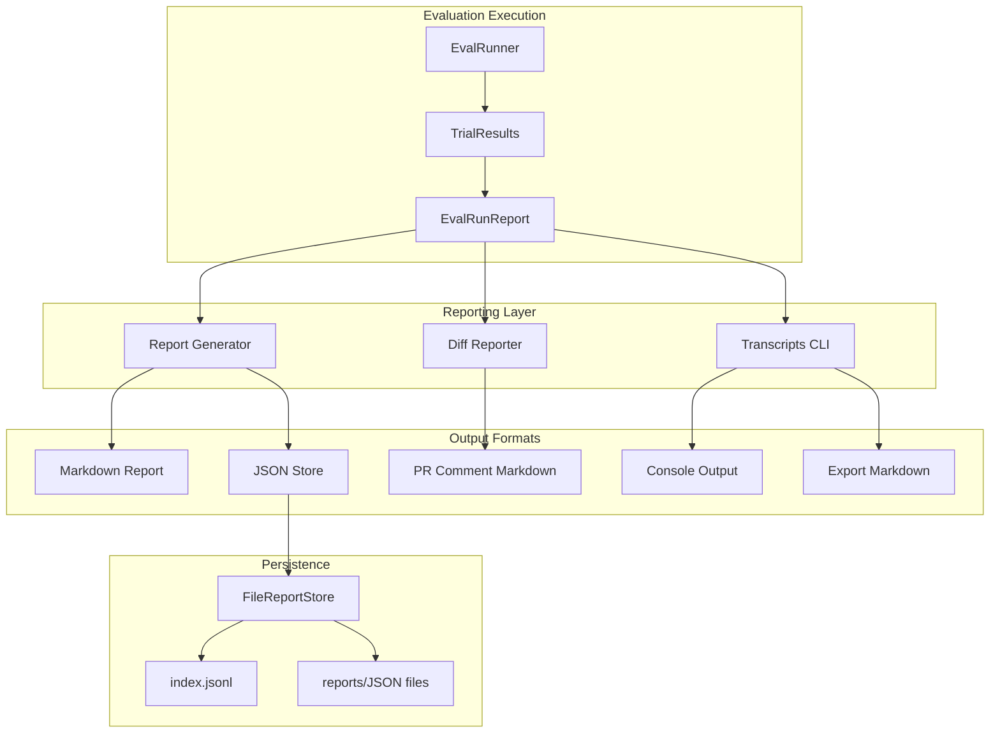
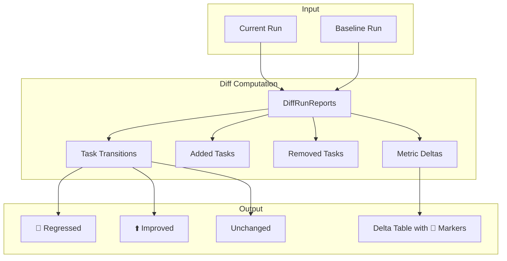
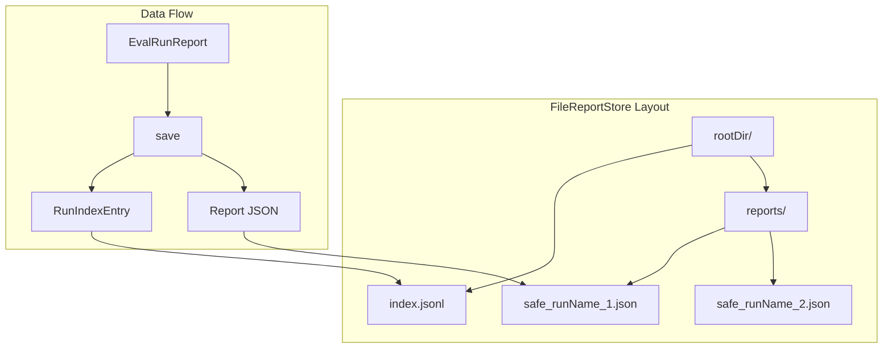
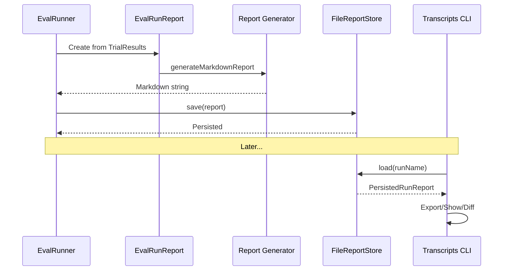

The eval framework's reporting system transforms raw evaluation data into structured, human-readable Markdown summaries and machine-parseable JSON — designed for CI/CD pipelines, PR comments, and cross-run trend analysis. This page covers the architecture of report generation, the Markdown output format, and the diff system for comparing evaluation runs.

## Report Architecture

The reporting layer sits between the evaluation runner and persistence, composing metrics from trial results into digestible summaries. The system follows a clear separation of concerns: `EvalRunReport` computes metrics, `report_generator.dart` formats Markdown, `diff_reporter.dart` handles cross-run comparisons, and `ReportStore` manages persistence.



Sources: [report_generator.dart](lib/src/eval/reporting/report_generator.dart#L1-L40), [diff_reporter.dart](lib/src/eval/reporting/diff_reporter.dart#L1-L30), [report_store.dart](lib/src/eval/reporting/report_store.dart#L1-L30)

## EvalRunReport: The Data Foundation

`EvalRunReport` is the central data structure that aggregates trial outcomes into actionable metrics. It computes pass rates, per-grader means, bucket-level pass rates, and pass@k/pass^k statistics — all derived from the raw `TrialResult` list.

| Metric | Description | Calculation |
|--------|-------------|-------------|
| `trialPassRate` | Overall fraction of trials that passed | `passed_trials / total_trials` |
| `taskPassRate` | Fraction of tasks that passed (kind-dependent) | Regression: all trials pass. Capability: at least one passes |
| `graderMeans` | Mean score per grader across all trials | Excludes null scores |
| `bucketPassRates` | Pass rate grouped by failure bucket metadata | Uses `metadata['failure_bucket']` |
| `passAtK` | pass@k for each task | Computed via binomial coefficient |
| `passCaretK` | pass^k for each task | `(pass_rate)^k` |

The `taskPassRate` calculation depends on suite kind, which is a critical distinction:

- **Regression suites**: A task passes only if *every* trial passes (strict quality gate)
- **Capability suites**: A task passes if *at least one* trial passes (demonstrates capability)
- **Mixed suites**: Same as regression (conservative default)

Sources: [eval_run_report.dart](lib/src/eval/core/eval_run_report.dart#L20-L146)

## Markdown Report Generation

The `generateMarkdownReport` function produces a complete Markdown summary suitable for CI/CD artifacts, Slack notifications, or PR comments. The output structure follows a consistent template:

```mermaid
graph LR
    A[Report Header] --> B[Top-line Metrics]
    B --> C[pass@k / pass^k Table]
    C --> D[Bucket Pass Rates]
    D --> E[Failed Trials Detail]
    E --> F[Suite Health]
```

The report includes these sections:

1. **Header**: Run name, suite name, kind, timestamps, duration
2. **Top-line metrics**: Task pass rate, trial pass rate, grader means
3. **pass@k / pass^k by task**: Per-task k-table with configurable k values
4. **Pass rate by failure bucket**: Grouped pass rates using task metadata
5. **Failed trials**: Detailed breakdown with scores, rationale, and assertions
6. **Suite health**: Saturation status, graduation candidates, broken tasks

### Example Output Structure

```markdown
# Eval Run: `calculator_1692000000000`

- Suite: **calculator** (capability)
- Started: 2025-08-19T10:00:00.000Z
- Duration: 2m30s
- Tasks: 5 · Trials: 25

## Top-line metrics

| Metric | Value |
|---|---|
| Task pass rate | 80.0% |
| Trial pass rate | 76.0% |
| Grader mean: `accuracy` | 0.842 |

## pass@k / pass^k by task

| Task | pass@1 | pass^1 | pass@3 | pass^3 |
|---|---|---|---|---|
| `basic_math` | 100.0% | 100.0% | 100.0% | 100.0% |
| `word_problem` | 60.0% | 60.0% | 96.0% | 21.6% |
```

### Configuration Options

| Parameter | Type | Default | Description |
|-----------|------|---------|-------------|
| `taskBucketMap` | `Map<String, String>?` | `null` | Maps task IDs to failure buckets for bucket-level analysis |
| `ksToReport` | `List<int>` | `[1, 3]` | Which k values to include in pass@k/pass^k tables |
| `health` | `SuiteHealthReport?` | `null` | Suite health data for saturation/graduation analysis |

Sources: [report_generator.dart](lib/src/eval/reporting/report_generator.dart#L8-L186)

## Diff Reporting for Cross-Run Comparison

The diff system compares two `EvalRunReport` instances to highlight regressions, improvements, and structural changes. This is particularly valuable for PR comments, showing exactly what changed between a feature branch and main.



### Transition Detection

Tasks are classified into three transition kinds based on pass rate changes:

| Transition | Condition | Visual Marker |
|------------|-----------|---------------|
| **Regressed** | Pass rate decreased by ≥ threshold | 🚨 in report |
| **Improved** | Pass rate increased by ≥ threshold | ⬆️ in report |
| **Unchanged** | Change below significance threshold | — |

The default significance threshold is 5% (0.05), configurable via `significanceThreshold`. This prevents noise from insignificant fluctuations.

### Diff Output Structure

```markdown
# Eval diff: `pr_123` vs `main`

- Suite: **calculator** (capability)
- Tasks: 5 (was 5)

## Top-line metrics

| Metric | This run | Baseline | Δ |
|---|---|---|---|
| task_pass_rate | 80.0% | 100.0% | -20.0% ⬇ 🚨 |
| trial_pass_rate | 76.0% | 92.0% | -16.0% ⬇ 🚨 |
| grader_mean.accuracy | 0.842 | 0.951 | -0.109 ⬇ |

## 🚨 Regressed tasks (1)

- `word_problem`: baseline 100.0% → current 60.0%

## ⬆️ Improved tasks (0)
```

The 🚨 marker appears automatically for regression suites when pass rates decrease, providing immediate visual feedback in PR comments.

Sources: [diff_reporter.dart](lib/src/eval/reporting/diff_reporter.dart#L1-L259)

## Transcripts CLI: Command-Line Reporting

The `transcripts` CLI tool provides command-line access to report data, enabling quick inspection and export without writing Dart code. It reads from the same `FileReportStore` used by the evaluation runner.

| Command | Description | Example |
|---------|-------------|---------|
| `list` | List recent runs (newest first) | `dart run bin/transcripts.dart list --suite calculator` |
| `show` | Show detailed trial information | `dart run bin/transcripts.dart show --trial main/task_x#0` |
| `diff` | Compare trials across two runs | `dart run bin/transcripts.dart diff --task task_x --runs main,pr` |
| `export` | Export full run as Markdown | `dart run bin/transcripts.dart export --run main --format markdown` |

### Human vs JSON Output

The `show` command supports both human-readable and JSON formats:

**Human format** (default): Formatted with emojis, aligned columns, and truncated previews — ideal for terminal inspection.

**JSON format** (`--format json`): Machine-parseable output for scripting, CI pipelines, or custom visualization tools.

The `export` command generates a complete Markdown document with per-trial scores, transcript metrics, and tool call summaries — useful for detailed post-mortem analysis.

Sources: [transcript_viewer.dart](lib/src/eval/observability/transcript_viewer.dart#L1-L339), [bin/transcripts.dart](bin/transcripts.dart#L1-L9)

## FileReportStore: Persistence Layer

The persistence layer uses an append-only JSONL index file and individual JSON files per run, enabling efficient listing and loading without parsing all report data.



### Index File Format

Each line in `index.jsonl` contains a `RunIndexEntry` with lightweight metadata:

```json
{"runName":"calculator_1692000000000","suiteName":"calculator","suiteKind":"capability","startedAt":"2025-08-19T10:00:00.000Z","endedAt":"2025-08-19T10:02:30.000Z","taskPassRate":0.8,"trialPassRate":0.76,"numTrials":25}
```

This enables fast listing and filtering without loading full report data. The `listRecent` method returns index entries for quick overview, while `loadRecent` provides full `PersistedRunReport` objects for detailed analysis.

### SuiteSnapshot for Historical Analysis

Historical runs store a `SuiteSnapshot` instead of the full `EvalSuite` object, preserving metadata needed for cross-run analysis while avoiding the need to reconstruct runtime objects (graders, reference solutions) that may have changed.

Sources: [report_store.dart](lib/src/eval/reporting/report_store.dart#L30-L305)

## Integration with Evaluation Pipeline

The reporting system integrates seamlessly with the evaluation runner, producing reports automatically and persisting them for later analysis. The runner attaches task bucket metadata and health data during report generation.



### Example: Generating Reports in Your Code

```dart
final report = await runner.runSuite(
  runName: 'my_eval',
  suite: mySuite,
  concurrency: 4,
);

// Generate Markdown for CI artifact
final md = report.toMarkdownSummary(
  taskBucketMap: {'task_a': 'easy', 'task_b': 'hard'},
  ksToReport: [1, 3, 5],
);
File('eval_report.md').writeAsStringSync(md);

// Generate diff for PR comment
final baseline = await reportStore.load('main_baseline');
if (baseline != null) {
  final diff = report.diffWith(baseline);
  File('pr_comment.md').writeAsStringSync(diff.toMarkdown());
}
```

Sources: [example/eval_demo/main.dart](example/eval_demo/main.dart#L145-L165)

## Related Topics

- **[Eval Architecture Overview](16-eval-architecture-overview)**: Understand how reports fit into the overall evaluation system
- **[Trials, Outcomes, and Transcripts](18-trials-outcomes-and-transcripts)**: Learn about the raw data that feeds into reports
- **[pass@k and pass^k Metrics](19-passatk-and-pass-k-metrics)**: Deep dive into the statistical metrics computed in reports
- **[Suite Health Analysis and Graduation](22-suite-health-analysis-and-graduation)**: Understand saturation detection and task graduation logic
- **[Observability and Trace Export](21-observability-and-trace-export)**: Complementary tracing and export capabilities