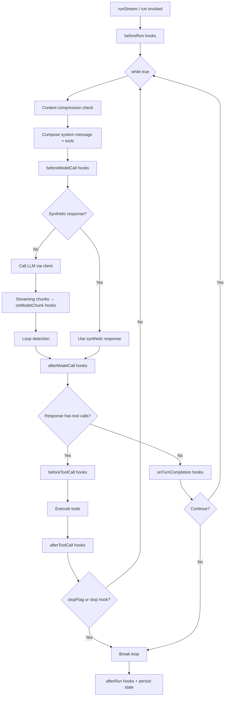
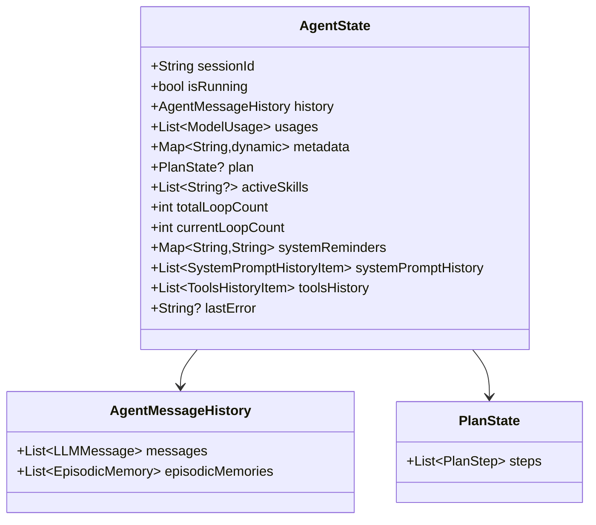
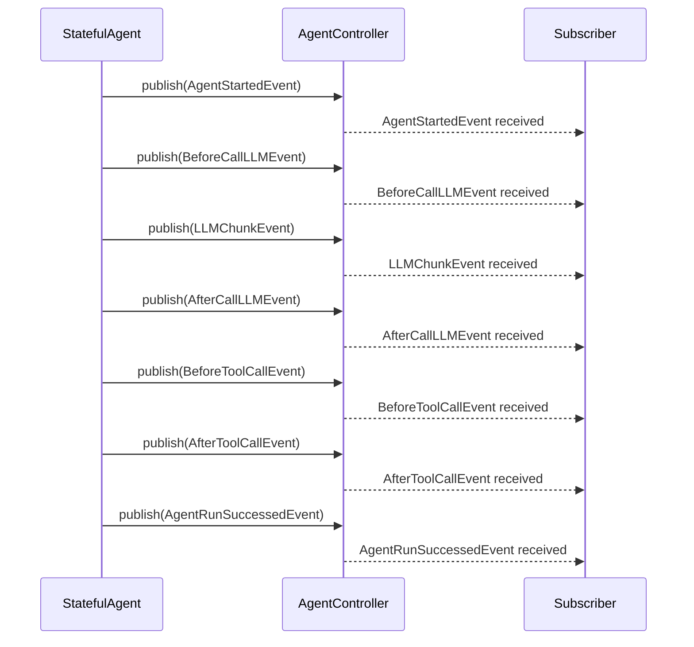

**StatefulAgent** is the central orchestration engine of `dart_agent_core` — a stateful, event-driven executor that runs an autonomous **think → act → observe** loop until the task is complete or a stop condition is met. Every call to `run()` or `runStream()` enters this loop, advancing through LLM calls, tool executions, and hook interventions until the agent determines it has produced a final answer.

This page explains how the agent loop works internally, what controls it, and how to leverage its extensibility points.

---

## The Agentic Loop Architecture

The agentic loop is a deterministic state machine embedded inside `StatefulAgent.runStream()`. Each iteration of the loop performs a complete **model → tools → evaluation** cycle:



Sources: [lib/src/agent/stateful_agent.dart#L850-L1218](lib/src/agent/stateful_agent.dart#L850-L1218)

---

## Anatomy of `runStream()`

The `runStream()` method is the canonical entry point — it returns a `Stream<StreamingEvent>` that yields lifecycle events in real time. The simpler `run()` method is a convenience wrapper that collects the `fullModelMessage` and `functionCallResult` events from `runStream()` and returns them as a `List<LLMMessage>`.

Sources: [lib/src/agent/stateful_agent.dart#L828-L848](lib/src/agent/stateful_agent.dart#L828-L848)

### Loop Variables

| Variable | Purpose | Default |
|----------|---------|---------|
| `maxTurns` | Maximum LLM calls per `run()` invocation | 20 |
| `maxTurnContinuations` | Maximum hook-driven continuations after a no-tool-call turn | 3 |
| `maxRetryCount` | Consecutive empty/empty-stop-reason retries before abort | 3 |

Sources: [lib/src/agent/stateful_agent.dart#L499](lib/src/agent/stateful_agent.dart#L499), [lib/src/agent/stateful_agent.dart#L859-L862](lib/src/agent/stateful_agent.dart#L859-L862)

### Loop Exit Conditions

The loop terminates when any of these conditions is met:

| Condition | Exception Code | Description |
|-----------|---------------|-------------|
| No tool calls in response | — | Model produced a final text answer |
| `stopFlag = true` on a tool result | — | A tool signals completion |
| `TurnCompletionHookResult.stop` | `stopByController` | An `afterToolCall` hook requests stop |
| `AgentException` thrown | Various | Loop detection, cancellation, abort |
| Max turns exceeded | `loopDetection` | Safety net against infinite execution |
| Max retries exceeded | `loopDetection` | Repeated empty or malformed responses |
| User cancellation via `CancelToken` | `cancelled` | External cancellation signal |

Sources: [lib/src/agent/stateful_agent.dart#L883-L889](lib/src/agent/stateful_agent.dart#L883-L889), [lib/src/agent/stateful_agent.dart#L1095-L1108](lib/src/agent/stateful_agent.dart#L1095-L1108), [lib/src/agent/stateful_agent.dart#L1134-L1148](lib/src/agent/stateful_agent.dart#L1134-L1148)

---

## The Six Phases of Each Turn

Every iteration of the while-loop executes six distinct phases. Understanding them is crucial for building effective hooks and extensions.

### Phase 1: Context Compression

Before each LLM call, the agent checks whether a `ContextCompressor` is attached and whether the token threshold has been exceeded. If so, older messages are compressed into episodic memory to stay within the model's context window.

Sources: [lib/src/agent/stateful_agent.dart#L891-L893](lib/src/agent/stateful_agent.dart#L891-L893), [lib/src/agent/context_compressor.dart#L82-L98](lib/src/agent/context_compressor.dart#L82-L98)

### Phase 2: Request Composition

The agent dynamically assembles the full LLM request by:

1. **Composing the system message** from user prompts, sub-agent instructions, skill instructions, and general principles
2. **Composing the tool list** by combining user-defined tools with planner tools, skill tools, sub-agent tools, and memory tools
3. **Injecting system reminders** from `state.systemReminders` as a `<system-reminders>` XML block before the last user message

Sources: [lib/src/agent/stateful_agent.dart#L521-L583](lib/src/agent/stateful_agent.dart#L521-L583), [lib/src/agent/stateful_agent.dart#L586-L661](lib/src/agent/stateful_agent.dart#L586-L661), [lib/src/agent/stateful_agent.dart#L1851-L1892](lib/src/agent/stateful_agent.dart#L1851-L1892)

### Phase 3: `beforeModelCall` Hooks

The `beforeModelCall` phase gives hooks full control over the request before it reaches the LLM. A hook can:

| Action | Effect |
|--------|--------|
| `proceed` | Optionally rewrite the `ModelCallRequest` and continue to the LLM |
| `respond` | Supply a synthetic `ModelMessage`, **skipping the LLM call entirely** |
| `abort` | Throw an `AgentException` to terminate the run |

Sources: [lib/src/agent/agent_hook.dart#L244-L270](lib/src/agent/agent_hook.dart#L244-L270), [lib/src/agent/stateful_agent.dart#L1263-L1314](lib/src/agent/stateful_agent.dart#L1263-L1314)

### Phase 4: LLM Communication

The agent sends the composed messages to the LLM client via either `client.stream()` (streaming) or `client.generate()` (non-streaming). Streaming chunks are accumulated into a `ModelMessage` via the internal `_ModelMessageAccumulator`.

Sources: [lib/src/agent/stateful_agent.dart#L925-L1010](lib/src/agent/stateful_agent.dart#L925-L1010), [lib/src/agent/stateful_agent.dart#L114-L201](lib/src/agent/stateful_agent.dart#L114-L201)

### Phase 5: Response Processing

After the LLM responds, the agent:

1. Passes the complete response through `afterModelCall` hooks (which can **rewrite**, **retry**, or **abort**)
2. Yields a `fullModelMessage` streaming event
3. Checks whether the response contains tool calls

Sources: [lib/src/agent/stateful_agent.dart#L1056-L1087](lib/src/agent/stateful_agent.dart#L1056-L1087), [lib/src/agent/stateful_agent.dart#L1413-L1433](lib/src/agent/stateful_agent.dart#L1413-L1433)

### Phase 6: Tool Execution

If the model requested tool calls, the agent:

1. Runs `beforeToolCall` hooks on **each** call (can `deny`, `defer`, or `proceed`)
2. Executes the allowed tool calls concurrently via `_executeTools()`
3. Runs `afterToolCall` hooks on **each** result (can rewrite results, inject follow-up messages, or signal stop)
4. Appends the model message and tool results to `state.history.messages`
5. Persists state via `autoSaveStateFunc` if configured

Sources: [lib/src/agent/stateful_agent.dart#L1472-L1573](lib/src/agent/stateful_agent.dart#L1472-L1573), [lib/src/agent/stateful_agent.dart#L1668-L1834](lib/src/agent/stateful_agent.dart#L1668-L1834)

---

## `AgentState`: The Agent's Memory

`AgentState` is the serializable snapshot of everything the agent knows and has done. It is the single source of truth that persists across loop iterations and across `run()` invocations.



Key design decisions:

- **`history.messages`** is the full conversation history — model messages and tool results — that gets sent to the LLM every turn
- **`systemPromptHistory`** and **`toolsHistory`** track when system prompts and tool sets changed, so the agent can detect context shifts across turns
- **`isRunning`** enables **suspend/resume**: if the agent is cancelled mid-run, calling `resume()` picks up where it left off
- **`metadata`** is a free-form map for application-specific data (user IDs, preferences, feature flags)

Sources: [lib/src/agent/stateful_agent.dart#L223-L326](lib/src/agent/stateful_agent.dart#L223-L326), [doc/state_and_memory.md](doc/state_and_memory.md)

---

## Dynamic System Prompt and Tool Composition

The system message and tool list are **not static** — they are recomposed at the start of every loop iteration. This enables skills, planners, and sub-agents to inject or remove capabilities dynamically.

### System Message Composition Order

| Priority | Part | Source |
|----------|------|--------|
| 1 | User system prompts | `StatefulAgent.systemPrompts` |
| 2 | Sub-agent instructions | Built from `subAgents` list |
| 3 | Skill instructions | From `Skill` objects or directory `SKILL.md` files |
| 4 | General principles | Built-in efficiency guidelines |

### Tool Composition Order

| Priority | Source | Condition |
|----------|--------|-----------|
| 1 | User-defined tools | Always included |
| 2 | Planner tools (`write_todos`) | If `planMode` is `auto` or `must` |
| 3 | Skill tools | If skills are active and not `forceActivate`-all |
| 4 | `RunJavaScript` tool | If directory skills + JavaScript runtime enabled |
| 5 | Sub-agent delegation tools | If sub-agents are configured |
| 6 | `retrieve_memory` tool | If episodic memories exist |

Sources: [lib/src/agent/stateful_agent.dart#L521-L583](lib/src/agent/stateful_agent.dart#L521-L583), [lib/src/agent/stateful_agent.dart#L586-L661](lib/src/agent/stateful_agent.dart#L586-L661)

---

## Streaming vs Non-Streaming Execution

`StatefulAgent` supports two execution modes, both sharing the same internal loop:

| Aspect | `run()` | `runStream()` |
|--------|---------|---------------|
| Return type | `Future<List<LLMMessage>>` | `Stream<StreamingEvent>` |
| Granularity | Full messages + tool results only | Real-time chunks, lifecycle events, retries |
| Internal mechanism | Collects `fullModelMessage` and `functionCallResult` events | Yields events as they occur |
| Preferred for | Simple integrations, testing | Flutter UIs, progress indicators, diagnostics |

### Streaming Events

| Event Type | Data Payload | When |
|------------|-------------|------|
| `beforeCallModel` | `CallLLMParams` | Before LLM is invoked |
| `modelChunkMessage` | `ModelMessage` | Each streaming token chunk |
| `modelRetrying` | `Map<String, dynamic>` | Provider transient error or empty response |
| `functionCallRequest` | `List<FunctionCall>` | Model requested tool calls |
| `functionCallResult` | `FunctionExecutionResultMessage` | Tools finished executing |
| `fullModelMessage` | `ModelMessage` | Complete assembled response for this turn |

Sources: [lib/src/agent/stateful_agent.dart#L828-L848](lib/src/agent/stateful_agent.dart#L828-L848), [doc/architecture.md#L19-L48](doc/architecture.md#L19-L48)

---

## Controller Events (Observability)

The `AgentController` provides a separate **observability channel** via the `EventBus` pub/sub system. Controller events are fire-and-forget notifications designed for UI updates, tracing, and metrics — they do **not** control the agent loop.



**Complete event catalog:**

| Event | Published When |
|-------|---------------|
| `AgentStartedEvent` | `run()` begins |
| `AgentResumedEvent` | `resume()` begins |
| `BeforeCallLLMEvent` | Before each LLM call |
| `LLMChunkEvent` | Each streaming chunk arrives |
| `LLMRetryingEvent` | Retry triggered |
| `AfterCallLLMEvent` | After LLM response assembled |
| `BeforeToolCallEvent` | Before each tool execution |
| `AfterToolCallEvent` | After each tool result |
| `PlanChangedEvent` | Planner tool updates the plan |
| `AgentRunSuccessedEvent` | Run completed successfully |
| `AgentStoppedEvent` | Run ended (success, error, or cancel) |
| `OnAgentExceptionEvent` | Non-cancel exception caught |
| `OnAgentErrorEvent` | Dart `Error` caught |
| `OnAgentCancelEvent` | Cancellation via `CancelToken` |

Sources: [lib/src/agent/events.dart#L1-L100](lib/src/agent/events.dart#L1-L100), [lib/src/agent/controller.dart#L1-L42](lib/src/agent/controller.dart#L1-L42)

---

## Cancellation and Suspension

`StatefulAgent` integrates with the `dio` package's `CancelToken` for cooperative cancellation:

```dart
final cancelToken = CancelToken();

// Cancel from elsewhere (e.g., UI button press)
cancelToken.cancel('user cancelled');

await agent.runStream(messages, cancelToken: cancelToken);
```

**Two cancellation modes:**

| Mode | Cancel Message | Behavior |
|------|---------------|----------|
| Full cancel | Any string (e.g., `"user cancelled"`) | Throws `AgentException(AgentExceptionCode.cancelled)` |
| Suspension | Exactly `"Suspend"` | Same exception, but detectable via `agent.isSuspend(error)` — enables resume later |

When cancelled, the agent catches the exception in its `finally` block, runs `afterRun` hooks, and persists state. If the agent's `state.isRunning` was `true`, calling `resume()` or `resumeStream()` will restart the loop from the current state.

Sources: [lib/src/agent/stateful_agent.dart#L1837-L1849](lib/src/agent/stateful_agent.dart#L1837-L1849), [doc/architecture.md#L144-L198](doc/architecture.md#L144-L198)

---

## Quick Start: Running a Simple Agent

```dart
import 'package:dart_agent_core/dart_agent_core.dart';

// 1. Define a tool as a plain Dart function
String getWeather(String location) {
  return 'Sunny, 25°C in $location';
}

void main() async {
  // 2. Create a tool definition
  final weatherTool = Tool(
    name: 'get_weather',
    description: 'Get the current weather for a location.',
    executable: getWeather,
    parameters: {
      'type': 'object',
      'properties': {
        'location': {'type': 'string', 'description': 'City name'},
      },
      'required': ['location'],
    },
  );

  // 3. Create the agent
  final agent = StatefulAgent(
    name: 'weather_agent',
    client: OpenAIClient(apiKey: 'YOUR_API_KEY'),
    modelConfig: ModelConfig(model: 'gpt-4o-mini'),
    tools: [weatherTool],
    state: AgentState.empty(),
    systemPrompts: ['You are a helpful weather assistant.'],
  );

  // 4. Run the agentic loop
  final responses = await agent.run([
    UserMessage.text('What is the weather in Tokyo?'),
  ]);

  // 5. Read the final answer
  final finalMessage = responses.last as ModelMessage;
  print(finalMessage.textOutput);
}
```

Sources: [example/simple_agent_example.dart#L1-L55](example/simple_agent_example.dart#L1-L55)

---

## Configuration Reference

| Parameter | Type | Default | Description |
|-----------|------|---------|-------------|
| `name` | `String` | required | Human-readable agent name |
| `client` | `LLMClient` | required | LLM provider client |
| `modelConfig` | `ModelConfig` | required | Model name, temperature, etc. |
| `state` | `AgentState` | required | Serializable agent state |
| `systemPrompts` | `List<String>` | `[]` | System prompt parts |
| `tools` | `List<Tool>?` | `null` | Available tools |
| `toolChoice` | `ToolChoice?` | `null` | Force a specific tool |
| `compressor` | `ContextCompressor?` | `null` | Automatic context compression |
| `planMode` | `PlanMode?` | `null` | `auto`, `must`, or `null` (disabled) |
| `skills` | `List<Skill>?` | `null` | Dynamic capability modules |
| `skillDirectoryPath` | `String?` | `null` | SKILL.md directory mode |
| `subAgents` | `List<SubAgent>?` | `null` | Delegable sub-agents |
| `hooks` | `List<AgentHook>` | `[]` | Lifecycle hook pipeline |
| `loopDetector` | `LoopDetector?` | `DefaultLoopDetector` | Infinite loop detection |
| `controller` | `AgentController?` | `null` | Event observation channel |
| `autoSaveStateFunc` | `Function(AgentState)?` | `null` | State persistence callback |
| `maxTurns` | `int` | `20` | Max LLM calls per run |
| `maxTurnContinuations` | `int` | `3` | Max hook-driven continuations |
| `withGeneralPrinciples` | `bool` | `true` | Include efficiency guidelines |
| `disableSubAgents` | `bool` | `false` | Disable sub-agent tools |
| `isSubAgent` | `bool` | `false` | Running as delegated sub-agent |

Sources: [lib/src/agent/stateful_agent.dart#L476-L519](lib/src/agent/stateful_agent.dart#L476-L519)

---

## Next Steps

- **Tool System and Parameter Modes** — learn how to define tools with object or function parameter modes: [Tool System and Parameter Modes](6-tool-system-and-parameter-modes)
- **State Management and File Persistence** — understand `AgentState` serialization, `FileStateStorage`, and episodic memory: [State Management and File Persistence](7-state-management-and-file-persistence)
- **Streaming and Controller Events** — master the `StreamingEvent` stream and `AgentController` event bus: [Streaming and Controller Events](8-streaming-and-controller-events)
- **AgentHook Pipeline** — dive deep into all hook phases and their typed result system: [AgentHook Pipeline](14-agenthook-pipeline)
- **Loop Detection and Recovery** — understand the dual mechanism (tool-signature + LLM-diagnosis) loop detector: [Loop Detection and Recovery](15-loop-detection-and-recovery)
- **Planning with PlanMode** — enable structured task tracking with the `write_todos` tool: [Planning with PlanMode](11-planning-with-planmode)