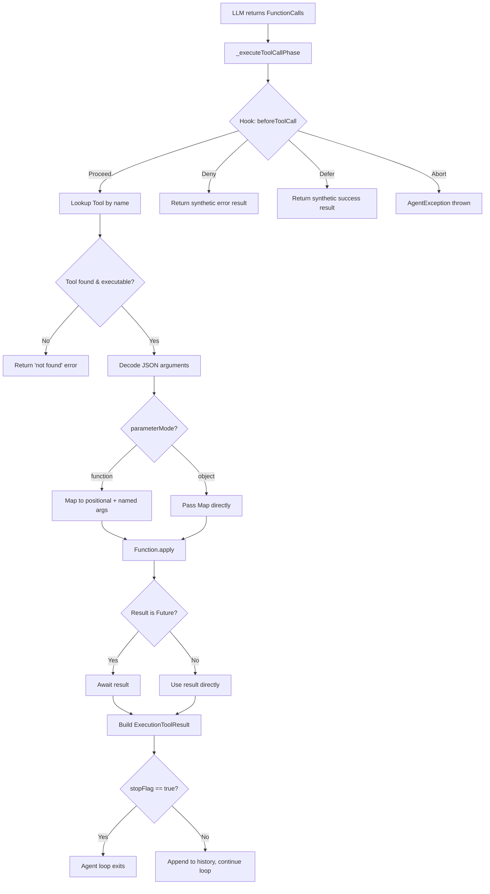

The tool system is the bridge between LLM reasoning and real-world execution in `dart_agent_core`. It allows you to wrap any Dart function as a tool, expose it to the LLM via a JSON Schema definition, and let the agent autonomously invoke it when needed. This page covers tool definition, parameter modes, execution flow, and advanced patterns for building reliable tool-calling agents.

## Tool Definition Anatomy

Every tool is an instance of the `Tool` class, which encapsulates four essential elements: an identifier, a natural-language description, a JSON Schema defining the expected parameters, and the actual Dart function to execute. The LLM uses the name and description to decide when to call the tool, and the schema to generate the correct arguments.

```dart
final weatherTool = Tool(
  name: 'get_weather',
  description: 'Get the current weather for a location.',
  executable: getWeather,
  parameters: {
    'type': 'object',
    'properties': {
      'location': {
        'type': 'string',
        'description': 'The city and state, e.g. Seattle, WA',
      },
    },
    'required': ['location'],
  },
);
```

The `parameters` field must follow the JSON Schema standard, with a top-level `type: 'object'` and a `properties` map describing each argument. The LLM provider's API consumes this schema directly — OpenAI wraps it in a `function` object, Claude maps it to `input_schema`, and the framework handles the translation transparently.

Sources: [lib/src/core/tool.dart#L10-L43](lib/src/core/tool.dart#L10-L43) · [example/simple_agent_example.dart#L18-L39](example/simple_agent_example.dart#L18-L39)

## Parameter Modes

The `ToolParameterMode` enum controls how decoded JSON arguments are dispatched to your Dart function. This is one of the most consequential design decisions when building tools, because it determines whether you work with individual typed parameters or a single untyped map.

| Mode | Enum Value | Dispatch Mechanism | Function Signature Pattern |
|------|------------|-------------------|---------------------------|
| **Function** (default) | `ToolParameterMode.function` | `Function.apply()` with positional and named args | `String doWork(String a, {int b})` |
| **Object** | `ToolParameterMode.object` | Direct map passthrough | `dynamic doWork(Map<String, dynamic> args)` |

### Function Mode (Default)

In function mode, the framework inspects the JSON Schema `properties` map, iterates over its keys **in definition order**, and maps each value to the corresponding Dart function parameter. By default, all parameters are treated as **positional**. To declare specific parameters as Dart named parameters, list their keys in the `namedParameters` field.

```dart
// 1 positional, 1 named parameter
String submitOrder(String itemId, {required int quantity}) {
  return 'Order placed: $itemId x$quantity';
}

final tool = Tool(
  name: 'submit_order',
  description: 'Submit an order.',
  executable: submitOrder,
  namedParameters: ['quantity'],
  parameters: {
    'type': 'object',
    'properties': {
      'itemId': {'type': 'string'},
      'quantity': {'type': 'integer'},
    },
    'required': ['itemId', 'quantity'],
  },
);
```

The dispatch logic in `_executeTools` processes arguments as follows:

1. Decode the JSON arguments string into a `Map<String, dynamic>`.
2. Iterate over the schema `properties` keys **in their definition order**.
3. For each key, check if it exists in `tool.namedParameters`:
   - If **yes**: add to `namedArgs` as a `Symbol(key)` → `value` pair.
   - If **no**: append to `positionalArgs` list.
4. For missing positional arguments, pad with `null` to preserve alignment.
5. Call `Function.apply(tool.executable!, positionalArgs, namedArgs)`.

**Critical implication**: Because positional arguments rely on definition order, the order of keys in your schema `properties` map directly determines which value maps to which function parameter. Reordering schema properties silently breaks tool execution.

Sources: [lib/src/core/tool.dart#L2-L9](lib/src/core/tool.dart#L2-L9) · [lib/src/agent/stateful_agent.dart#L1729-L1778](lib/src/agent/stateful_agent.dart#L1729-L1778)

### Object Mode

Set `parameterMode: ToolParameterMode.object` to bypass `Function.apply()` entirely. The decoded arguments `Map<String, dynamic>` is passed directly to your executable as its single argument. This gives you full control over argument parsing and eliminates positional-ordering fragility.

```dart
final tool = Tool(
  name: 'search_products',
  description: 'Search the product catalog.',
  parameterMode: ToolParameterMode.object,
  executable: (Map<String, dynamic> args) async {
    final query = args['query'] as String;
    final maxResults = args['maxResults'] as int? ?? 10;
    return await searchProducts(query, maxResults);
  },
  parameters: {
    'type': 'object',
    'properties': {
      'query': {'type': 'string'},
      'maxResults': {'type': 'integer'},
    },
    'required': ['query'],
  },
);
```

**When to prefer object mode**:

- You have many parameters and want to avoid positional-ordering risks.
- You need to handle missing or optional fields with custom default logic.
- You want to deserialize the map into a typed DTO object yourself.
- You're building tools dynamically from external schema definitions.

**When to prefer function mode**:

- You have a small number of well-defined parameters and want Dart's type safety enforced at the function signature level.
- You want the framework to handle type coercion (integer/number casting, array item typing) automatically.

### Type Coercion in Function Mode

When using function mode, the framework automatically casts values based on the JSON Schema `type` field before passing them to your function. This happens in the `addArgument` closure within `_executeTools`:

| Schema Type | Dart Type | Coercion Logic |
|-------------|-----------|----------------|
| `string` | `String` | No coercion (JSON strings map directly) |
| `integer` | `int` | `value.toInt()` if value is `num` |
| `number` | `double` | `value.toDouble()` if value is `num` |
| `boolean` | `bool` | No coercion |
| `array` of `string` | `List<String>` | `.cast<String>()` |
| `array` of `integer` | `List<int>` | `.cast<int>()` |
| `array` of `number` | `List<double>` | `.map((e) => (e as num).toDouble()).toList()` |
| `array` of `boolean` | `List<bool>` | `.cast<bool>()` |

This coercion is especially important when the LLM returns numeric values as `num` (the JSON number type) but your function expects `int` or `double`.

Sources: [lib/src/agent/stateful_agent.dart#L1700-L1747](lib/src/agent/stateful_agent.dart#L1700-L1778)

## The Full Tool Execution Pipeline

When the LLM responds with one or more `FunctionCall` objects, the agent enters `_executeToolCallPhase`, which orchestrates lookup, argument parsing, execution, and result assembly. Understanding this pipeline is essential for debugging tool failures and building effective `AgentHook` strategies.



### Tool Lookup

The framework matches each `FunctionCall.name` against the `tools` list using `firstWhere`. If no tool matches or the matched tool has no `executable`, an error result is returned with `isError: true`. This means misspelled tool names in your schema will silently produce error messages rather than throwing exceptions — useful for resilience, but easy to overlook during development.

Sources: [lib/src/agent/stateful_agent.dart#L1679-L1691](lib/src/agent/stateful_agent.dart#L1679-L1691)

### Argument Decoding

Arguments arrive as a JSON string inside `FunctionCall.arguments`. The framework decodes this string into a `Map<String, dynamic>` and handles three edge cases:

1. **Empty string**: Treated as an empty map `{}`.
2. **Invalid JSON**: Returns an error result with the decode exception message.
3. **Missing required keys**: For function mode, missing positional args are padded with `null`. For named args, they are simply omitted from the `namedArgs` map.

Sources: [lib/src/agent/stateful_agent.dart#L1696-L1725](lib/src/agent/stateful_agent.dart#L1696-L1725)

### Zone Context

Every tool execution runs inside a Dart `Zone` that carries an `AgentCallToolContext`. This allows tools to access agent state without receiving it as an explicit parameter — a critical pattern for tools that need session metadata, the parent agent instance, or cancellation support.

```dart
String checkBalance(String currency) {
  final context = AgentCallToolContext.current;
  final userId = context?.state.metadata['user_id'] as String?;
  return fetchBalance(userId, currency);
}
```

| Field | Type | Purpose |
|-------|------|---------|
| `state` | `AgentState` | Current session state, history, metadata |
| `agent` | `StatefulAgent` | The agent instance that invoked this tool |
| `batchCallId` | `String` | UUID shared by all tools in the same parallel batch |
| `cancelToken` | `CancelToken?` | Cancellation handle from the parent run |

Sources: [lib/src/agent/stateful_agent.dart#L1770-L1783](lib/src/agent/stateful_agent.dart#L1770-L1783)

## Advanced Return Types

### Plain Returns

The simplest pattern: return a `String`, `Map`, or any Dart object. The framework converts it to a `TextPart` for the LLM conversation history.

### `AgentToolResult`

When you need structured output, metadata attachment, or loop control, return an `AgentToolResult`:

```dart
Future<AgentToolResult> processPayment(String orderId) async {
  final result = await paymentService.charge(orderId);
  return AgentToolResult(
    content: TextPart('Payment ${result.success ? "succeeded" : "failed"}: ${result.message}'),
    stopFlag: !result.success, // stop loop on failure
    metadata: {'transaction_id': result.transactionId},
  );
}
```

| Field | Type | Effect |
|-------|------|--------|
| `content` | `UserContentPart?` | Single result part (text, image, etc.) |
| `contents` | `List<UserContentPart>?` | Multiple parts for multimodal results |
| `stopFlag` | `bool` | If `true`, the agent loop exits after this tool |
| `metadata` | `Map<String, dynamic>?` | Attached to the `FunctionExecutionResult` |

Sources: [lib/src/agent/stateful_agent.dart#L348-L360](lib/src/agent/stateful_agent.dart#L348-L360)

## Tool Choice Control

The `ToolChoice` class lets you influence how the LLM selects tools, analogous to OpenAI's `tool_choice` parameter.

| Mode | Enum Value | Behavior |
|------|------------|----------|
| **None** | `ToolChoiceMode.none` | LLM never calls tools (text-only responses) |
| **Auto** | `ToolChoiceMode.auto` | LLM decides whether to use tools (default) |
| **Required** | `ToolChoiceMode.required` | LLM must call a tool every turn |

When using `required` mode, you can optionally specify `allowedFunctionNames` to restrict which tools the LLM can invoke. If the list is non-empty, only the first name is used as the forced tool (matching OpenAI's API constraint). If empty, the LLM must call *some* tool but can choose any.

```dart
final agent = StatefulAgent(
  name: 'forced_tool_agent',
  client: client,
  modelConfig: modelConfig,
  state: AgentState.empty(),
  tools: [weatherTool, calendarTool],
  toolChoice: ToolChoice(
    mode: ToolChoiceMode.required,
    allowedFunctionNames: ['get_weather'],
  ),
);
```

Sources: [lib/src/core/llm_client.dart#L70-L93](lib/src/core/llm_client.dart#L70-L93)

## Built-in Tool Injection

The framework automatically injects several tool categories depending on your agent configuration. Understanding this injection is important because these tools compete for context window space and can affect LLM behavior.

| Source | Condition | Tools Injected |
|--------|-----------|----------------|
| Planner | `planMode` is `auto` or `must` | `write_todos` |
| Skills (in-memory) | `skills` is non-empty, not all force-activated | `activate_skills`, `deactivate_skills` |
| Skills (force-active) | Each skill with `forceActivate: true` | Skill's own tools injected directly |
| Sub-agents | `subAgents` non-empty, `disableSubAgents` is `false`, not in sub-agent mode | `delegate_task` |
| Directory skills + JS | `skillDirectoryPath` set, `javaScriptRuntime` provided | `RunJavaScript` |

The `composeTools()` method assembles the final tool list by starting with user-provided tools and appending built-in tools in a deterministic order. The combined list is serialized into a `toolsHash` for change detection — if the hash is unchanged between turns, the LLM client can skip re-sending tool definitions, saving tokens.

Sources: [lib/src/agent/stateful_agent.dart#L586-L651](lib/src/agent/stateful_agent.dart#L586-L651) · [lib/src/agent/planner.dart#L79-L118](lib/src/agent/planner.dart#L79-L118) · [lib/src/agent/skill.dart#L56-L93](lib/src/agent/skill.dart#L56-L93) · [lib/src/agent/sub_agent.dart#L27-L50](lib/src/agent/sub_agent.dart#L27-L50)

## Provider Tool Format Translation

The framework abstracts provider-specific tool schemas. Each LLM client translates the unified `Tool` object into the format expected by its API:

| Provider | Schema Field | Tool Choice Field |
|----------|-------------|-------------------|
| OpenAI | `tools[].function.parameters` | `tool_choice` (`auto`/`none`/`required`/`{function: {name}}`) |
| Claude | `tools[].input_schema` | `tool_choice` (`{type: auto}`/`{type: any}`/`{type: tool, name}`) |
| Gemini | `tools[].function_declarations[].parameters` | `tool_config` |

The `Tool.toJson()` method serializes the tool definition for persistence and history tracking, including the `parameterMode` and `namedParameters` fields, ensuring round-trip fidelity.

Sources: [lib/src/core/tool.dart#L33-L43](lib/src/core/tool.dart#L33-L43) · [lib/src/llm/openai_client.dart#L387-L416](lib/src/llm/openai_client.dart#L387-L416) · [lib/src/llm/claude_client.dart#L394-L417](lib/src/llm/claude_client.dart#L394-L417)

## Tool Lifecycle Events

The `AgentController` provides visibility into tool execution at two key moments, enabling tracing, logging, and policy enforcement:

```dart
controller.on<BeforeToolCallEvent>((event) {
  print('Tool about to execute: ${event.functionCall.name}');
  print('Arguments: ${event.functionCall.arguments}');
});

controller.on<AfterToolCallEvent>((event) {
  print('Tool completed: ${event.result.name}');
  print('Error: ${event.result.isError}');
});
```

These events fire for every tool call in every turn. Combined with the `AgentHook` pipeline (which can intercept, rewrite, deny, or defer calls), you have fine-grained control over tool execution without modifying the tools themselves.

Sources: [doc/architecture.md#L92-L112](doc/architecture.md#L92-L112)

## Common Patterns and Anti-Patterns

| Pattern | Recommendation |
|---------|---------------|
| Wrapping external APIs | Use async executables; return `AgentToolResult` with error metadata on failure |
| File system operations | Return file content as `TextPart`; include path validation errors in `isError: true` |
| Destructive operations | Guard with `AgentHook` in `beforeToolCall` to require confirmation |
| Many optional parameters | Use object mode to avoid positional fragility |
| Simple 2-3 parameter tools | Use function mode for type safety and cleaner signatures |
| Tools with side effects | Return `AgentToolResult` with `stopFlag: true` when the side effect should end the conversation |
| Dynamic tool generation | Build tool lists programmatically; the framework handles schema serialization |

Sources: [example/simple_agent_with_skills_example.dart#L36-L62](example/simple_agent_with_skills_example.dart#L36-L62) · [example/simple_agent_with_directory_skills_example.dart#L55-L83](example/simple_agent_with_directory_skills_example.dart#L55-L83)

## Next Steps

Now that you understand how tools are defined and executed, explore these related topics:

- **[StatefulAgent and the Agentic Loop](5-statefulagent-and-the-agentic-loop)** — How the think-act-observe loop orchestrates tool calls with LLM reasoning.
- **[Skills: Dynamic Capability System](9-skills-dynamic-capability-system)** — How tools are bundled into modular skill units that the agent can activate and deactivate at runtime.
- **[AgentHook Pipeline](14-agenthook-pipeline)** — How to intercept, rewrite, deny, or defer tool calls using the hook system.
- **[State Management and File Persistence](7-state-management-and-file-persistence)** — How tool results and conversation history are persisted across sessions.