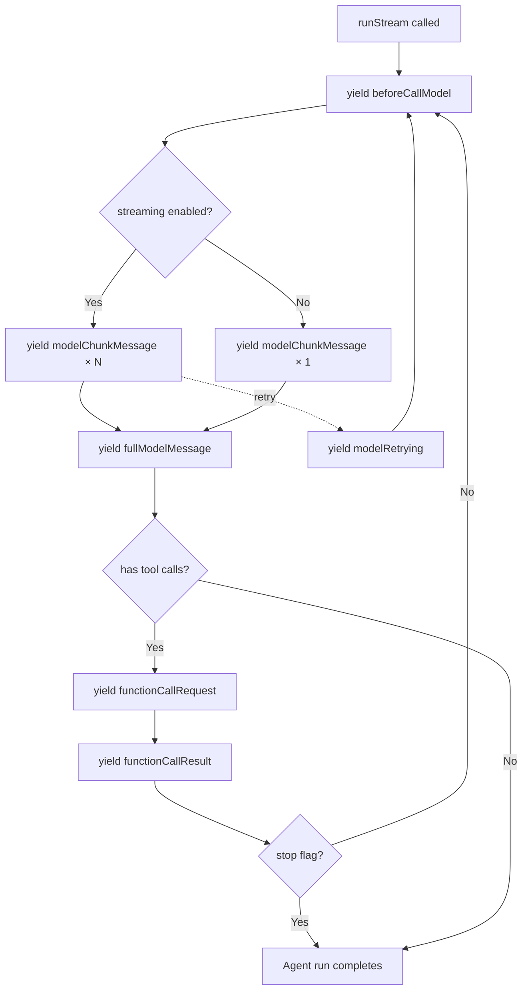
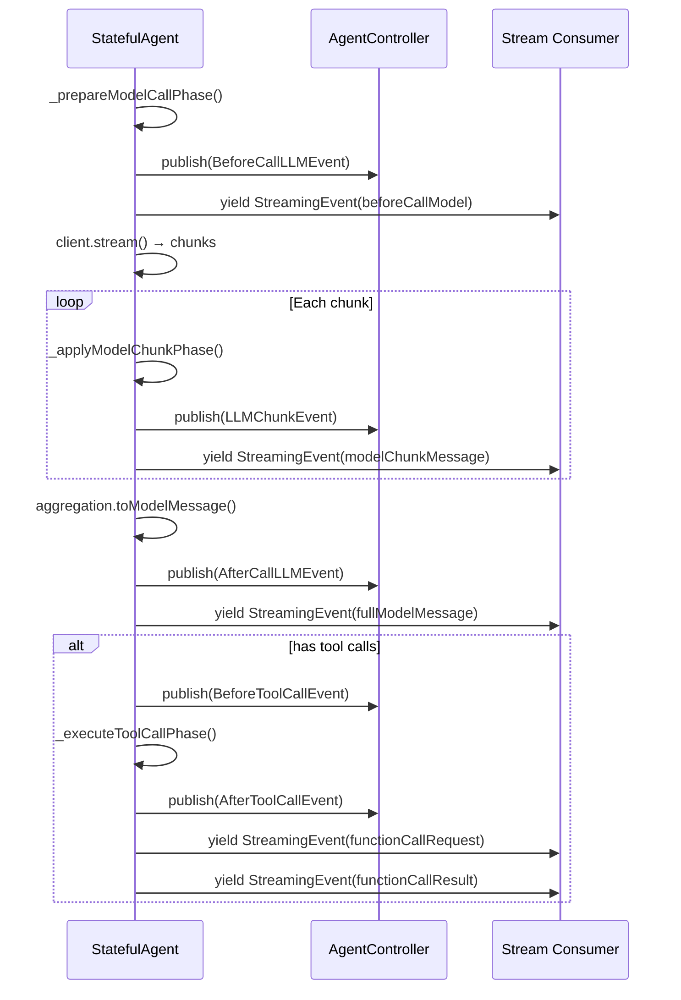

This page explains the two complementary event mechanisms in `dart_agent_core`: the **`Stream<StreamingEvent>` API** returned by `runStream()` for consuming incremental agent output, and the **`AgentController` pub/sub system** for observing and intercepting every phase of an agent run. Understanding both—and how they interact with the hook pipeline—is essential for building responsive, observable agent applications.

## Two Event Systems, One Run

Every call to `StatefulAgent.runStream()` produces a Dart `Stream<StreamingEvent>` that yields lightweight, structured events as the agent executes. In parallel, if the agent was constructed with an `AgentController`, the same lifecycle moments are published as strongly-typed `Event` objects on an internal `EventBus`. These two systems serve different purposes:

| Aspect | `Stream<StreamingEvent>` | `AgentController` |
|---|---|---|
| **Access pattern** | `await for (final event in stream)` — consumer-pull | `controller.on<T>((e) => ...)` — observer-push |
| **Event types** | `StreamingEventType` enum (6 values) | 14 concrete `Event` subclasses |
| **Data payload** | Generic `dynamic data` field | Strongly-typed fields per event class |
| **Request/Response** | Not supported | Supported via `controller.request()` |
| **Typical use** | Real-time UI rendering, SSE proxies | Logging, policy enforcement, metrics |

Both systems fire from within the same `runStream()` generator, ensuring your observer and your stream consumer see the same logical sequence.

Sources: [stateful_agent.dart](lib/src/agent/stateful_agent.dart#L850-L870) · [controller.dart](lib/src/agent/controller.dart#L1-L42) · [message.dart](lib/src/core/message.dart#L363-L380)

## The Streaming Event Lifecycle

When you call `runStream()`, the agent enters an **agentic loop**—it calls the LLM, accumulates the response, executes any requested tools, and repeats until the model signals completion or a stop condition is met. Each phase yields a `StreamingEvent` with a specific `eventType`:



### Event Type Reference

| `StreamingEventType` | When emitted | `data` type | Purpose |
|---|---|---|---|
| `beforeCallModel` | Before every LLM call in the loop | `CallLLMParams` | Signals that a model request is about to be sent |
| `modelChunkMessage` | For each incremental chunk from the LLM (or once for non-streaming) | `ModelMessage` | Carries partial text, function calls, or usage metadata |
| `modelRetrying` | When the agent retries due to empty response, missing stop reason, or hook request | `Map<String, dynamic>` with `retryReason` | Transparent retry observation |
| `fullModelMessage` | After all chunks are accumulated into a complete response | `ModelMessage` | The finalized model output for this turn |
| `functionCallRequest` | When the model's response contains one or more `FunctionCall` entries | `List<FunctionCall>` | Signals tool execution is about to begin |
| `functionCallResult` | After all tools in the batch have been executed | `FunctionExecutionResultMessage` | Contains results (success/error) for each tool call |

Sources: [message.dart](lib/src/core/message.dart#L363-L380) · [stateful_agent.dart](lib/src/agent/stateful_agent.dart#L905-L1130)

## Streaming vs Non-Streaming Mode

The `useStream` parameter on `runStream()` and `run()` controls whether the agent calls `client.stream()` or `client.generate()`. Both paths converge on the same `StreamingEvent` output—the difference is how chunks arrive:

| Mode | LLM client method | Chunk frequency | Latency to first token | Use case |
|---|---|---|---|---|
| `useStream: true` | `client.stream()` | Many incremental chunks | Lowest | Real-time UI, typewriter effects |
| `useStream: false` | `client.generate()` | Single chunk per turn | Highest | Batch processing, simpler error handling |

When streaming is enabled, the agent's internal `_ModelMessageAccumulator` merges each incoming `ModelMessage` chunk—appending text to a `StringBuffer`, collecting function calls, and tracking usage stats—until the LLM signals completion via `stopReason`.

Sources: [stateful_agent.dart](lib/src/agent/stateful_agent.dart#L941-L1025) · [stateful_agent.dart](lib/src/agent/stateful_agent.dart#L100-L200)

## The AgentController Pub/Sub System

`AgentController` wraps an `EventBus` and exposes a typed observer API. You register handlers with `controller.on<EventType>()` and the controller notifies you whenever the agent publishes that event type during its run.

### Supported Controller Events

The controller fires these events at well-defined lifecycle points:

| Event Class | Published when | Key fields |
|---|---|---|
| `AgentStartedEvent` | Agent run begins (after `beforeRun` hooks) | `agent`, `input` |
| `AgentResumedEvent` | `resume()` or `resumeStream()` is called | `agent` |
| `BeforeCallLLMEvent` | Before each LLM call | `agent`, `params` (`CallLLMParams`) |
| `LLMChunkEvent` | For each accumulated chunk | `agent`, `params`, `response` (`ModelMessage`) |
| `AfterCallLLMEvent` | After the full model response is assembled | `agent`, `params`, `response`, `stopReason` |
| `LLMRetryingEvent` | When a retry occurs | `agent`, `reason` |
| `BeforeToolCallEvent` | Before each tool is executed | `agent`, `functionCall` |
| `AfterToolCallEvent` | After each tool completes | `agent`, `result` (`FunctionExecutionResult`) |
| `PlanChangedEvent` | When the planner updates the todo list | `agent`, `plan` (`PlanState`) |
| `AgentRunSuccessedEvent` | Agent run completes without error | `agent`, `input`, `modelMessages`, `stopReason` |
| `AgentStoppedEvent` | Agent run ends (success or error, in `finally`) | `agent`, `input`, `modelMessages`, `error` |
| `OnAgentExceptionEvent` | An exception is caught | `agent`, `error` |
| `OnAgentErrorEvent` | A string error is reported | `agent`, `error` |
| `OnAgentCancelEvent` | The run is cancelled via `CancelToken` | `agent`, `exception`, `reason` |

Sources: [events.dart](lib/src/agent/events.dart#L1-L100) · [planner.dart](lib/src/agent/planner.dart#L135-L140)

### Setting Up a Controller

Creating and attaching an `AgentController` is straightforward. The controller is passed to the `StatefulAgent` constructor and receives events automatically:

```dart
final controller = AgentController();

// Subscribe to specific event types
controller.on<AgentStartedEvent>((event) {
  print('Agent "${event.agent.name}" started');
});

controller.on<BeforeToolCallEvent>((event) {
  print('Tool call: ${event.functionCall.name}(${event.functionCall.arguments})');
});

controller.on<AfterToolCallEvent>((event) {
  final status = event.result.isError ? 'FAILED' : 'OK';
  print('Tool result: ${event.result.name} -> $status');
});

controller.on<AgentRunSuccessedEvent>((event) {
  print('Agent completed. Stop reason: ${event.stopReason}');
});

// Attach to agent
final agent = StatefulAgent(
  name: 'my_agent',
  client: client,
  modelConfig: modelConfig,
  state: AgentState.empty(),
  controller: controller,
);
```

Sources: [simple_agent_with_controller_example.dart](example/simple_agent_with_controller_example.dart#L47-L75)

### The EventBus: Pub/Sub and Request/Response

Under the hood, `AgentController` delegates to an `EventBus` that supports two communication patterns:

**Publish/Subscribe** — the observer pattern. `publish()` sends an event to all registered listeners. By default, notifications are scheduled as microtasks (async), but `sync: true` fires them immediately:

```dart
// Pub/Sub: observe all events of a type
controller.on<LLMChunkEvent>((event) {
  // event is typed as LLMChunkEvent
  print(event.response.textOutput);
});
```

**Request/Response** — a synchronous query pattern. A handler is registered for a specific event type, and any code can send that event to receive a result. If no handler is registered, the `orElse` fallback is called (non-blocking) or an exception is thrown:

```dart
// Register a handler (only one per event type allowed)
controller.registerHandler<BeforeToolCallEvent, bool>((event) async {
  // Return true to allow, false to deny
  return event.functionCall.name != 'dangerous_tool';
});

// Send a request
final allowed = await controller.request<BeforeToolCallEvent, bool>(
  BeforeToolCallEvent(agent, functionCall),
  defaultValue: true, // fallback if no handler
);
```

The `EventBus` closes cleanly: after `close()`, all pending async notifications are dropped, subsequent `publish()` calls are no-ops, and `request()` throws `StateError` unless an `orElse` fallback is provided.

Sources: [event_bus.dart](lib/src/core/event_bus.dart#L1-L90) · [event_bus_test.dart](test/core/event_bus_test.dart#L1-L33)

## Dual-Event Synchronization

A critical architectural detail: for most lifecycle phases, the agent emits **both** a controller event and a streaming event in sequence. This means you can use either system—or both—without missing information:



**Key difference**: controller events fire **before** streaming events for the same phase. This means a controller handler can inspect (or even modify via hooks) data before it reaches your stream consumer. For example, a `BeforeCallLLMEvent` fires before `beforeCallModel` is yielded, giving your controller first-look at the `CallLLMParams`.

Sources: [stateful_agent.dart](lib/src/agent/stateful_agent.dart#L905-L915) · [stateful_agent.dart](lib/src/agent/stateful_agent.dart#L1080-L1130)

## Consuming the Streaming API

The simplest pattern iterates over the stream and filters by event type:

```dart
final stream = agent.runStream([
  UserMessage.text('Tell me about Dart.'),
]);

await for (final event in stream) {
  switch (event.eventType) {
    case StreamingEventType.modelChunkMessage:
      final chunk = event.data as ModelMessage;
      if (chunk.textOutput != null) {
        stdout.write(chunk.textOutput);  // typewriter effect
      }
    case StreamingEventType.functionCallRequest:
      print('\n[Agent is calling a tool...]');
    case StreamingEventType.fullModelMessage:
      print('\n[Turn complete. Stop reason: ${event.data.stopReason}]');
    case StreamingEventType.modelRetrying:
      final reason = (event.data as Map)['retryReason'];
      print('\n[Retrying: $reason]');
    default:
      break;
  }
}
```

For cases where you only need final results, the synchronous `run()` method consumes the stream internally and returns only `fullModelMessage` and `functionCallResult` events as a `List<LLMMessage>`:

```dart
final responses = await agent.run([
  UserMessage.text('Calculate 2 + 2.'),
]);
// responses contains ModelMessage and FunctionExecutionResultMessage entries
```

Sources: [simple_agent_stream_example.dart](example/simple_agent_stream_example.dart#L44-L58) · [stateful_agent.dart](lib/src/agent/stateful_agent.dart#L830-L849)

## Interaction with the Hook Pipeline

The hook pipeline (`AgentHook` / `AgentHookPipeline`) and the event systems are complementary layers. Hooks run **first** and can modify, deny, or abort data before controller events are published and streaming events are yielded:

| Hook phase | What it can do | Events that follow |
|---|---|---|
| `beforeRun` | Modify input messages, abort run | `AgentStartedEvent` → `beforeCallModel` |
| `beforeModelCall` | Modify request, inject synthetic response, abort | `BeforeCallLLMEvent` → `beforeCallModel` |
| `onModelChunk` | Modify or drop individual chunks, abort | `LLMChunkEvent` → `modelChunkMessage` |
| `afterModelCall` | Modify response, request retry, abort | `AfterCallLLMEvent` → `fullModelMessage` |
| `beforeToolCall` | Deny/defer tool call, provide synthetic result, abort | `BeforeToolCallEvent` → `functionCallRequest` |
| `afterToolCall` | Modify result, inject messages, stop loop, abort | `AfterToolCallEvent` → `functionCallResult` |
| `onTurnCompletion` | Force continuation with extra messages | Loop restarts or completes |
| `beforePersistState` | Skip or abort state persistence | — |

If a hook returns `abort`, an `AgentException` with code `stopByController` is thrown and no further streaming or controller events are published for that phase.

Sources: [agent_hook.dart](lib/src/agent/agent_hook.dart#L460-L540) · [agent_hook.dart](lib/src/agent/agent_hook.dart#L1-L50)

## Retry and Error Recovery Events

The agent has built-in retry logic that surfaces through both event systems. Retries occur when:

1. **The LLM signals a retry** via a `StreamingControlMessage` with `StreamingControlFlag.retry`
2. **The model returns an empty `stopReason`** — up to 3 consecutive retries
3. **The model returns an empty response** (no text, no function calls, no response ID) — up to 3 consecutive retries
4. **A hook requests a retry** via `ModelResponseHookResult.retry()`

Each retry yields a `StreamingEvent` with `eventType: modelRetrying` and publishes an `LLMRetryingEvent` on the controller. The accumulator resets and the loop continues. If the retry budget is exhausted, an `AgentException` with code `loopDetection` is thrown.

On cancellation (via Dio's `CancelToken`), an `OnAgentCancelEvent` is published and `AgentExceptionCode.cancelled` is thrown. The `AgentStoppedEvent` is always published in the `finally` block, regardless of success or failure.

Sources: [stateful_agent.dart](lib/src/agent/stateful_agent.dart#L970-L1075) · [stateful_agent.dart](lib/src/agent/stateful_agent.dart#L1145-L1160) · [exception.dart](lib/src/agent/exception.dart#L1-L20)

## Next Steps

- For understanding how hooks intercept and modify the stream, see [AgentHook Pipeline](14-agenthook-pipeline)
- For the agentic loop mechanics (turns, max limits, state persistence), see [StatefulAgent and the Agentic Loop](5-statefulagent-and-the-agentic-loop)
- For tool execution details, see [Tool System and Parameter Modes](6-tool-system-and-parameter-modes)
- For the planner events (`PlanChangedEvent`), see [Planning with PlanMode](11-planning-with-planmode)