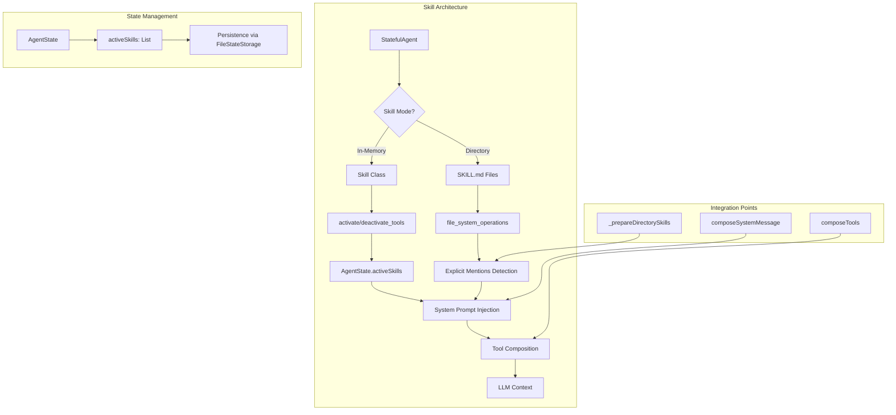
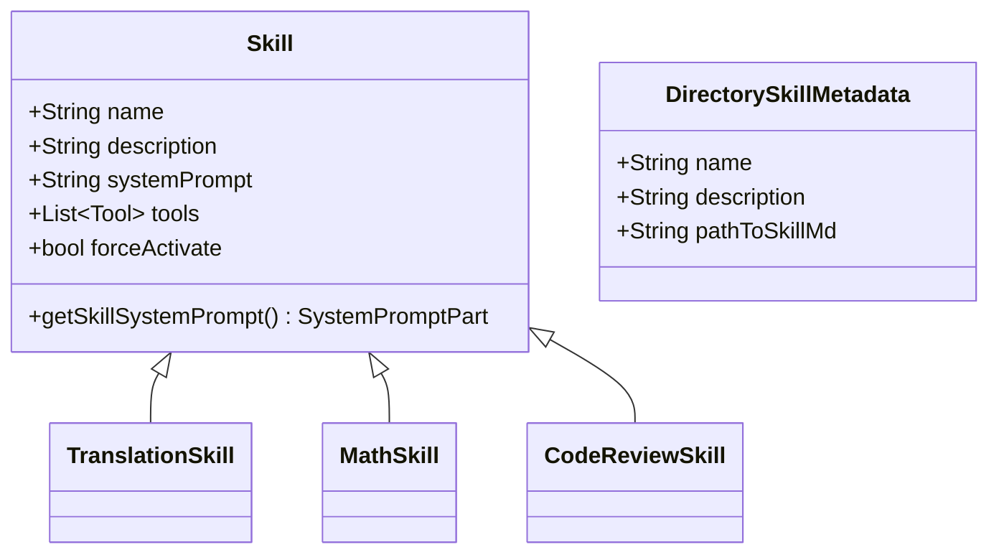
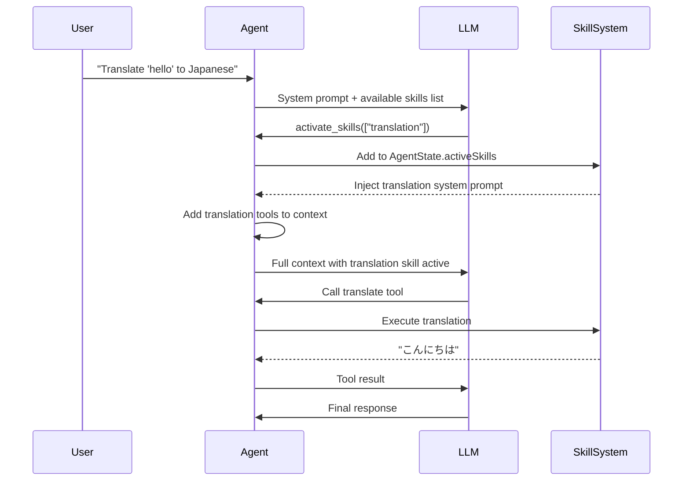
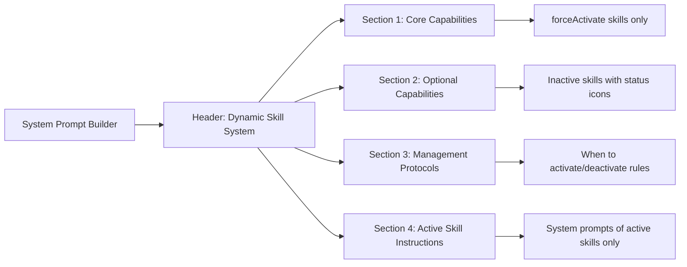
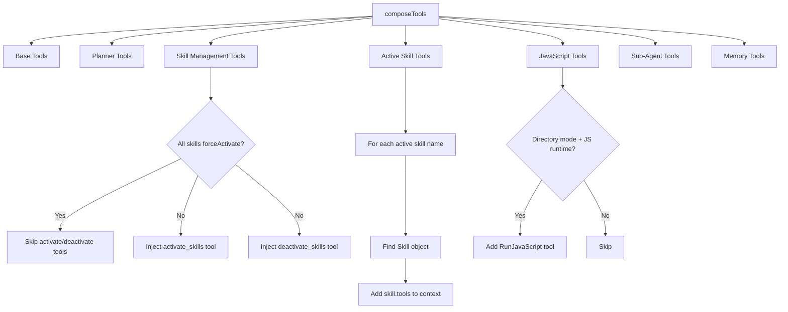
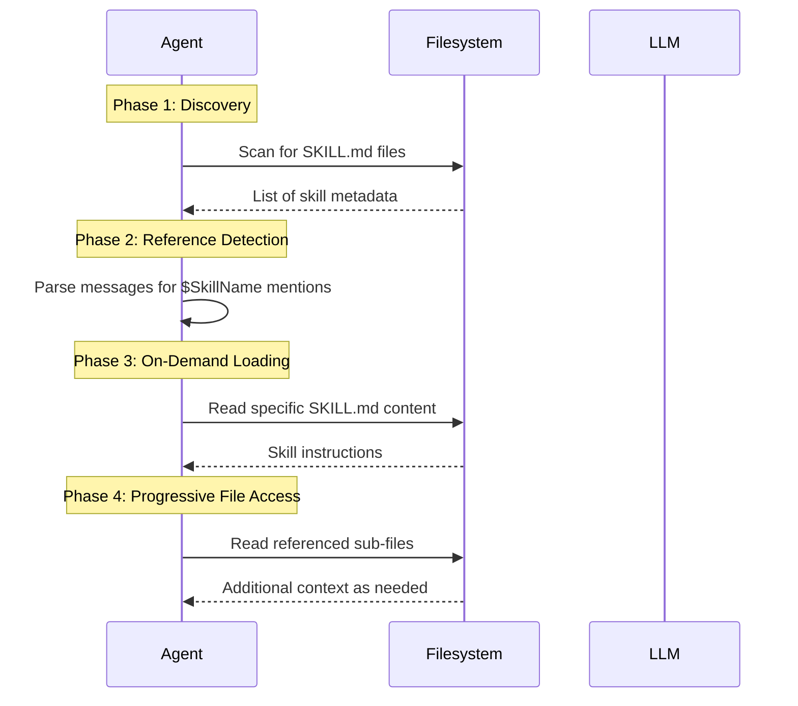

The Skills system provides a modular, context-efficient mechanism for extending agent capabilities at runtime. Rather than loading all specialized behaviors upfront, Skills enable dynamic activation and deactivation of capability bundles—each consisting of a system prompt and optional tools—based on the current conversation's requirements. This architecture optimizes context window usage while maintaining semantic clarity for the LLM.

## Architecture Overview

The Skills system operates through two mutually exclusive modes, each designed for different use cases and deployment patterns.



The system enforces a strict mutual exclusion between in-memory and directory skills to prevent architectural conflicts. This constraint is validated at agent construction time, ensuring predictable behavior across both modes.

Sources: [skill.dart](lib/src/agent/skill.dart#L10-L30), [stateful_agent.dart](lib/src/agent/stateful_agent.dart#L486-L505)

## Core Abstractions

### Skill Base Class

The `Skill` abstract class defines the contract for all capability bundles. Each skill encapsulates a self-contained behavioral unit with its own system prompt and toolset.



**Key Design Decisions:**
- **`forceActivate: true`** marks skills as permanent capabilities that cannot be deactivated by the agent. These represent core behavioral rules or identity constraints.
- **`tools` list** allows skills to bundle specialized tools that are only available when the skill is active, preventing tool pollution in unrelated contexts.
- **`systemPrompt`** contains the behavioral instructions injected into the LLM's system message when the skill is active.

Sources: [skill.dart](lib/src/agent/skill.dart#L10-L30)

### Two Operational Modes

| Mode | Configuration | Discovery | Activation | Best For |
|------|--------------|-----------|------------|----------|
| **In-Memory** | `skills: [TranslationSkill(), MathSkill()]` | Static registration | Agent calls `activate_skills` tool | Predefined, compile-time known capabilities |
| **Directory** | `skillDirectoryPath: './skills'` | Filesystem scanning for `SKILL.md` | Explicit user mentions (`$SkillName`) or task matching | Dynamic, runtime-discoverable capabilities |

**In-Memory Skills** are defined as Dart classes that extend `Skill`. The agent can dynamically toggle them using built-in `activate_skills` and `deactivate_skills` tools.

**Directory Skills** are discovered by scanning the filesystem for `SKILL.md` files with YAML frontmatter. They support progressive disclosure—the agent reads skill files on-demand rather than loading all instructions upfront.

Sources: [skill.dart](lib/src/agent/skill.dart#L220-L250), [stateful_agent.dart](lib/src/agent/stateful_agent.dart#L545-L556)

## Dynamic Activation Mechanism

### In-Memory Skills Activation

The activation flow for in-memory skills follows a tool-based protocol where the LLM decides when to activate capabilities based on task requirements.



**Activation Protocol:**
1. Agent injects skill registry into system prompt with activation status indicators
2. LLM analyzes task requirements and calls `activate_skills` tool
3. Tool updates `AgentState.activeSkills` list and returns confirmation
4. Subsequent `composeSystemMessage()` and `composeTools()` calls include activated skill content
5. LLM can later call `deactivate_skills` to release unused capabilities

Sources: [skill.dart](lib/src/agent/skill.dart#L50-L120)

### Directory Skills Detection

Directory skills use explicit mention detection rather than LLM-driven activation. The system scans incoming messages for skill references using pattern matching.

```mermaid
flowchart TD
    A[Incoming Messages] --> B{Parse for Skill Mentions}
    B --> C[Pattern 1: $SkillName]
    B --> D[Pattern 2: [$SkillName](path)]
    B --> E[Pattern 3: Plain text match]
    
    C --> F[Collect Mentioned Names]
    D --> G[Collect Mentioned Paths]
    E --> H[Fuzzy Name Matching]
    
    F --> I[Deduplicate & Validate]
    G --> I
    H --> I
    
    I --> J[Load SKILL.md Content]
    J --> K[Inject as UserMessage]
    K --> L[Agent Processes Skill Instructions]
```

**Detection Patterns:**
- **`$SkillName`**: Explicit skill name reference (case-sensitive)
- **`[$SkillName](path)`**: Markdown-style link with optional path
- **Plain text**: Unambiguous skill name mentions (when names are unique)

This approach respects progressive disclosure principles—skill bodies are only loaded when explicitly referenced, preventing context window bloat.

Sources: [skill.dart](lib/src/agent/skill.dart#L400-L450)

## System Prompt Construction

The `buildSkillSystemPrompt` function generates a structured system prompt section that teaches the LLM how to manage its own capabilities.

### Prompt Structure



**Key Optimization:** The builder only injects system prompts for currently active skills, saving context window space. Inactive skills are listed with descriptions but without their full behavioral instructions.

**Status Indicators:**
- `[🔒 ACTIVE]`: Force-activated skills (immutable)
- `[🟢 ACTIVE]`: Dynamically activated skills
- `[⚪ INACTIVE]`: Available but currently inactive skills

Sources: [skill.dart](lib/src/agent/skill.dart#L130-L200)

## Tool Composition and State Management

### Tool Injection Logic

The `composeTools` method dynamically assembles the available toolset based on active skills and configuration.



**State Persistence:** Active skill names are stored in `AgentState.activeSkills`, which persists across agent runs via `FileStateStorage`. This ensures skill activation state survives session interruptions.

Sources: [stateful_agent.dart](lib/src/agent/stateful_agent.dart#L595-L615)

## Directory Skills Implementation

### SKILL.md File Format

Directory skills use a standardized file format with YAML frontmatter for metadata extraction.

```yaml
---
name: code_review
description: Review code for bugs, style issues, and security vulnerabilities.
---

# Code Review Skill

When reviewing code:
1. Check for security vulnerabilities
2. Identify logic errors
3. Suggest idiomatic improvements
```

**Frontmatter Fields:**
- `name`: Unique skill identifier (required)
- `description`: Brief capability description (required)

The parser extracts these fields to create `DirectorySkillMetadata` objects without loading the full skill content.

Sources: [skill.dart](lib/src/agent/skill.dart#L520-L560)

### Progressive Disclosure Protocol

Directory skills implement a multi-stage loading pattern to minimize context usage.



**Context Hygiene Rules:**
- Only load skill bodies when explicitly referenced
- Resolve relative paths from skill directory first
- Load only specific referenced files, not entire directories
- Summarize long sections rather than pasting verbatim

Sources: [skill.dart](lib/src/agent/skill.dart#L300-L350)

## Error Handling and Edge Cases

### Mutual Exclusion Enforcement

The system enforces strict separation between skill modes to prevent architectural conflicts.

```dart
assert(
  skills == null ||
      skills.isEmpty ||
      skillDirectoryPath == null ||
      skillDirectoryPath == '',
  'skills and skillDirectoryPath cannot be enabled at the same time',
);
```

**Runtime Validation:** Attempting to enable both modes throws an `AssertionError` at construction time, preventing invalid configurations from reaching execution.

### Skill Not Found Handling

Both activation tools return detailed status messages for debugging:

```dart
// Activation response
"Skills have been activated: translation"
"Skills already active: math"  
"Skills not found: nonexistent_skill"
"Do not try to deactivate force-activated skills: core_personality"
```

This feedback helps the LLM self-correct when attempting invalid operations.

Sources: [skill.dart](lib/src/agent/skill.dart#L50-L120), [stateful_agent.dart](lib/src/agent/stateful_agent.dart#L500-L505)

## Integration with Agent Lifecycle

Skills participate in the standard agent loop without special handling:

1. **System Prompt Phase:** Active skill instructions are included in `composeSystemMessage()`
2. **Tool Phase:** Active skill tools are available in `composeTools()`
3. **Execution Phase:** Skill tools execute within the standard `AgentCallToolContext` zone
4. **Persistence Phase:** `AgentState.activeSkills` is serialized via `toJson()`

This integration ensures skills compose cleanly with other extension points like hooks, planners, and sub-agents.

Sources: [stateful_agent.dart](lib/src/agent/stateful_agent.dart#L540-L560)

## Next Steps

After understanding the Skills system, explore these related topics:

- **[File-System Skills with SKILL.md](10-file-system-skills-with-skill-md)** - Deep dive into directory skill configuration and progressive disclosure patterns
- **[Tool System and Parameter Modes](6-tool-system-and-parameter-modes)** - Understand how skill tools integrate with the broader tool architecture
- **[State Management and File Persistence](7-state-management-and-file-persistence)** - Learn how skill activation state persists across sessions
- **[AgentHook Pipeline](14-agenthook-pipeline)** - See how hooks can intercept or modify skill-related behavior